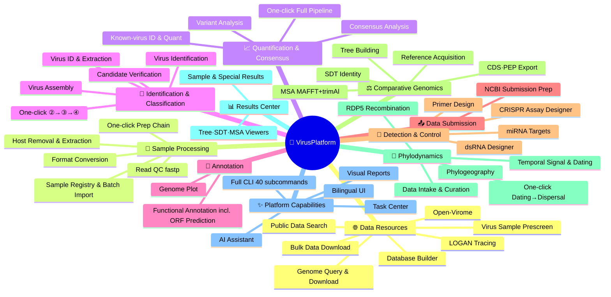

<div align="center">

[English](README_EN.md) · [简体中文](README.md)

# 🌿 VirusPlatform — Plant Virus Analysis Platform

**A local, high-performance platform for plant virus diagnostics and in-depth analysis**

From raw FASTQ to NCBI submission files, **entirely point-and-click**:
Host removal → known-virus identification & quantification → assembly → ORF prediction → functional annotation → phylogeny / SDT / molecular clock / phylogeography → primer design → genome plots → interactive reports → public-data tracing → NCBI submission prep


</div>

---

## ✨ At a Glance

- **One pipeline, end to end** — a 15-stage cascade (⓪–⑩; 13 stages in the default analysis order, with QC and subsampling optional) where each step's output feeds the next, with resume-from-checkpoint, forced reruns, and automatic graceful degradation of optional steps.
- **Local-first, offline-friendly** — all external tools (kunpeng / SPAdes / MAFFT / RAxML-NG / DIAMOND / salmon / primer3 …) ship with the platform or are auto-detected; databases are built and searched locally; downloads hit only an NCBI/ENA/NGDC official-domain whitelist.
- **Dual entry: GUI + CLI** — a pywebview desktop window or browser UI (bilingual CN/EN one-click switch), backed by the same engine that powers the full `main.py` CLI for scripted batch runs.
- **Phylogenetics beyond tree building** — built-in TreeTime ML molecular clock, discrete-trait geographic reconstruction (mugration), skyline plots, RTT/DRT regression, BSP, BEAST hand-off with Markov-jump parsing, and phylogeographic migration animations (GIF) — plant-virus epidemiology in one place.
- **It gets smarter with use** — per-stage runtimes feed a self-learning model that drives real-time progress and ETA on every task card; plus concurrency gates for heavy jobs, a disk-watermark banner, and resource-estimate logging.
- **AI assistant (chat-driven agent)** — an always-available chat dock on the home page interprets results, answers task-status questions and suggests next steps. The assistant only reads on-disk products (advisory layer, read-only); key numbers are computed from result files in code and injected as context, never invented by the model. One OpenAI-compatible client covers DeepSeek / GLM / Qwen / Kimi / OpenAI, with local Ollama for fully offline use; only statistical digests and table rows are sent — never raw sequences. It also ships a three-layer proactive driver: **stage explanations** (static knowledge base, zero cost) → **result broadcasts** (auto interpretation at key milestones) → **decision gates** (AI assessment with your confirm/stop at key stages, off by default). The AI can also **drive data discovery**: say "find transcriptome data for species X" and it searches SRA+GSA via the built-in public-data search engine (auto-broadcast when done), then drafts an action order to download selected runs into the platform — capability awareness comes from the platform's own module map, so it never deflects you to external databases. Execution power is graded: **action orders** (AI drafts, you approve, parameter diffs visible) → **auto-retry** (one same-parameter rerun on failure, off by default) → **auto-tuning loop** (bounded-key parameter proposals with auto re-run, manual opt-in); destructive/global-reset actions are never in the whitelist.
- **A closed research loop** — public-data search (NCBI SRA + NGDC GSA) → bulk download → analysis → LOGAN tracing across all of SRA → NCBI GenBank/BioSample submission prep, without ever leaving the platform.

## 🧭 Analysis Workflow

```mermaid
flowchart LR
    A["⓪ QC<br/>fastp · fq2fa"] --> B["① Host removal<br/>kunpeng host DB"]
    B --> C["②b ID & quant<br/>kvsuite · salmon"]
    C --> D["③ Assembly<br/>SPAdes rnaviral"]
    D --> D2["③b/③c Verify<br/>consensus & variants"]
    D2 --> E["④ Host prediction<br/>ICTV cascade"]
    E --> F["⑥ ORF calls<br/>pyrodigal"]
    F --> G["⑥b Annotation<br/>DIAMOND · Pfam HMM · BFVD"]
    G --> H["⑦ Tree/SDT<br/>MAFFT · FastTree/RAxML"]
    H --> I["⑧ Primers<br/>primer3"]
    I --> J["⑨ Genome plots<br/>gbdraw / DFV"]
    J --> K["⑩ Report<br/>plotly · pycirclize"]
    K --> L["Tracing / clock /<br/>phylogeo / submission"]
```



## 🗺️ Feature Map

> The in-app manual hosts an **interactive feature tree** (click to expand, jump straight to each tool card); `docs/功能全景图.html` is a standalone panorama page.



## 📦 Module Overview

> Each module's **detailed documentation (inputs/outputs · parameters · CLI · product folders · caveats) lives in the [Wiki](https://github.com/zhangwenda0518/PlantVirusAnalysisPlatform/tree/main/wiki)** (pages in Chinese).

### Main analysis pipeline (per-sample, ⓪ → ⑩)

| Step | Wiki | Engine | Output |
|---|---|---|---|
| ⓪ fastp QC (optional) | [Preprocess](https://github.com/zhangwenda0518/PlantVirusAnalysisPlatform/blob/main/wiki/Preprocess.md) | fastp | clean reads, QC report |
| ⓪b FASTQ→FASTA (optional) | same page | seqkit fq2fa | conv_R1/R2.fa.gz (speeds up classification) |
| ① Host removal | same page | kunpeng (host DB) | kept_R1/R2, host fraction |
| ②b Known-virus ID & quant | [Kvsuite](https://github.com/zhangwenda0518/PlantVirusAnalysisPlatform/blob/main/wiki/Kvsuite.md) | salmon (EM quant) / minibwa | ID table, filtered quant table, BAM+depth, viral reads |
| ③ Assembly & classification | [Assembly](https://github.com/zhangwenda0518/PlantVirusAnalysisPlatform/blob/main/wiki/Assembly.md) | SPAdes metaviral/rna + BLAST | contigs, viral-contig annotation table |
| ③b Candidate verification | same page | host filter → length split → blastx/BFVD/CDD/viroid | verified candidate set |
| ③c Consensus & variants | same page | reads re-mapped to reference → per-position counts | consensus sequences, variant table |
| ④ Host prediction | [Host-Prediction](https://github.com/zhangwenda0518/PlantVirusAnalysisPlatform/blob/main/wiki/Host-Prediction.md) | kunpeng + ICTV host-probability cascade | host_prediction.tsv, sankey/sunburst |
| ⑥ ORF calling | [ORF](https://github.com/zhangwenda0518/PlantVirusAnalysisPlatform/blob/main/wiki/ORF.md) | pyrodigal + pyrodigal-rv | faa/ffn/gff |
| ⑥b ORF annotation | same page | DIAMOND/MMseqs2/blastp × RefSeq viral proteins + Pfam HMM + BFVD domains | orf_annotation.tsv, GFF3, feature diagrams |
| ⑦ Phylogeny & SDT | [Phylo](https://github.com/zhangwenda0518/PlantVirusAnalysisPlatform/blob/main/wiki/Phylo.md) | MAFFT + trimAl + FastTree/RAxML-NG/NJ; exact SDT engine | tree.nwk, identity matrix + heatmap |
| ⑧ Primer design | [Primer](https://github.com/zhangwenda0518/PlantVirusAnalysisPlatform/blob/main/wiki/Primer.md) | primer3 (conserved/full-length) + thermodynamic scoring | primers.tsv |
| ⑨ Genome plots | [Genome-Plots](https://github.com/zhangwenda0518/PlantVirusAnalysisPlatform/blob/main/wiki/Genome-Plots.md) | gbdraw / dna_features_viewer | circular + linear SVG |
| ⑩ Visual report | [Report](https://github.com/zhangwenda0518/PlantVirusAnalysisPlatform/blob/main/wiki/Report.md) | plotly + pycirclize + matplotlib | report.html |

### Extended analyses

| Module | Wiki | Description |
|---|---|---|
| Phylodynamics toolkit | [Phylodynamics](https://github.com/zhangwenda0518/PlantVirusAnalysisPlatform/blob/main/wiki/Phylodynamics.md) | TreeTime ML clock / mugration / skyline / ancestral sequences, RTT·DRT regression, BSP, MCC-tree parsing, spatiotemporal downsampling, metadata governance, alignment QC |
| BEAST interface | [BEAST](https://github.com/zhangwenda0518/PlantVirusAnalysisPlatform/blob/main/wiki/BEAST.md) | server job package generation/read-back verification, Markov-jump (MJRM) XML injection & log parsing, MCC state parsing |
| Phylogeography | [Phylogeography](https://github.com/zhangwenda0518/PlantVirusAnalysisPlatform/blob/main/wiki/Phylogeography.md) | metadata-driven migration reconstruction + migration-arc GIF animation; RDP5 recombination; pre-recombination sequence pre-filtering |
| Public data search & download | [Public-Data](https://github.com/zhangwenda0518/PlantVirusAnalysisPlatform/blob/main/wiki/Public-Data.md) | SRA+GSA dual-engine search, unified metadata (Core14/Full), publication-grade metadata figures, aria2c bulk download + built-in sracha for GSA .sra, host-genome download via NCBI taxon / accession (chromosome filter) / gget (Ensembl Plants), full NCBI datasets CLI wrapper (genome/gene/taxonomy/virus with host filter, virus feeds DB building directly) |
| Toolbox | [Toolbox](https://github.com/zhangwenda0518/PlantVirusAnalysisPlatform/blob/main/wiki/Toolbox.md) | end-to-end dsRNA design (windowing → efficacy → off-target → primers), miRNA target prediction (5 engines), NCBI reference download, GenBank collections & CDS/PEP export, MSA viewer, contig depth annotation, LOGAN data download (pull public pre-assembled contigs by accession and feed host removal / viral extraction / ORF / tracing directly), one-step tools |
| NCBI submission prep | [Submission](https://github.com/zhangwenda0518/PlantVirusAnalysisPlatform/blob/main/wiki/NCBI-Submission.md) | one unified_metadata.csv table drives it all: online editing → validation → source.src / miuvig / assembly / BioSample / template.sbt |
| LOGAN tracing | [Logan](https://github.com/zhangwenda0518/PlantVirusAnalysisPlatform/blob/main/wiki/Logan.md) | paste a sequence or pick sample contigs → auto-split into ≤2500 bp fragments (configurable adjacent overlap) → copy per fragment / export FASTA / package all → submit through the embedded Logan-Search dashboard on the same page; the task-based batch API remains available in CLI/MCP |

### Platform infrastructure

| Module | Wiki | Description |
|---|---|---|
| Databases & references | [Databases](https://github.com/zhangwenda0518/PlantVirusAnalysisPlatform/blob/main/wiki/Databases.md) | Taxonomy, kunpeng DBs, virus reference/ID DB, annotation DBs (RefSeq proteins / Pfam), tree DBs (plant_tree.db / ICTV VMR), host-probability tables, host-DB building |
| Pipeline orchestration | [Pipeline-Overview](https://github.com/zhangwenda0518/PlantVirusAnalysisPlatform/blob/main/wiki/Pipeline-Overview.md) | dependency scheduling, checkpoint resume, weighted progress with self-learning ETA, resource estimates, concurrency gates |
| Settings · tasks · ops | [Settings-Ops](https://github.com/zhangwenda0518/PlantVirusAnalysisPlatform/blob/main/wiki/Settings-Ops.md) | bilingual UI, 19 default parameters, disk watermark, environment self-check, tool_runs archiving/cleanup, database migration |
| Full CLI reference | [CLI-Reference](https://github.com/zhangwenda0518/PlantVirusAnalysisPlatform/blob/main/wiki/CLI-Reference.md) | all 40 subcommands with per-parameter quick reference |
| FAQ & known issues | [FAQ](https://github.com/zhangwenda0518/PlantVirusAnalysisPlatform/blob/main/wiki/FAQ.md) | common questions, non-ASCII path handling, large-genome DB building, SDT semantics, ML tree building… |

## 🚀 Quick Start

### 1. Install

```bat
git clone https://github.com/zhangwenda0518/PlantVirusAnalysisPlatform.git
cd PlantVirusAnalysisPlatform
python -m pip install -r requirements.txt   :: install dependencies (no longer bundled since 2026-10-11, saves ~700MB of clone size)
:: No Python on this machine? Skip line 3 and just run 环境自检.bat —
:: it uses the bundled interpreter (3rd/python/) to detect missing packages
:: and installs them automatically (Tsinghua mirror)
```

- Requires **Windows 10+ and Python 3.12+**. **The platform is released as source code (decided 2026-10-11) — modify and customize it to your needs.** External tools come pre-provisioned in `3rd/` (~1.2GB: single-file tools + tool suites + a bundled Python interpreter), clone and go — **no self-building needed or supported** (the source-build route was retired on 2026-10-11; the historical test log lives in `docs/归档记录_源码构建路线_20261011.md`).
- **A slim clone without `3rd/`** (e.g. the [Gitee mirror](https://gitee.com/zhang-wenda/plant-virus-analysis-platform), 861 files / 28 MB): open **Settings → Plugins → Plugin source**, click *Detect* to list the missing tools, then *Fill missing* to download and unpack them from the domestic mirror (32 tool packages, each verified by sha256). Sources are tried in order with automatic fallback (self-hosted mirror → Gitee Release → GitHub Release).
- gbdraw is the preferred genome-plot engine: `pip install git+https://github.com/satoshikawato/gbdraw.git` (falls back automatically to the pure-Python dna_features_viewer).
- Only one file exceeds GitHub's 100MB per-file hard limit and is served from the [Release (external-tools)](https://github.com/zhangwenda0518/PlantVirusAnalysisPlatform/releases/tag/external-tools) instead — download and put it back in place:
  `3rd/tools/rdp5/3seqTable` (105MB). Python dependencies are installed via pip only (since 2026-10-11, including the former `_polars_runtime.pyd` at 168MB — no manual downloads needed).
- Databases (~3.4GB) are not in git: copy the whole `databases/` folder from an existing deployment (across drives use `python main.py db-migrate --to D:\dbdir`); for prebuilt-DB details and build-from-scratch instructions see [Wiki · Databases](https://github.com/zhangwenda0518/PlantVirusAnalysisPlatform/blob/main/wiki/Databases.md).

### 2. Launch (two modes)

| Mode | Command | Notes |
|---|---|---|
| Desktop window | `python app.py --gui` | pywebview/WebView2 shell around the local UI; no address bar |
| Web mode | `python app.py --web` | opens in the default browser; the printed URL can be copied to another device's browser |
| Auto (default) | `python app.py` | prefers the desktop window, falls back to browser |

Port probing starts at **8765** and increments automatically — **use the URL printed in the console**. Binds to `127.0.0.1` only; never exposed to the network.

### 2.5 Auto-update (packaged builds, since 2026-11-05)

- A packaged `VirusPlatform.exe` checks for a new version at startup: when one is found it **downloads and verifies the package (mandatory sha256 + resumable HTTP ranges + multi-source fallback), then swaps and restarts by itself once running/queued tasks finish**; `platform.json`, `run/` (results and API keys), the `3rd/` tools and the databases are all preserved as-is, and a failed swap **rolls back automatically**. The swap is performed by a background script after the main process exits (a ~400 MB zip package).
- To opt out: turn off *auto check* / *auto install* in the **Settings → Software update** card, or check manually with `VirusPlatform.exe --cli update --check`. For intranet deployments, point `update_manifest_url` in `platform.json` at your internal server (an explicitly configured source host is exempt from the private-network check).
- Source-code users are unaffected: a git checkout never self-updates (just `git pull`).

### 3. First-time setup (once)

1. **NCBI Taxonomy**: the database package already ships the official archive (155 MB); the platform extracts it in the background on first launch (about a minute, no network needed). Standalone deployments can also download it with one click from the Databases page;
2. **Databases page** → pick a host genome FASTA + the host TaxID (e.g. 4081 for tomato) → build the host DB (the virus DB ships prebuilt — nothing to do);
3. **Settings page** → threads, e-mail, and 19 analysis defaults as needed (defaults work out of the box).

### 4. Run your first sample

**Pipeline page** → new sample (name + R1/R2) → ▶ Run remaining steps.
For a first pass, set subsampling to 100,000 read pairs to validate the whole flow in minutes.

CLI equivalent:

```bat
python main.py selfcheck                                   :: environment self-check
python main.py init-taxonomy                               :: download taxonomy
python main.py build-host-db --genome host-db\genome.fa --taxid 4081
python main.py analyze --r1 R1.fastq.gz --r2 R2.fastq.gz --sample NX-5
python main.py report --sample NX-5                        :: regenerate the report
```

## 🧰 External Tools

The `3rd/` prebuilt tree ships with the repository — clone and go (decided 2026-10-11: **the source-build route is retired**;
see `docs/归档记录_源码构建路线_20261011.md` for the historical test log). To swap an individual tool, drop the new build into
its `3rd/` path and it is picked up automatically, or register a custom path under the `tools` section of `platform.json`
(takes effect on save); `python main.py tools` reports detection status and `python main.py selfcheck` runs the full checkup.
A missing tool only affects its own step — optional steps (fastp / fq2fa / gbdraw) grey out and skip automatically, while
required steps clearly name what is missing.

## 🖥️ UI Tour

The top navigation follows the workflow (🌐 switches CN/EN; the task-center entry carries a running-tasks badge):

**Overview** (cover + DB status + workflow entries) · **Pipeline** (15 cascaded step cards, ⓪ → ⑩) · **Results** (reports / extended results / tree·MSA·SDT viewers) · **Toolbox** (one-step tools + reference data) · **Downloads** (SRR/CRR/URL bulk) · **Public Data Search** · **Databases** (Taxonomy / host DB) · **Public Virome** · **LOGAN Tracing** · **Submission Prep** · **Task Center** · **Settings** · **Manual**

Highlights:
- Every finished task auto-expands a **result-preview panel** (key numbers + product list + open report); system notifications when the page is in the background;
- 9 pipeline step cards carry a `📊 view` button — tables open in-place, HTML reports in a new window;
- Storage page: free-space bar + per-subdatabase usage breakdown; a site-wide yellow banner appears below 20GB free;
- Concurrency gates: ≤2 heavy / ≤4 light jobs, with visible queue positions.

## 📁 Directory Layout

```
VirusPlatform/
├─ app.py                    Web GUI service (localhost only)
├─ main.py                   CLI entry (40 subcommands)
├─ Virus_Platform_Core/      Core pipeline package (shared by GUI & CLI, 130+ modules)
│  ├─ web/                   Flask blueprints (pages/API/tasks)
│  ├─ known_virus_suite/     ②b known-virus ID & quant engine
│  ├─ ncbi_submit/           NCBI submission-prep engine
│  ├─ public_meta/           public-data search engine
│  └─ mirna_target/          miRNA target prediction (5 engines)
├─ webapp/                   page templates & static assets (i18n bilingual)
├─ tests/                    self-checks, data generators, integration tests
├─ dev_tools/                DB-build & maintenance scripts (build_virus_db.py / package.py etc.)
├─ docs/                     development docs & module inventories
├─ wiki/                     source Markdown of this repo's Wiki (kept in sync)
├─ examples/                 built-in example data (✨Example buttons, ~9MB)
├─ 3rd/                      external dependencies (bin/ tools/ python/ open-virome/;
│                            python/ ships the interpreter only, dependencies are
│                            installed from requirements.lock; only 3seqTable (>100MB)
│                            comes from the Release)
├─ databases/                virus classification/reference/annotation/tree DBs (~3.4GB, not in git)
├─ host-db/                  host genomes & host classification DBs (one DB per species)
├─ platform.json             tool paths / language / analysis defaults
└─ run/                      runtime data (results/logs/tasks/…, rebuildable)
```

Legacy path compatibility: platform-relative paths like `tool_runs/`, `results/` are auto-redirected into `run/`; `tools/`, `bin/` → `3rd/`. No old calls need rewriting.

## 📤 Distribution Form (decided 2026-10-24: three tiers split along `3rd/` contents)

**Three official tiers** (all produced by `dev_tools/package.py`; program, databases and examples are separated; the output lands in `PVAP/` next to the repository):

| Tier | Toolchain | Command |
|---|---|---|
| ① Standalone platform | **Main pipeline + verification/data acquisition built in** (QC fastp / host removal minibwa+blast / assembly spades / identification kunpeng / alignment mafft+trimal / trees fasttree / quant+consensus minimap2+samtools+bcftools+salmon / candidate verification diamond+mmseqs / datasets CLI + bin helpers): ⓪–⑩ and the *Data Resources* / *Virus identification and classification* groups run offline out of the box; **specialized tools — recombination (RDP5), phylodynamics (iqtree/raxml/lsd2), NCBI submission (table2asn) — are installed as plugins on demand** (one-click fill / module self-heal / offline zip) | `python dev_tools/package.py --minimal-tools --verify` |
| ② Platform + databases | Same as ① plus the database package (`--with-built-virusdb` adds the prebuilt kunpeng plant/ref classification DBs, ready to use) | `python dev_tools/package.py --minimal-tools --with-db --with-built-virusdb --verify` |
| ③ Full | **All 26 tools built in** (ready out of the box) plus the database package | `python dev_tools/package.py --with-db --with-built-virusdb --verify` |

- All three tiers share the same exe/_internal; only the contents of `3rd/tools` differ — switching tiers is a `--no-exe` copy, no PyInstaller rerun needed;
- Plugin packages (32, per-package sha256, domestic mirror preferred) serve three purposes: filling tools in a slim clone, adding the large components to a standalone build, and repairing damaged installs; `--with-plugins` now only means "pre-install into `plugins/` for offline repair" (non-default);
- A source package is still available via `--with-source` (overlay it on the program directory to run from source); **cloning the repository remains fully supported** — read, modify and customize in the source, which also suits agent-driven workflows;
- Database migration is unchanged: `python main.py db-migrate --to D:\dbdir` (robocopy + byte verification before switching config), or set the path directly in Settings → Database directory;
- The third-party license index is [`THIRD_PARTY_NOTICES.md`](THIRD_PARTY_NOTICES.md) (generated by scanning with `dev_tools/third_party_notices.py`); runtime files of third-party tools (e.g. RDP5 session snapshots) are shipped neither in the repository nor in packages.

## 📚 Documentation

- **[Wiki home](https://github.com/zhangwenda0518/PlantVirusAnalysisPlatform/tree/main/wiki)** — 25 pages, one per module (quick start / pipeline stages / phylodynamics / BEAST / phylogeography / public data / toolbox / submission / LOGAN / databases / CLI / FAQ). Pages are written in Chinese.
- Wiki sources are kept in the [`wiki/`](wiki/) folder of this repository.
- **[MCP server](docs/mcp_server.md)** — exposes the toolbox / pipeline / task management as 22 `vp_*` tools (toolbox + pipeline + task management + full CLI + virus prescreen + OpenVirome cloud search), so MCP clients such as Claude Desktop and ZCode can drive the platform directly (stdio and streamable-HTTP modes, per-parameter schemas and invocation models).

  <a id="mcp-external"></a>
  **External agent configuration** (add the block below to your client's MCP config; replace the paths with your local install):

  ```json
  {
    "mcpServers": {
      "virusplatform": {
        "command": "D:\\PVAP\\PlantVirusAnalysisPlatform\\VirusPlatform\\VirusPlatform.exe",
        "args": ["--mcp-stdio"],
        "cwd": "D:\\PVAP\\PlantVirusAnalysisPlatform\\VirusPlatform"
      }
    }
  }
  ```

  For a source checkout (not packaged), use `"command": "python"`, `"args": ["mcp_server.py"]`, `"cwd": "<repository root>"`.
  Once connected, the client can call every `vp_*` tool; the web **MCP Console** (`/mcp`) is a debug panel over the same contract — it connects and lists the tools automatically, with no manual selection.
  Note: destructive tools (e.g. `vp_delete_tool_run`) are not exposed in the web console or the built-in chat dock; whether an external agent is similarly restricted depends on its own permission policy.
- Development notes: [`docs/DEVELOPMENT_NOTES.md`](docs/DEVELOPMENT_NOTES.md) (Chinese).

## ❓ FAQ (quick picks)

<details>
<summary><b>Page shows "Failed to fetch" / clicks do nothing?</b></summary>

The server process is gone — closing the black console window quits the platform; or the browser tab belongs to a dead instance; or a heavy job is saturating memory/CPU. The UI shows a red diagnostic banner while disconnected and clears it automatically on recovery.
</details>

<details>
<summary><b>Which input formats are supported?</b></summary>

FASTQ / FASTQ.gz (paired: R1+R2; single-end: R1 only); FASTA / FASTA.gz; GenBank .gb/.gbk (genome plots & reference collections). Unpack .zip/.rar/.tar archives first.
</details>

<details>
<summary><b>SPAdes / BLAST errors (non-ASCII paths)?</b></summary>

Handled automatically: SPAdes runs through an ASCII-safe `%TEMP%\vp_spades` staging dir; BLAST databases are built under `%TEMP%\vp_blast`.
</details>

<details>
<summary><b>Host-DB building fails on large genomes?</b></summary>

Fixed: sequences are auto-split into ≤1MB chunks (34bp overlap preserves cross-cut k-mers). A 1.8GB genome builds with 2GB of RAM, with k-mer counts identical to whole-sequence indexing.
</details>

More in the [Wiki FAQ](https://github.com/zhangwenda0518/PlantVirusAnalysisPlatform/blob/main/wiki/FAQ.md) (Chinese).

## 🙏 Credits & Acknowledgements

The platform integrates many excellent open-source tools and data resources, including (but not limited to):

- **kunpeng** — ultra-low-memory metagenomic classifier (host removal / virus classification core)
- **SPAdes** (metaviral/rna), **salmon**, **minibwa**, **fastp**, **seqkit**, **crabz**
- **pyrodigal / pyrodigal-rv / orfipy** (ORF calling), **DIAMOND / MMseqs2 / BLAST+** (homology search)
- **pyhmmer × Pfam**, NCBI **RefSeq Viral** (protein DB), **BFVD** viral domain DB (same library and naming as the NCBI submission chain suvtk). (The NCBI CDD domain-annotation layer was removed on 2026-09-29: its local library prefilter index allocates ~5 GB at once and repeatedly OOMed on low-memory machines; replaced by BFVD.)
- **MAFFT / trimAl / Gblocks / FastTree / RAxML-NG / IQ-TREE 3** (phylogenetics), **TreeTime** (molecular clock)
- **BEAST 1.x** (Markov-jump counting semantics; no local MCMC), **Logan-Search** (Chikhi et al. 2025, bioRxiv 10.1101/2024.07.30.605881)
- **ICTV VMR / MSL** (taxonomy metadata), NCBI **Taxonomy / SRA / GenBank / BioSample**, NGDC **GSA**
- **primer3** (primers), **gbdraw / dna_features_viewer** (genome plots), **plotly / pycirclize / matplotlib** (visualization)
- **snipit** (cross-sample SNP plots; O'Toole et al., 2024, Bioinformatics btae510; GPL-3.0, invoked as a separate process)
- **RDP5** (recombination detection), **sracha** (GSA .sra conversion, pure Rust)
- Methodological alignment: VirPhyKit (Yin et al., 2025, Ecol Evol; code fully re-implemented, only input/output contracts aligned), MMPV-RNA pipelines (host-prediction C9 cascade / SDT semantics / submission prep)
