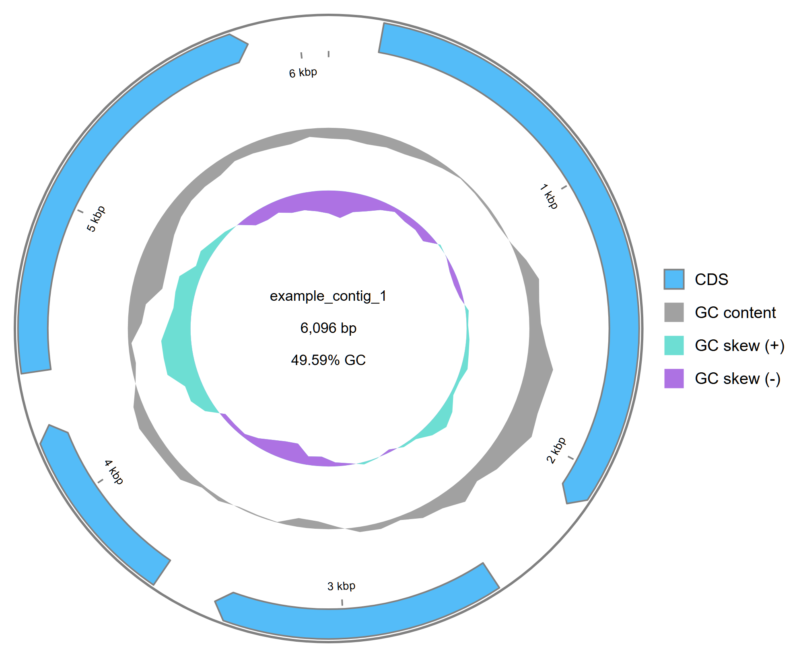
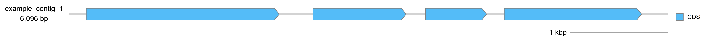

# Annochain · 一键注释分析

> 返回 [Home](Home) ｜ 上一页：[Annotate-Intro](Annotate-Intro) ｜ 下一页：[ORF](ORF)

输入核酸 FASTA，用一条任务跑完「ORF 预测 → 功能注释 → 基因组图谱 → NCBI 提交准备」。
ORF 注释产物直接推进提交项目。

对应引擎 / 页面：`Virus_Platform_Core/web/chains.py::_tool_job_annochain`（注册于 `Virus_Platform_Core/web/tools_api.py`）；工具卡 `t-annochain`（`webapp/templates/tools.html#t-annochain`，工具箱「病毒注释分析」组）；操作目录 id `annochain`。

---

## 输入

### 输入格式

- 核酸 FASTA（contigs / 基因组），界面注明支持 `.gz`。
- 链首可勾选 kunpeng 病毒库分类，用于回填提交表的 organism / family。

### 参数

| 参数 | 必填 | 说明 |
|---|---|---|
| `fasta` | 是 | 核酸 FASTA（contigs / 基因组，支持 `.gz`） |
| `min_aa` | 否 | 最短 ORF 氨基酸数，默认 `100`，运行时夹到 1–5,000 |
| `classify` | 否 | `1` / `true` / `yes` / `on` 开启链首 kunpeng 分类；界面复选框默认勾选 |
| `threads` | 否 | 透传给各子步骤；留空用平台默认 |

- `classify` 开启但 kunpeng 病毒库未就绪时，链**不会失败**。
- 日志写明「分类降级」，提交表 organism 留空，改在「数据提交」页手动填写。

## 流程

步骤编号是动态的：勾选 kunpeng 分类时链首多一步，界面显示 ①–⑤；不勾选时是 ①–④。

| 顺序（不勾选分类时） | 步骤 | 复用的引擎 | 主要产物 |
|---|---|---|---|
| 可选 | kunpeng 病毒库分类 | `_tool_job_contigs`（`min_len=200`、`confidence=0`） | 病毒分类表；提交准备步据此回填 organism / family |
| ① | ORF 预测 | `_tool_job_orf`（`annotate=False`） | `03_assembly/viral_contigs.fasta`、`contigs.filtered.fasta`、`summary.json`；`04_orf/` |
| ② | ORF 功能注释 | `_tool_job_orfa` 的 run 模式，直接注释 ORF 步的运行目录 | `04b_orf_annot/orf_annotation.tsv`、汇总表、`orf_annotation.gff3`、`genome_diagrams/` |
| ③ | 基因组图谱 | `_tool_job_genoplot`（gbdraw，圈图 + 线图） | `09_genome_plots/<contig>.circular.svg`、`.linear.svg` |
| ④ | NCBI 提交准备 | `Virus_Platform_Core/ncbi_submit/store.py`（不建 run_dir） | `run/submissions/<链运行名>/` 下的表、序列、featuretable 与提交包 |

### 编排与依赖

- ② 依赖 ① 的运行目录；③ 依赖 ② 产出的 GFF3；④ 读输入 FASTA 与 ① / ② 的注释。
- ①–③ 各建自己的 run 目录；④ 不建 run_dir，落 `run/submissions/`。
- 汇总目录只放链接与清单。
- `classify` 只在链首执行一次，分类表供提交准备步回填。

### 运行目录与命名约定

- ORF 步的运行名固定以 `orf_` 开头，功能注释步按这个命名找目标目录。
- 注释产物写回 **ORF 步的运行目录**，不是注释步自己的空运行目录。
- 图谱步的注释来源按 `04b_orf_annot/*.gff3` → `04b_orf_annot/*.gff` → `04_orf/*.gff` 顺序查找。
- 出图上限默认 12 条，模式 `both`。

### 失败与降级

- 图谱步由 `gbdraw` 出图；`gbdraw` 缺失时该步直接报错（run 模式不走 DFV 回退），链随之中断。
- 任一步抛错则整条链失败；已完成的子运行目录仍保留在 `run/tool_runs/` 下，可单独打开。
- 提交准备步的 featuretable 生成是例外：抛 `ValueError` 时只记日志并跳过，链继续。

### 提交准备步的建档顺序

1. `create_table(链运行名)`：建同名提交项目，已存在则复用；
2. 若跑了 kunpeng 分类：`import_from_run(项目, 分类运行)`，organism / family 自动回填；
3. `import_from_fasta(项目, 输入 FASTA)`：按序列头补表行；
4. `link_orf_run(项目, ORF 步的 orf 运行)`：把 ORF 注释关联到提交表；
5. `export_submission_fasta(项目, 输入 FASTA)`：导出 `sequences.fsa`；
6. `generate_feature_tbl(项目)`：生成 `featuretable.tbl`，抛 `ValueError` 时跳过并记日志，其余异常仍会中断链；
7. `package_zip(项目)`：打包 `submission_package.zip`。

- 建项目与补表行是幂等的，重跑不会重复建项目 / 建行。

## 产物

### 目录结构

汇总目录（链运行名形如 `annochain_<时间戳>_<6位十六进制>`；子运行名是 4 位后缀）：

```text
run/tool_runs/annochain_20261105_120000_ab12cd/
  _chain.json                 # 步骤、子运行名、摘要
  chain_report.html           # 按需生成（材料 / 方法 / 结果）
  chain_report_meta.json      # 与上者配套
  step_orf        -> orf_20261105_120000_ab12        # 目录链接
  step_orfa       -> orfa_20261105_120000_cd34    # 注释写回 step_orf/04b_orf_annot/
  step_genoplot   -> genoplot_20261105_120000_ef56
  orf_annotation.tsv          # 链接自 ORF 步的 04b_orf_annot/
  <contig>.circular.svg
  <contig>.linear.svg
```

### 关键文件与字段

| 文件 / 目录 | 内容 |
|---|---|
| `_chain.json` | 步骤、子运行名、摘要；只在链正常跑完时写入 |
| `chain_report.html` | 按需生成的规范报告 |
| `chain_report_meta.json` | 与报告配套的元数据 |
| `step_orf` / `step_orfa` / `step_genoplot` | 各步运行目录链接 |
| `orf_annotation.tsv` | 链接自 ORF 步的 `04b_orf_annot/` |
| `<contig>.circular.svg` / `.linear.svg` | 图谱步产物 |
| `run/submissions/<链运行名>/` | 提交准备的真实落点：表、序列、featuretable 与提交包 |

- 链接优先 `symlink`；Windows 无权限时退化为硬链接。
- 仍失败则跳过，并在运行日志里记一行。
- 中途失败时不会有 `_chain.json` 汇总清单，但各步真实运行目录已在 `run/tool_runs/`。

## 示例输入与输出

### 示例输入

```text
D:/data/annochain_in/
└── example_contig_1.fasta     核酸 FASTA（示例 contig 6,096 bp）
```

- 界面填该 FASTA，最短 ORF 长度保持 `100`，按需勾选自动分类。

### 示例输出

图谱步用 `gbdraw` 为每条 contig 出圈图与线图两张 SVG。
下面取自链运行目录 `run/tool_runs/annochain_20261105_021306_39a592/`。



*图注：环图——外圈蓝色箭头是 CDS，箭头方向即链方向；第二圈灰色是 GC content 波动；最内圈青绿 / 紫色是 GC skew（+ / −）。圆心标注序列名 `example_contig_1`、长度 6,096 bp 与 49.59% GC；外圈刻度 1–6 kbp，右侧图例对应四类轨道。源文件 `example_contig_1.circular.svg`。*



*图注：线图——同一条 contig 展开成线性坐标，蓝色箭头为 CDS（含方向），浅灰横线是全长坐标轴；右下角 1 kbp 为比例尺，最右侧为 CDS 图例。横向比例更适合放进论文图版或幻灯片。源文件 `example_contig_1.linear.svg`。*

- 两张图都由「ORF 功能注释」步产出的 GFF3 驱动。
- 单条 contig 需要重出图时走 [Genome-Plots](Genome-Plots)。
- 结果面板显示提交项目名、featuretable 是否生成、缺失 contig 数。
- 同时给「→ 数据提交页完善元数据」入口。
- **作者、测序信息等元数据仍需人工填写**；organism / family 在分类成功时自动回填，否则也在提交页手动填写。

## 界面与 CLI

### 界面

- 入口：病毒注释分析组 →「⚡ 一键分析」（`/tools?g=annotate#t-annochain`）。
- 填 FASTA、最短 ORF 长度、线程数与自动分类复选框，点「⚡ 一键运行」。
- 运行结束后结果区给出步骤表、汇总目录条目、输出目录，以及「📄 规范报告」「↻ 读取汇总」。

### CLI 与 agent

- CLI 没有独立的 `annochain` 子命令；参数与调用口径走统一操作目录。

```bat
python main.py agent-ops --id annochain --schema
python -m Virus_Platform_Core.chain_report <run 名或目录> [--force] [--open]
```

- 外部 agent 经 MCP 提交：

```text
vp_run_tool(tool="annochain", params={"fasta": "D:/data/contigs.fasta", "min_aa": 100, "classify": "1"})
```

## 相关

- 注释结果怎么读 → [ORF](ORF)
- 基因组图细节 → [Genome-Plots](Genome-Plots)
- 提交表与 BankIt 流程 → [NCBI-Submission](NCBI-Submission)
- 结果与报告入口 → [Results](Results)、[Report](Report)
