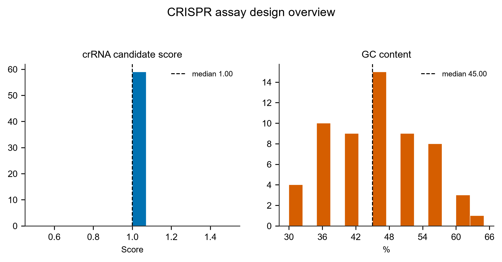
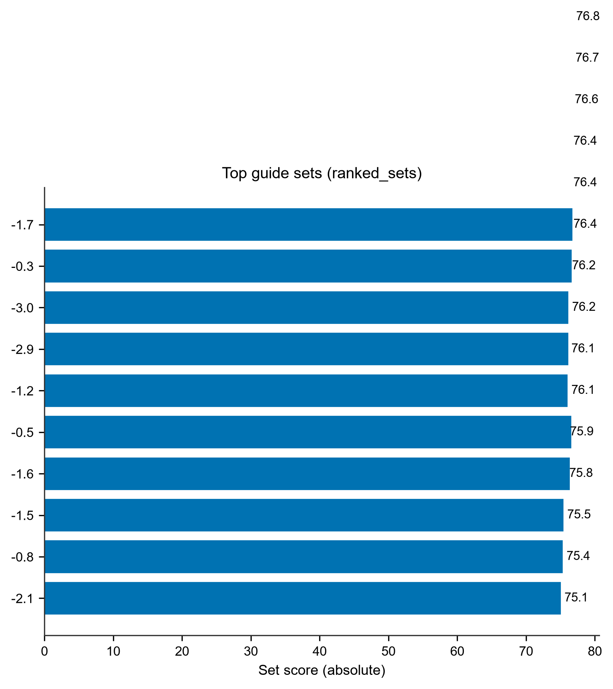

# CRISPR-Design · CRISPR/Cas12a 检测试剂设计

> 返回 [Home](Home) ｜ 上一页：[Primer](Primer) ｜ 下一页：[LAMP-Design](LAMP-Design)

一次产出 Cas12a crRNA 候选 × RPA（或 PCR）引物对的协同设计。另附复合评分排序、订购表与 L1–L5 实验验证清单。输入是多分离物目标 FASTA（可带近缘病毒与宿主筛查），产物是可直接下单的 crRNA / 引物组合与排序表。全程本地离线，复用平台已纳管的 MAFFT / primer3 / ViennaRNA / BLAST，不引入新外部工具。

对应引擎：`Virus_Platform_Core/crispr_design.py`（模块版本 1.0.0）；工具卡 `t-crispr`（检测与防治 → CRISPR 检测试剂设计）；CLI `main.py crispr-design`；操作目录 id `crispr`。

## 输入

### 输入格式

| 输入 | 必选 | 说明 |
|---|---|---|
| 目标 FASTA | ✅ | 多分离物，建议 ≥10 株，覆盖度评估才可靠 |
| 近缘病毒 FASTA | 可选 | 同属 / 同科近缘种加常见复合侵染毒源；也可固定放入 `databases/crispr/near_neighbors/`（放即生效） |
| 宿主基因组筛查 | 默认开 | 用 host-db 当前宿主源基因组；无配置则跳过并如实注明 |

- 片段分组：header 含 `RNA1` / `S2` / `segment 3` 等标签时自动按片段分组，多分体基因组各片段独立设计；无标签视为同一分子。
- 宿主筛查路线：FASTA ≤1.5 GB 走 k-mer 索引路（首次建索引较慢，之后有缓存）；更大走 BLAST 路。
- 参考序列可用「比较基因组分析 → 参考序列获取」按 ICTV 科 / 属一键拉取。

### 参数

| 参数 | 默认 | 说明 |
|---|---|---|
| `input` | 必填 | 目标序列 FASTA（CLI `-i`） |
| `near_fasta` | — | 近缘 FASTA（CLI `--near`）；k-mer 排除筛查与位点级 leak 核查双重生效 |
| `amp_mode` | `RPA` | `RPA` / `PCR` / `LAMP`（CLI `--amp`；`LAMP` 为 CRISPR-LAMP 档） |
| `profile` | `strict` | 严格档 `strict` / 放松档 `relaxed`（CLI `--profile`） |
| `nuclease` | `cas12a` | `cas12a` / `cas13a`，切换效应酶档案（CLI `--nuclease`） |
| `probe_type` | `none` | `exo` / `nfo`，仅 RPA 档可用（CLI `--probe`） |
| `use_host` | 开 | 宿主脱靶筛查（CLI `--no-host` 关闭） |
| `group_by_segment` | 开 | 按片段标签分组 |
| `top_n` | — | 输出组合数（CLI `--top-n`） |
| `-o` | 自动 | 输出目录 |

## 流程

设计文档见 `docs/CRISPR检测设计模块规划_20261006.md`。

### 步骤一：分组与多序列比对

1. 按片段标签分组。
2. 组内做多序列 MAFFT。
3. 逐列统计保守性，并取多数共识（平票记 N，不猜）。

### 步骤二：crRNA 漏斗筛选

1. 双链 TTTV PAM 扫描：严格档只收 TTTV；放松档前 3 位容 1 错配，需实验验证。
2. 过滤：spacer 平均保守分（严格 0.95 / 放松 0.85）、GC 30–70%、同聚物 ≥5 剔除、poly-T≥4 标记 T7 风险、RNAfold MFE ≥ −5 kcal/mol。
3. PAM 优先级：TTTA / TTTC / TTTG > TTTT > 容错 PAM（LbCas12a 活性口径）。

### 步骤三：引物与扩增子设计

1. 每个存活位点取侧翼 ±250 bp 窗口。
2. primer3 设计 RPA 引物（30–35 nt / Tm 60–70 / 产物 100–200 bp）或 PCR 引物对。
3. primer3 出对不足时自动枚举兜底。
4. 硬约束：扩增子必须完整包含 PAM+spacer，且两侧各留 ≥25 bp。

### 步骤四：双库特异性筛查

1. crRNA spacer 与引物对逐条筛查宿主库 + 近缘库（20-mer，mm0 / mm1 / mm2 分层）。
2. spacer 精确命中一票否决。
3. ≤1 错配标记「近缘≤1mm」。
4. 引物精确命中整对剔除；3′ 端 ≤1 错配重罚。

### 步骤五：负组位点级核查

提供近缘 FASTA（`--near` 或表单「近缘病毒排除 FASTA」）时，在 k-mer 序列级筛查之外附加位点级核查：

- 目标与近缘序列合并 MAFFT，共识只算目标行，用 `col_map` 映射近缘同源列。
- 每个候选位点在近缘同源窗上核查：PAM 保留且种子（前 8 nt）全配对 = leak（近缘序列同样满足识别条件 → 误检风险）；PAM 已变且种子错配 = clear（背景干净）。
- leak>0 的组合降权 ×(1−0.5×leak%)，flags 打「近缘leakX%」，不 veto——株系区分是能力信号，留给实验判读。
- Cas13a 路线无 PAM：`pam_kept` 退化为恒真，leak = 近缘同源窗种子全配对。
- 证据边界见「证据边界与工程约束」一节。

### 步骤六：复合评分与群体覆盖率

1. 21 项特征效用加权：脱靶 / 二聚体 / 3′ 端 / Tm 平衡 / GC / 种子区 / 结构；初始权重来自 CASPER 拟合 100 组实验对的公开配置。
2. 总分再乘覆盖率因子：mm0 覆盖 100% 不折减，0% 折半（PathoGD prevalence 口径）。
3. 覆盖不了目标群体的序列特征再好，也不算可用试剂。

### 步骤七：排序与交付

1. 按复合分排序，取 `top_n` 组合。
2. 输出排序表、漏斗明细、订购表与验证清单（见「产物」）。

## 设计档位与能力

### 参数档：严格 / 放松

| 档 | 适用 | 关键差异 |
|---|---|---|
| **严格**（默认） | 低变异病毒 / 分型精确 | 保守 0.95、仅 TTTV、产物 100–200 bp |
| **放松** | 高变异 RNA 病毒 | 保守 0.85、容错 PAM、产物 90–300 bp（PathoGD 黄病毒实测先例） |

### 效应酶档案（NucleaseProfile）

引擎的酶参数已抽象为档案对象（借鉴 crisprDesign `CrisprNuclease` 的轻量净室版）。PAM / PFS、spacer 长度区间、DR 序列、seed 长度、poly-T 口径全部随档案切换。新增酶等于新增档案条目。

| 档案 | 适用 | 关键差异 |
|---|---|---|
| **LbCas12a**（默认） | DNA 靶标（RPA / PCR 扩增后检测） | TTTV PAM；spacer 20–24；poly-T≥4 仅标记 |
| **LwaCas13a** | RNA 病毒直接检测（免逆转录路线） | 无 PAM（保守窗口即位点）；spacer 27–30；poly-T≥4 硬否决（crRNA 一律 T7 体外转录，36 nt DR：Kellner et al. 2017 SHERLOCK 口径） |

Cas13a 模式的订购表只出 T7 体外转录模板（T7 启动子 + DR + spacer）。对 RNA 植物病毒可走「粗提液 → RT-free 检测」；需要信号放大时仍配 RT-RPA 引物，设计逻辑同 Cas12a，位点即 spacer 本身。

### 扩增档：RPA / PCR / LAMP

`--amp LAMP` 时扩增方式切换为环介导等温扩增：

- 在 crRNA 位点侧翼窗内，由 `lamp_design` 内核设计 F3 / F2 / F1 / B1 / B2 / B3 六条引物（FIP = F1c + TTTT + F2，BIP = B1 + TTTT + B2c，可选 LF / LB 环引物）。
- F2-B2 产物必须包住 crRNA 位点。
- LAMP 六条引物逐条做排除库脱靶筛查，任一 mm0 命中即整组剔除。
- 组合评分 = 0.5×CASPER（FIP / BIP 当 f / r）+ 0.5×lamp 组评分。
- RPA 探针在 LAMP 档强制关闭（探针是 RPA 专属）。
- `ranked_sets.tsv` 追加 `lamp_F3` / `FIP` / `BIP` / `B3` / `LF` / `LB` / `lamp_bp` 七列。

### 二期能力：探针、差分错配、panel 与兼并码

- **EXO / NFO 探针**（RPA 模式可选）：在扩增子内部（引物结合区之间，留 5 bp 边距）扫描 30–35 nt 窗口，要求纯 ACGT、GC 30–70、同聚物 <4、达保守档阈值、Tm≥60℃。窗口尽量居中。
  - EXO = 5′-FAM—THF（中位）—BHQ1-3′，用于 ExoIII 实时荧光。
  - NFO = 5′-FAM—THF—C3-3′，用于 EndoIV 侧流，需配套一端 5′ 生物素引物，订购表已注明。
  - 空间不足时该组合标记跳过原因；订购表与组合表自动带修饰标记序列。
- **intentional mismatch 建议**：近缘库 ≤1–2 错配命中的候选，自动定位天然差异位，并建议在 PAM 远端（避开 seed）引入人工错配实现差分去稳定（靶标 1 个人工错配 vs 近缘 ≥2）。序列与位置依赖，区分度增益与活性损失须实验验证。
- **跨片段 panel 汇总**：`panel.tsv` 加报告 / 订购表 panel 页，每个片段取评分最高的一套组合，给多分体病毒多联检视图。
- **IUPAC 兼并码共识**：平票列记兼并码（W / S / M / K / R / Y）而非 N，引物模板区不被 N 打洞；crRNA 与引物交付序列仍有纯 ACGT 硬守卫。

### 标准操作清单对照

| 操作清单要求 | 平台实现 |
|---|---|
| MSA 保守区（CP / MP / RdRp，多分离株） | MAFFT 逐列保守性 + 多数共识；参考序列可从「参考序列获取」按 ICTV 科 / 属拉取 |
| Cas12a TTTV PAM + 下游 20–24 nt | 双链 PAM 扫描（严格 / 容错档），spacer 20–24 |
| Cas13a 无 PAM，28–30 nt 直接选 | NucleaseProfile cas13a 档案，保守窗口即位点，27–30 |
| Cas13a DNA 体系前向引物加 T7 启动子 | cas13a 模式自动输出 forward+T7（订购表 / 详情 / 报告） |
| spacer GC 40–60% | 漏斗硬界 30–70%（宽），评分偏好 40–60 |
| 避免与 DR 骨架形成稳定结构 / 自二聚 | spacer 单独 MFE≥−5，加 DR+spacer 联合折叠 ΔMFE 闯门（全长比 DR 单折低 >3 kcal 判互作剔除） |
| 种子区（PAM 近端 8–10 nt）绝对保守 | seed 区逐列保守硬约束（严格档 1.0 / 放松 0.95），漏斗独立统计 |
| RPA 产物 100–250 bp、位点距引物 ≥10–20 bp | 严格档 100–200（放松 90–300），位点边距默认 25 bp |
| 引物 30–35 nt、GC 30–70% | primer3 主路 + 枚举兜底同口径 |
| 3′ 端避 GC 富集 / 回文 | 末三碱基全 G/C 一票否决（primer3 后置 + 枚举路 + 探针）；3′ 同碱基 run 与交叉二聚体进评分 |
| 多 crRNA × 多引物对候选 | 每位点 ≤2 组合、top_n 输出、21 特征评分排序 + 覆盖率因子 |
| 体外荧光报告正交筛选 | L1 清单（aLoD / time-to-positive / 多 crRNA 并排） |
| Cas12a / 13a crRNA 结构（DR+spacer） | 订购表三格式：spacer / DR+spacer / T7 转录模板（DR 取自档案：Cas12a `UAAUUUCUACUAAGUGUAGAU`；Cas13a `GAUUUAGACUACCCCAAAAACGAAGGGGACUAAAAC`） |

## 证据边界与工程约束

### 计算结论不覆盖什么

计算设计仅为序列级候选优先级排序，不构成 crRNA 活性、错配区分度、扩增兼容性或基质性能的证据。

- 负组位点级核查与 intentional mismatch 建议都只是排序信号。
- LAMP 扩增档同样不证明扩增效率与引物间干扰。
- 实验结论必须按 L1–L5 逐级建立。

### L1–L5 实验验证清单

- **L1** 纯化靶标：合成靶标测 aLoD / time-to-positive。
- **L2** 加标基质：健康植株粗提液（纸片 / 碱裂解）加标 + 近缘病毒交叉反应。
- **L3** 回顾性田间样本：平台 02_kvsuite 阳性可召回，RT-qPCR 对照。
- **L4** 前瞻性多地点田间（非开发者操作）。
- **L5** 实际使用：储存稳定性 / 批次一致性 / 单样成本。

### 真实数据验证规模

四病毒 × 双酶矩阵，全部用番茄真实宿主 + BLAST / k-mer 双路 + 真实近缘属内种 + EXO / NFO 探针：

| 病毒 | 基因组 | 耗时 | 关键验证点 |
|---|---|---|---|
| PVY（马铃薯 Y 病毒） | 单体 9.7 kb × 15 株 | 14s | 全配置基线；多分离物兼并码场景可跑通 |
| ToMV（番茄花叶病毒） | 单体 6.4 kb × 8 株 | 37s | 近缘 TMV（同属 ~80% 同源）veto 9 候选——交叉反应高危区实证 |
| CMV（黄瓜花叶病毒） | 三分体 RNA1/2/3 × 7 株 | 45s / 164s（Cas13a） | 多分体分组、panel 按段取优；RNA2 亚组分裂覆盖 57% 被正确降权 |
| TSWV（番茄斑萎病毒） | 字母式 L / M / S 分段 | 121s | 字母分段命名支持；INSV（同属）veto 7 候选 |

同一基线（15 株 PVY + 6 株 PVA 近缘 + 810 MB 番茄宿主）下 Cas12a 与 Cas13a 均约 14s。

各门控工作量：Cas12a 309 位点（保守 −182 / 种子 −107 / DR 互作 −1）→ 17 存活；Cas13a 15,686 窗口（保守 −9,168 / 种子 −5,631 / polyT −74 / DR 互作 −233）→ 384 存活。宿主 BLAST 筛查在 17 个候选中标记 8 个 ≤1mm 背景命中；810 MB 番茄 BLAST 库实建 6.4s。

验证运行按工具运行目录落盘（`run/tool_runs/<run>/crispr/`），可直接打开 `report.html` 复核。

### 工程约束与降级行为

- **primer3 与兼并码**：primer3 不认 IUPAC 兼并码。模板送 primer3 前兼并位转 N，`PRIMER_MAX_NS=0` 自动阻止引物落位，兼并码保模板区长度的本意不变。
- **大宿主 k-mer 索引**：810 MB 基因组 `np.unique` 峰值约 40 GB。k-mer 索引上限设为 250 MB，超限或失败一律降级 BLAST 路（`blastn-short` 批查），不静默放弃筛查。
- **BLAST+ 与中文路径**：LMDB 在平台根含中文时 `mdb_env_open` 失败。BLAST 库改建在 `%TEMP%` ASCII 中转目录（`_ascii_work_base`，同 MAFFT 方案），`host.fa` 按大小比对增量重拷。
- **分段识别**：支持 header 中段出现的 `segment RNA1` 与字母式 L / M / S 分段；isolate 编号（如 `A-25`）不参与分段判断。
- **界面契约**：任务 stage 全中文化；`tests/test_crispr_ui.py` 锁定卡片控件、i18n 与渲染分支。
- **分发形态**：分发自带解释器（`3rd/python`，含 primer3 / RNA / openpyxl）11.8s 跑通，叠加用户形态 10.6s，快照 164 文件；MAFFT 缺失时报「未找到工具 [mafft]，请在 platform.json 或 GUI 设置页指定路径」。

## 产物

### 目录结构

```text
run/tool_runs/<run>/crispr/
├── ranked_sets.tsv          top 组合全特征排序表
├── crrna_candidates.tsv     漏斗全程明细（含被否候选）
├── order_sheet.xlsx         订购表（三种 crRNA 格式 + 引物）
├── validation_checklist.md  L1–L5 植物病毒语境验证清单
├── panel.tsv                跨片段 panel（每片段取最高分组合）
├── report.html / report.json 独立交互报告与数据
├── crispr_design.json       参数快照（可复现）
└── summary.json             摘要（含 negative_locus 元段）
```

### 关键文件与字段

| 文件 | 内容与关键字段 |
|---|---|
| `ranked_sets.tsv` | top 组合全特征；含 21 项评分、覆盖率、`negative_leak%`；LAMP 档追加 `lamp_F3` / `FIP` / `BIP` / `B3` / `LF` / `LB` / `lamp_bp` |
| `crrna_candidates.tsv` | 漏斗全程明细，含被否候选与否决原因；`negative_leak%` / `near_locus_clear` 两列 |
| `order_sheet.xlsx` | spacer / DR-spacer / T7 体外转录模板三种 crRNA 格式 + 引物；含修饰标记序列与 panel 页 |
| `validation_checklist.md` | L1–L5 验证清单，LAMP 档并入 65°C Bst 与内外引物浓度比 |
| `report.json` | 每组合 `negative_leak` 字段、评分构成与参数快照 |
| `crispr_design.json` | 参数快照，可复现 |

## 示例输入与输出

### 示例输入

目标多分离物 FASTA。header 含 `RNA1` / `S2` / `segment 3` 等片段标签时自动按片段分组（多分体各片段独立设计）；无标签则全部视为同一分子。

```text
>PVY_isolate_01|RNA1
AAAATTAAAACATATACAAACTTCAATTCAAACAACAAAGCAAAAGCAACTCAAACAAAC
>PVY_isolate_02|RNA1
AAAATTAAAACATATACAAACTTCAATTCAAACAACAAAGTAAAAGCAACTCAAACAAAC
>PVY_isolate_01|RNA2
AAATAAACAAACAAACAAACAAACAAACAAACAAACAAACAAACAAACAAACAAACAAAC
```

### 示例输出

`ranked_sets.tsv`（top 组合全特征）、`crrna_candidates.tsv`（漏斗全程明细）、`order_sheet.xlsx`（三种 crRNA 格式 + 引物订购表）、`validation_checklist.md`（L1–L5 验证清单）、`report.html`。



*图注：左面板是候选 crRNA 评分直方图（虚线为中位数 1.00，本示例候选集中在同一分值），右面板是候选 GC 含量直方图（虚线为中位数 45.00%）；先看评分分布是否集中在高分一端、GC 是否落在 30–70% 硬界内，再看是否有候选脱离主峰需要单独复核。*



*图注：Top 10 个 guide 组合（`ranked_sets.tsv`）按组合绝对分值排序的横向条形图，横轴为 Set score（absolute，0–80）；本示例前十名分值挤在 75.1–76.4，说明排名前列的多个组合质量接近——可按产物长度、片段覆盖互补等实验考虑自由挑选，不必死磕第一名。*

## 界面与 CLI

### 界面

工具卡 `t-crispr` 的结果区分三层：

1. **位点轨道图**：每片段一条 SVG 泳道。图上叠保守性折线与漏斗存活位点三角标记（红 = 入选 / 灰 = 未入选 / 空心 = 已否决），再加 top 组合扩增子条带。
2. **评分分解面板**：点击表格行展开，7 类效用条形 + 三种 crRNA 订购序列与 T7 提示。
3. **`report.html`**（独立交互报告，plotly）：① 各片段保守性剖面与位点散点；② Top 组合评分构成堆叠条形（条形总长 = 基础分 / 100，悬浮含各类权重）；③ 评分 vs 群体覆盖率散点（x 轴按数据自适应）；④ 明细表。通过平台服务打开自动加载 plotly，本地双击打开的副本表格仍可读。

订购与归档级明细在 `order_sheet.xlsx` / `ranked_sets.tsv` / `crrna_candidates.tsv`，含被否决候选与否决原因。

### CLI 与 agent

```bash
python main.py crispr-design -i targets.fa --near nearvirus.fa \
    --amp RPA --profile relaxed --top-n 20
python main.py crispr-design -i rna_virus.fa --nuclease cas13a \
    --profile strict --top-n 20
python main.py crispr-design -i targets.fa --no-host -o run/my_crispr
python main.py crispr-design -i targets.fa --probe exo --top-n 10
```

- agent：操作目录 id `crispr`，参数经 MCP `vp_run_tool` 传入；schema 查询 `python main.py agent-ops --id crispr --schema`。
- 参数键口径与网页端表单同源，未列出的键被忽略。

## 相关

- 组导读 → [Detect-Intro](Detect-Intro)
- LAMP 引物组设计（`--amp LAMP` 的内嵌内核）→ [LAMP-Design](LAMP-Design)
- 引物设计（RPA / PCR 协同）→ [Primer](Primer)

### 引用

设计输出报告自动附带：Wang H. et al. *ACS Sensors* 2026（框架与 L1–L5）；Low S.J. et al. *Commun Biol* 2025 PathoGD（群体覆盖口径）；CASPER（初始评分权重）；AutoCORDSv2 / RPA-Primer-Design / CRISPRPrimerDesigner（规则与参数参考，全部净室实现，未复制任何 GPL 或无许可代码）。
