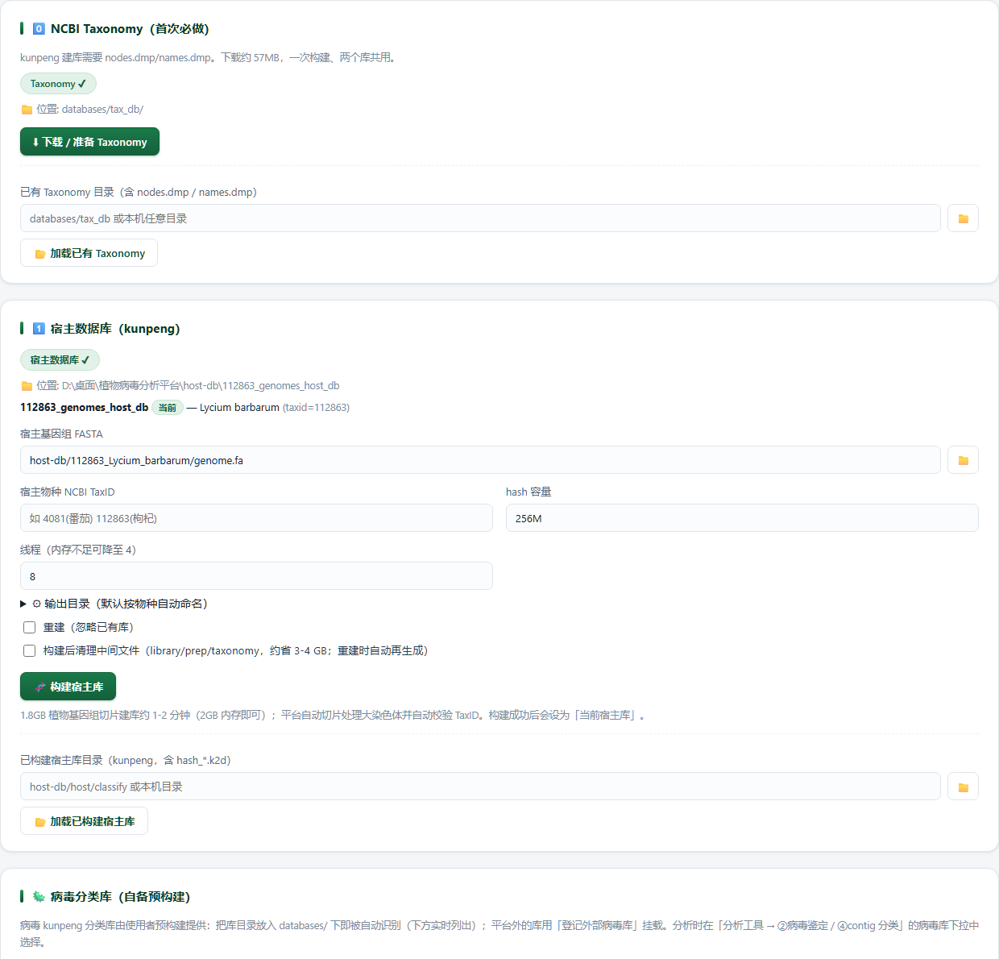

# Databases · 数据库与参考库

> 返回 [Home](Home) ｜ 上一页：[Ref-Data](Ref-Data) ｜ 下一页：[Sample-Intro](Sample-Intro)

平台数据库与参考库的登记处：Taxonomy、宿主库、病毒鉴定 / 分类库、建树参考库、注释库各自的目录、体积与构建方式。输入是已下载的 taxdump、宿主基因组与病毒数据集，产物是可被流水线直接调用的本地索引。平台数据库总体约 3.4GB，全部在 `databases/`；宿主数据独立在 `host-db/`，约 1.5GB/物种。

对应引擎：`ictv_db.py`（ICTV VMR 解析与选参）、`universal_ref.py`（通用病毒库建库）、`dev_tools/build_virus_db.py`（鉴定库重建）；页面：数据库构建页 `/build` + 设置页「数据库目录」；操作目录动作 `build_host_db`。

---

## 输入

### 输入格式

- **Taxonomy**：NCBI `new_taxdump.tar.gz`。
- **宿主基因组**：`host-db/<TaxID>_<物种>/genome.fa`，由 [Ref-Data](Ref-Data) 下载，`genome.fa` 是建库锚点名。
- **病毒数据集**：`reference.fasta` + `reference.ref_info.tsv`（VMR_Family / VMR_Genus 列），由 [Ref-Data](Ref-Data) 的 datasets virus 模式落位。
- **建树参考**：ICTV VMR 当前版 xlsx（用于生成 `ictv_tree.db`）；`plant_tree.db` 为预置成品。
- **注释库**：`viral_prot.faa`（RefSeq 病毒蛋白，首次自动下载）、Pfam-A-Viruses HMM、BFVD 库。
- **可选 `virus_ref/`**：非冗余植物病毒参考库，目录存在即启用，无需改配置。

### 参数

| 参数 | 位置 | 说明 |
|---|---|---|
| `active_host_db` | 构建页 / 配置 | 指定当前宿主库；多宿主库共存时一键切换 |
| 「构建后清理中间文件」/ `--clean-mid` | 构建页 / CLI | 清 library / prep / taxonomy 副本，省 3–4GB/库，重建时自动再生成 |
| `--tree-sampling macro/genus/lineage` | ⑦ 选参 | 从 `plant_tree.db` 取参考的口径 |
| `--genus` / `--download` | `ictv-refs` | 选参预览 / 缺的按需下载 |
| `--to` / `--mode move` / `--dry-run` / `--check` | `db-migrate` | 迁移目标与校验开关 |
| `extra_db_roots` | 构建页「📂 加载已构建宿主库」 | 自备宿主库登记路径白名单 |

## 流程

### 步骤一 · Taxonomy

- 数据库页一键下载 / `python main.py init-taxonomy`：`new_taxdump.tar.gz` 解压出 nodes / names / merged。
- 用途：宿主判定谱系、④ / ⑥b 的宿主类别归类、contig 深度注释 8 级谱系统列、TaxID 校验（`merged.dmp` 处理旧编号并回新编号）。

### 步骤二 · 宿主库

- 按物种一库：`host-db/<TaxID>_<源目录名>_host_db/`，库内 `host_db.json` 清单记录目标物种；多宿主库共存，`active_host_db` 指定当前（页面一键切换）；legacy 布局的固定槽位 host / classify / 仍识别。
- 建库要点：TaxID 建库前校验；FASTA 头自动规范化并注入 taxid；大基因组自动切片（≤1MB 片段、相邻重叠 34bp，k-mer 数与整条建库完全一致——2GB 内存可完成 1.8GB 基因组建库）；替换式重建。
- 自备宿主库放任意位置：构建页「📂 加载已构建宿主库」选中即登记路径白名单（`extra_db_roots`）。

### 步骤三 · 病毒鉴定库

- kv_index 自包含：`reference.fasta` + `reference.ref_info.tsv`（VMR_Family / VMR_Genus 列供 ②b 分类树）+ salmon_k31 索引；②b 识别 / 定量、③ BLASTN 回退、⑦ 参考池兜底共用。
- 重建：`build-virus-db` 或 `dev_tools/build_virus_db.py`。
- 更新：新版 4 件套（两个 FASTA 加两个 `Info.tsv` 加 `DATA_VERSION`）整体替换，平台按 `DATA_VERSION` 自动重建元数据缓存与 BLAST 库。

### 步骤四 · 建树参考库

- `plant_tree.db`（plant 口径，预下载）：植物病毒参考库 48 科 / 452 属 / 6,167 条。其中 45 科来自 acvirus 谱系 6,150 条，其余补齐 Ourmiaviridae / Ambiguiviridae / Pestiviridae。`plant_meta.tsv` 的 `Seq_Source` 列标明来源（ictv_db / ref_db）。
- ⑦ 的 `--tree-sampling macro/genus/lineage` 从 `plant_tree.db` 取参考；植物库未收录的由选参层联网补齐（单科缺口通常个位数）。
- `ictv_tree.db`（ictv 口径，按需）：ICTV VMR 参考库以官方 VMR 当前版 xlsx（`https://ictv.global/vmr/current?fid=15873`）解析全病毒分类元数据，版本 MSL41 含 22,785 accession / 4,068 属 / 393 科；另加按需下载的参考序列缓存。
- 解析层：VMR xlsx 转成 `taxa.txt`（谱系列加病毒名 / 基因组完整性 / Baltimore / 宿主组扩展列，多 accession 拆分）与 `DATA_VERSION`。
- 选参层：按属 / 科 / 种过滤，本地已有优先（`plant_tree.db` 命中优先于 gb 缓存），Complete genome 优先。
- 下载层：缺的 accession 经 NCBI efetch 落 `gb_cache/<acc>.gb`（幂等缓存，保留特征注释），并汇总 `gb_refs.fa`。
- 兜底层：⑦ 只读接入，谱系并入分类索引、缓存序列并入参考池；分析中不联网，未下载自动回退 `plant_tree.db`。
- 预览列 `Source` 显示命中库名。
- ictv 口径不预下载全病毒界序列（全量约 559MB），缺的按需下载。

### 步骤五 · 注释库

- **prot**：NCBI RefSeq 病毒蛋白全量，首次自动下载约 107MB 并建库；换库时替换 `viral_prot.faa` 后删 `organism_tax.tsv` / `db_info.json`，平台自动重建。
- **hmm/pfam**：`Pfam-A-Viruses.hmm`（1,074 profiles，自描述 DESC）；缺失时 HMM 层整体跳过。
- **bfvd**：mmseqs 格式 BFVD 病毒域库（`misc_db/suvtk/bfvd`，212MB，与 SUVTK 提交链共用；⑥b 注释层2 与 ③b 验证 B 路共用，product 命名同 `bfvd_uniprot_names.tsv`）。
- 注释库不含 CDD 结构域库（全量索引约 5GB，小内存机器易 OOM）；病毒域注释走 BFVD。

### 步骤六 · 可选参考库

- `virus_ref/` 为非冗余植物病毒参考库（源自 `plant_virus_db_pipeline`），目录存在即启用。
- ④ 用其 ICTV 谱系加已知宿主交叉验证（预测宿主 ∉ 已知宿主类别 → `host_check=WARN`）。
- ⑦ 参考池优先 RefSeq / 完整基因组；`ref_meta.tsv` 为规范化元数据缓存，首次使用自动构建：Segment 归一加本地 taxonomy 谱系补全，ICTV 种覆盖 10%→100%；`segment_norm.py` 把 299 种原始 Segment 写法收敛到受控词表。
- 不存在时平台照常运行，各调用点回退自带数据，`ref-status` 会提示「参考库未部署」。
- `universal_ref.py` 另支持通用病毒库（ref-virus / RVDB 口径）建库，按需重建 `universal/` 子目录。

## 产物

### 目录结构

```text
databases/
  tax_db/            nodes.dmp / names.dmp / merged.dmp
  kunpeng_db/        plant / ref / rvdb
  virusref_db/       kv_index/（reference.fasta + ref_info + salmon_k31 索引）+ blast/
  annot_db/          prot/ · hmm/pfam/
  tree_db/           plant_tree.db · ictv_tree.db
  misc_db/           host_prob · suvtk（bfvd）· viroids
  virus_ref/         可选：非冗余植物病毒参考库
host-db/
  <TaxID>_<源目录名>_host_db/   host_db.json
```

### 关键文件与字段

| 目录 | 内容 | 体积 | 来源 |
|---|---|---|---|
| `tax_db/` | NCBI Taxonomy：`nodes` / `names` / `merged.dmp` | ~545MB | 数据库页下载（~57MB 压缩包） |
| `kunpeng_db/` | kunpeng 分类库：`plant` / `ref` / `rvdb` | ref 680MB | 预置 |
| `virusref_db/` | 已知病毒鉴定库 `kv_index/`（自包含：`reference.fasta` + `ref_info` + `salmon_k31` 索引）+ `blast/` 本地检索库 | ~850MB | 预置 |
| `annot_db/` | 注释库：`prot/`（RefSeq 病毒蛋白 ~550MB）· `hmm/pfam/`（Pfam 病毒子集 ~119MB） | ~0.67GB | prot 首次运行自动下载；pfam 预置 |
| `tree_db/` | 建树参考库：`plant_tree.db`（植物口径预下载）· `ictv_tree.db`（ICTV VMR 元数据 + 按需序列缓存） | ~37MB | 预置 + `ictv-update` |
| `misc_db/` | `host_prob`（宿主概率表）· `suvtk`（BFVD 212MB）· `viroids` | — | 预置 |
| `virus_ref/`（可选） | 非冗余植物病毒参考库：8,465 条 98% ANI 聚类代表 + 5,773 条完整基因组 + ~199K 全量 + `DATA_VERSION` | 自备 | 外部获取后整体放入即启用 |

### 宿主概率表

- `{species,genus,family,order}_host_probability.tsv` 共 5.9 万条目，源自 ICTV 分类 × 宿主记录交叉统计。
- 它是 ④ 宿主预测的级联查表基础（见 [Host-Prediction](Host-Prediction)）。

## 示例输入与输出

### 示例输入

```text
Taxonomy：databases/tax_db/（已下载，含 nodes.dmp / names.dmp）
宿主基因组：host-db/112863_Lycium_barbarum/genome.fa
宿主库：host-db/112863_genomes_host_db/
```

### 示例输出

下图是顶部两卡——Taxonomy 与宿主库都已就绪。



*图注：0️⃣ NCBI Taxonomy 卡显示 `Taxonomy ✓` 与位置 `databases/tax_db/`，按钮「⬇ 下载 / 准备 Taxonomy」「加载已有 Taxonomy」，后者可指向本机任意含 `nodes.dmp` / `names.dmp` 的目录。1️⃣ 宿主数据库（kunpeng）卡显示已建成的 `112863_genomes_host_db` 为当前库（`Lycium barbarum`，taxid=112863），宿主基因组 FASTA 指向 `host-db/112863_Lycium_barbarum/genome.fa`，hash 容量 256M、线程 8，下方是「构建宿主库」「加载已构建宿主库」。最底部露出「🦠 病毒分类库（自备预构建）」卡的开头，页面继续往下还有原始数据集与病毒鉴定库两卡。*

`Taxonomy ✓` / `宿主数据库 ✓` 这两个徽标就是对应库能被流水线直接调用的开关。没打勾时，宿主判定谱系、④ / ⑥b 的宿主类别归类与 contig 的 8 级谱系注释都会缺料；建库完成后再回到本页，「当前」标签会标在新建的那一库上。

## 界面与 CLI

### 界面

- 数据库构建页（`/build`）按「先 Taxonomy、再宿主库、再病毒库」自上而下排卡。
- 设置页「数据库目录」直接填路径，即时反馈宿主库 / 病毒库 / Taxonomy 就绪状态；切换后 ictv_db / virus_ref / universal_ref / local_search / verify 路径常量同步刷新，无需重启。
- 从其他机器迁移：整体拷贝 `databases/`（与 `host-db/`）到目标机同位置即可；探测结果不写回 `platform.json`，保持可移植。

### CLI 与 agent

```bat
:: 库状态（MSL 版本 / 覆盖）
python main.py ictv-status
:: 在线下载 VMR → 解析
python main.py ictv-update
python main.py ictv-update --xlsx VMR_MSL42.xlsx
:: 选参预览
python main.py ictv-refs --genus Tobamovirus
:: 缺的按需下载
python main.py ictv-refs --genus Nepovirus --download
:: 参考库版本与统计
python main.py ref-status
:: 数据库迁移 / 外置
python main.py db-migrate --to D:\库目录 [--mode move] [--dry-run] [--check]
```

- `db-migrate`：robocopy（多线程 + 断点续传）→ 文件数与总字节校验 → 通过后才切配置；任一失败配置不动、源原样，可断点重跑；目标须在平台目录外且剩余 ≥ 源体积 +10GB。
- 其他入口：`init-taxonomy`（Taxonomy 准备）、`build-virus-db`（重建鉴定库）。
- agent：操作目录动作 `build_host_db`（建宿主库）；其余走上述 CLI。

## 相关

- 各库在分析里的用法 → [Kvsuite](Kvsuite) / [Host-Prediction](Host-Prediction) / [ORF](ORF) / [Phylo](Phylo)
- 数据库迁移与外置 → [Settings-Ops](Settings-Ops)
- 上游：下载宿主基因组 / 病毒数据集 → [Ref-Data](Ref-Data)
- 本组总览 → [Public-Data](Public-Data)
