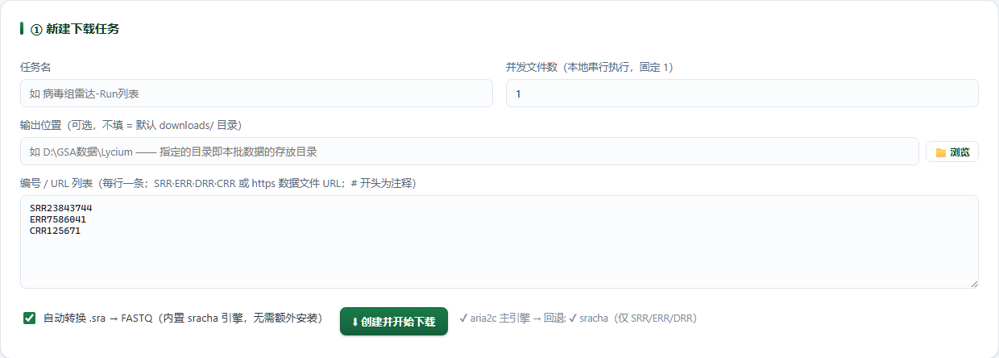

# Download · 公共数据下载

> 返回 [Home](Home) ｜ 上一页：[Logan-Fetch](Logan-Fetch) ｜ 下一页：[Ref-Data](Ref-Data)

批量取公共测序数据的总闸口：输入一批 accession / URL 与批次参数，产物是按批次归档、可直接进流水线的 FASTQ。批次完成后可一键建样品转入分析。

对应引擎：`Virus_Platform_Core/public_data.py`（accession 解析 + `DownloadManager` 下载 / 转换 / 校验）；页面：`Virus_Platform_Core/web/download.py` + `webapp/templates/download.html`，路由 `/download`；操作目录动作 `download_runs`（执行单，需用户批准）。

---

## 输入

### 输入格式

- 每行一条：SRR / ERR / DRR（ENA 直下 FASTQ.GZ）、CRR（NGDC / GSA）、任意数据文件 URL；`#` 开头为注释。
- 单批上限 500 条。

### 参数

| 参数 | 说明 |
|---|---|
| 任务名 | 必填；批次 id = `<任务名>_<YYYYmmdd_HHMMSS>` |
| 自动转换 `.sra → FASTQ` | 开关；打开后 `.sra` 转 FASTQ.GZ |
| 并发文件数 | 本地串行，固定 1 |
| 输出位置 | 可选；填了即批次目录本身，不再嵌一层 id；非空目录会提示同名文件将被覆盖 / 续传 |

## 流程

### 步骤一 · 编号解析

| 编号 | 解析路径 | 备注 |
|---|---|---|
| SRR / ERR | ENA filereport → 直出 `fastq_ftp` 链接（HTTPS） | ENA 未生成 FASTQ 时，只要 NCBI SRA 有该 run，改用 sracha 从 `.sra` 拉取 |
| DRR | 先 DDBJ（`dra/fastq/.../<acc>.fastq.bz2`）→ 再 ENA | DDBJ 与 ENA / NCBI 只共享元数据，原始文件留在提交方 archive |
| CRR | NGDC / GSA 搜索页 → browse 详情页 → 下载链接 | 自动过反爬验证页（Referer + auth_token）；cncb / big 双镜像同文件优先 cncb 主站 |
| 任一 SRR / ERR / DRR | 上述路径都解析失败时，兜底 sracha 直取 NCBI `.sra` | 返回里带原因写进批次日志，不做静默替换 |
| 任意 URL | 主机白名单 + 数据文件后缀白名单 | 文件名强制清洗，产物路径限定在批次目录内 |

- 解析失败会逐级记录原因，一次说清（如 `ENA 未返回…`、`DDBJ 目录不可达: HTTP 404`）。
- 双端 run 若 ENA 同时列出单端与 `_1/_2` 文件，只保留配对的两个。

### 步骤二 · 下载与校验

- aria2c：单文件 `-x 4 -s 4 -k 1M -c`（4 连接分段、1MB 分片、断点续传）；找不到 aria2c 时自动走内置 HTTP 下载，同样计速与断点。
- NGDC 低并发，防封控。
- 批次内串行：同一时间只允许一个批次在下载 / 转换（请求里的 `concurrency` 仅为兼容保留，固定 1）；多批次提交会排队，批次卡显示「等待中 · 第 N 批」。
- 完整性：ENA 给的字节数逐文件比对；再抽样做 gzip 魔数 + 解压检查；ENA 提供 `fastq_md5` 时一并留存（32 位十六进制才认）。

### 步骤三 · `.sra → FASTQ.GZ`

- 优先内置 `sracha`（`sracha fastq <sra> -O <批次目录> -t <线程> -f -q`，双端出 `_1/_2`、单端出 `<acc>.fastq.gz`），回退 `fasterq-dump --split-files`。
- sracha 为纯 Rust 引擎，比 fasterq-dump 快 5–13 倍，Windows 版已随平台编译，无需安装 sra-tools。
- 线程数 `max(2, min(CPU/2, 8))`；没有可用引擎时跳过转换，`.sra` 原样保留。

### 步骤四 · 状态机与批次操作

- 状态机：`resolving → downloading →（converting）→ completed / failed / cancelled / interrupted`；`interrupted` 可续传。
- 操作：暂停 / 继续（断点续传）、重试失败项、只重跑 `.sra` 转换、删除（记录 + 文件）、只删文件、只删记录。
- 任务中心：下载批次作为「外部任务」挂卡（不占并发名额、不落 `tasks/*.json`），可停止（转发到 `DownloadManager.cancel`，会 terminate aria2c / sracha 子进程）。

## 产物

### 目录结构

```text
downloads/<批次id>/
  <acc>_1.fastq.gz          双端 R1
  <acc>_2.fastq.gz          双端 R2
  <acc>.fastq.gz            单端 / 已转换的 FASTQ
  <acc>.sra                 没有可用转换引擎时原样保留
```

### 关键文件与字段

| 项 | 说明 |
|---|---|
| 批次目录 | 默认 `downloads/<批次id>/`；指定输出位置时该目录即批次目录 |
| FASTQ | `_1/_2` 双端配对或单端 `.fastq.gz` |
| `.sra` | 无可转换引擎时原样保留 |
| 文件下载 | `/downloads/<bid>/<文件名>`，严格限定在批次目录内 |

## 示例输入与输出

### 示例输入

```text
任务名：病毒组雷达-Run列表
编号 / URL：
SRR23843744
ERR7586041
CRR125671
```

### 示例输出

没有历史批次时只剩「① 新建下载任务」一张卡，下图即是它。



*图注：任务名同时是批次目录名（示例「病毒组雷达-Run列表」）。并发文件数本地串行，固定 1；输出位置可选，填了就作为批次目录本身。编号 / URL 列表每行一条（示例 SRR23843744 / ERR7586041 / CRR125671）。底部是「自动转换 .sra → FASTQ」开关与「⬇ 创建并开始下载」；按钮旁标注 aria2c 主引擎、sracha 回退（仅 SRR / ERR / DRR）。*

提交后进度、速度、ETA 与失败项都在下方批次卡里看，本批的 `.fastq.gz` 落在批次目录内。

## 界面与 CLI

### 界面

- 页面两段：① 新建下载任务——任务名、并发固定 1、可选输出位置、编号与 URL 列表、「自动转换 .sra → FASTQ」开关、「⬇ 创建并开始下载」。② 下载任务——批次卡给进度、速度、ETA、文件数、失败数、日志尾部与全部操作按钮。
- 「独立进度窗口」= `/download?pop=1`，可单独开窗挂机观察。
- 转入分析：批次完成后可勾选 run 调 `/api/dl/to_pipeline`，按 `_1/_2` 或单端 `.fastq.gz` 自动配对建样品（目录已存在且非空则跳过）。可选「加入批处理队列」（`enqueue`）；没有 R1 / 单端的条目会被跳过，不会留空样品目录。
- 上游入口：检索 / 预筛结果的「⬇ 转入数据下载」都写 `/api/dl/create` 后跳本页。

### CLI 与 agent

```text
无 main.py 独立子命令（下载由 DownloadManager 自管线程与状态）。
对外入口：
  Web   POST /api/dl/create           {name, items[], convert_sra, out_dir}
        POST /api/dl/batch/<bid>/<action>   pause|resume|cancel|retry|
                                            retry_convert|delete|
                                            delete_files|delete_record
        POST /api/dl/to_pipeline       {batch, runs[], project, enqueue}
  坞内 AI 执行单动作 download_runs（runs 1–500 条，需用户批准后执行）
```

## 相关

- 上游：先筛掉不含病毒的 → [Prescreen](Prescreen)；按物种找 Run → [Meta-Search](Meta-Search)
- 有现成组装就不必下 reads → [Logan-Fetch](Logan-Fetch)
- 下载后进流水线 → [Pipeline-Overview](Pipeline-Overview)
- 还要参考件（宿主基因组 / 病毒数据集） → [Ref-Data](Ref-Data)
- 本组总览 → [Public-Data](Public-Data)
