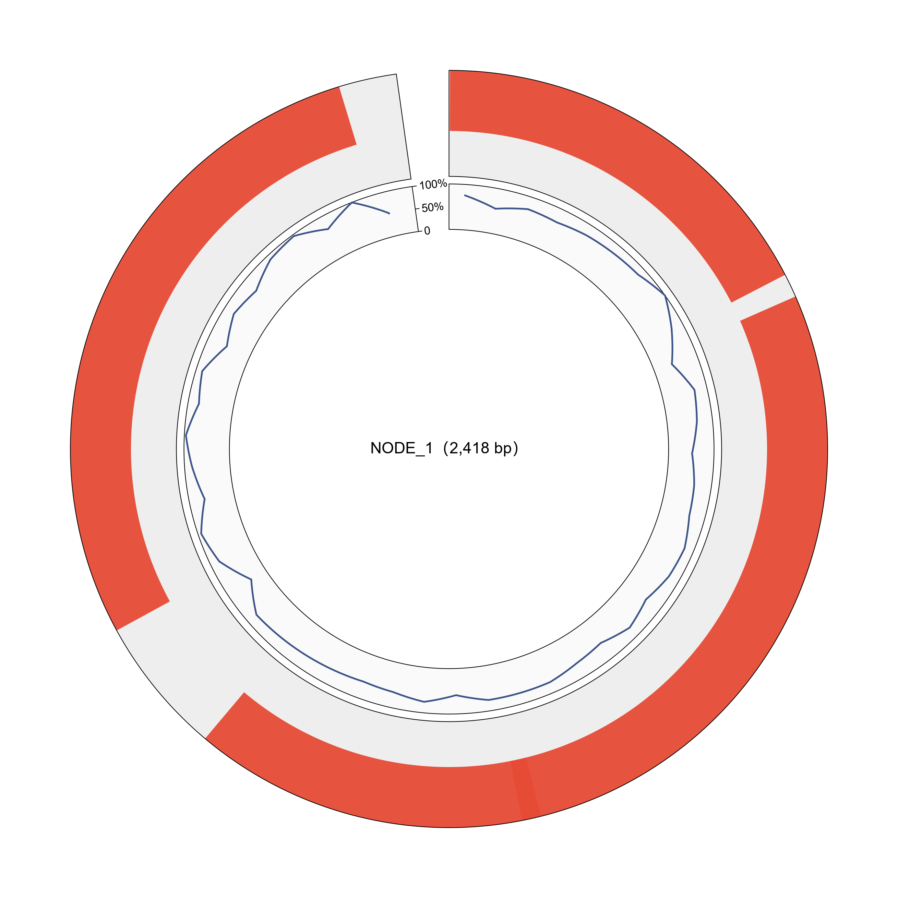

# Genome-Plots · 基因组图

> 返回 [Home](Home) ｜ 上一页：[ORF](ORF) ｜ 下一页：[NCBI-Submission](NCBI-Submission)

把 contig 的注释画成圈图与线图，供论文图版、幻灯片与报告使用。
默认读 ⑥ / ⑥b 的注释，也支持自备 FASTA + GFF3 或 GenBank 文件。

对应引擎：`gbdraw_plot.py`（gbdraw）、`dfv_plot.py`（dna_features_viewer 回退）；操作目录 id `genoplot`。

---

## 输入

### 输入格式

- 默认读 ⑥ / ⑥b 的注释产物，配对应的 contigs FASTA。
- 自备 FASTA + GFF3，或直接 GenBank `.gb` / `.gbk`。
- 自备文件可对任意病毒基因组出图，不限于本样品。

### 参数

| 参数 | 默认 | 说明 |
|---|---|---|
| `--plot-engine` | `auto` | `auto` / `gbdraw` / `dfv` |
| `--gbdraw-max` | 12 | 最多出图条数，按长度取最长 |
| `--gbdraw-fasta` | — | 自备 FASTA |
| `--gbdraw-ann` | — | GFF3，或直接给 GenBank `.gb` / `.gbk` |

## 流程

### 步骤一：选择引擎

| 引擎 | 定位 | 注释来源 |
|---|---|---|
| **gbdraw**（默认首选） | 圈图更精美（SVG 圈图 + 线图） | 自动取 ⑥ ORF 的 pyrodigal GFF3 |
| **dna_features_viewer（DFV）** | gbdraw 不可用时自动顶上（纯 Python，无外部 CLI） | 优先 ⑥b 的 `orf_annotation.gff3`（带 product / category，按结构蛋白 / 聚合酶等功能类别着色），回退 pyrodigal GFF3；支持 GenBank 输入 |

- 两引擎都未安装时 ⑨ 才灰显。
- DFV 随 `requirements.txt` 安装，因此实际很少触发。

### 步骤二：出图与嵌入报告

- 出图上限默认 12 条，按长度取最长。
- 结果文件为 `09_genome_plots/<contig>.circular.svg` 与 `.linear.svg`。
- SVG 内嵌 ⑩ 报告。

### 步骤三：Windows SVG MIME 处理

- Windows 注册表把 `.svg` 关联成非标准的 `image/svg`。
- Python mimetypes 照搬后，Flask 发出的 MIME 会让 Chromium 拒绝解码。
- 表现为 `` 裂图、`naturalWidth=0`。
- `app.py` 建应用前已 `mimetypes.add_type('image/svg+xml', '.svg')`。
- 该修复在 `app.py` 里，源码运行即时生效。

## 产物

### 目录结构

```text
run/results/<样品>/09_genome_plots/
├── <contig>.circular.svg    圈图
└── <contig>.linear.svg      线图
```

### 关键文件与字段

| 文件 | 内容 |
|---|---|
| `<contig>.circular.svg` | 环状基因组图，含 CDS 方向、GC content、GC skew |
| `<contig>.linear.svg` | 线状基因组图，含 CDS 方向与比例尺 |
| ⑩ 报告 | 内嵌上述 SVG |

## 示例输入与输出

### 示例输入

组装 contigs FASTA，默认取 `contigs.filtered.fasta`。
头里的长度 / 覆盖度用于选图与标注；序列交给 ⑥ 注释后出 GFF3 再绘图。

```text
>NODE_1_length_2418_cov_4.587207
TGACAATACTGTTAAGCAAGTGTATGCCGGTGACGACATGGCATTAGATGGAGTTGTGAG
TGAAAAGAAATCATTCAGGAAGTTGCAAAATCTACTAAAACTCACTTCAAAAACTCTGTA
```

### 示例输出

`09_genome_plots/<contig>.circular.svg / .linear.svg`，SVG 内嵌 ⑩ 报告，PNG 预览如下。



*图注：外圈红色弧段 = 预测的 ORF / 基因特征，按链与功能类别着色，缺口处为特征间隔；内圈蓝色折线 = 沿基因组的 GC 含量，刻度 0–100%，中间基线为 50%；圆心标注 contig 名与长度。GC 折线明显偏离 50% 的区域值得回到 ORF 表核对。*

## 界面与 CLI

### 界面

- 分析管道 ⑨ 阶段卡：出图引擎、最多出图条数、自备 FASTA / GFF3 / GenBank 输入 → 运行。
- 结果文件在 `09_genome_plots/` 下，可单独取用。

### CLI 与 agent

```bat
python main.py analyze --r1 ... --sample S1 --stages gbdraw --plot-engine auto --gbdraw-max 12
python main.py analyze ... --gbdraw-fasta x.fa --gbdraw-ann x.gff   :: 自备文件
python main.py analyze ... --gbdraw-ann x.gb                        :: GenBank 直接出图
```

- 外部 agent 走操作目录 id `genoplot`（MCP `vp_run_tool`）。

## 相关

- 注释从哪来 → [ORF](ORF)（⑥ GFF3 / ⑥b 带功能类别的 GFF3）
- 图如何汇总 → [Report](Report)
