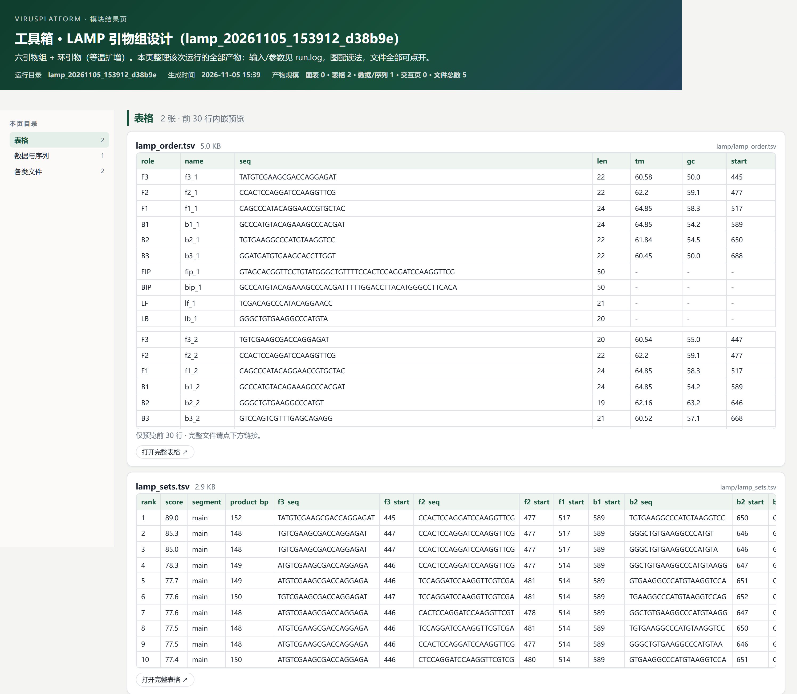

# LAMP-Design · LAMP 引物组设计

> 返回 [Home](Home) ｜ 上一页：[CRISPR-Design](CRISPR-Design) ｜ 下一页：[DsRNA](DsRNA)

多分离物目标 FASTA 进来，一整套 LAMP 六引物组订单表出来。链路：MAFFT 共识 → 保守区逐窗枚举 → 评分排序 → 订购表。输入是目标分离物 FASTA（可多分体），产物是序号化引物组、布局图与序列对照页。

对应引擎：`Virus_Platform_Core/lamp_design.py`（净室实现，参数口径参考 primer.uni-shine.cn 参数面与 Notomi 2000 以来的公共约束）。工具卡 `t-lamp`（检测与防治 → LAMP 引物组设计）；CLI `main.py lamp-design`；操作目录 id `lamp`。

## 输入

### 输入格式

- 目标 FASTA：多分离物序列，可多分体；按片段标签自动分组（`group_by_segment` 默认开）。
- 保守区取自组内 MAFFT 共识，按 `cons_min` 决定段窗是否入选。

### 参数

| 参数 | 默认 | 说明 |
|---|---|---|
| `product_min` / `product_max` | 120 / 180 | F2-B2 产物区间 bp |
| `use_loop` | 开 | 设计 LF / LB 环引物（CLI `--no-loop` 关闭） |
| `cons_min` | 0.85 | 段窗保守分下限（多分离物） |
| `gc_min` / `gc_max` | 30 / 65 | 引物 GC 区间 %（高 GC 靶标可到 75，高 AT 可到 20） |
| `tm_offset` | 0 | Tm 区间偏移 −6~+6，只放宽对应侧、不改排序 |
| `preset` | — | 界面智能预设：`high_gc`（GC 30–75 + Tm +2）/ `high_at`（GC 20–65）；只扩不缩，任一预设的出组数 ≥ 默认 |
| `top_n` | 20 | 输出组数（CLI `--top-n`） |
| `threads` | — | MAFFT 线程数 |

## 流程

### 步骤一：共识与保守区枚举

1. 多分离物组内做 MAFFT，取列共识。
2. 按 `cons_min` 过滤段窗，逐窗枚举六引物组候选。

### 步骤二：引物长度、Tm 与 GC

- 长度：F3 / B3 18–24 nt；F2 / B2 18–24 nt；F1 / B1 19–25 nt；LF / LB 16–24 nt。
- Tm 名义区间：区间外 53–62.5 / 内 56–66 / 中 59–68，与 uni-shine 名义区间一致。
- 排序目标用盐校正后的物理等效值：外 52 / 内 56 / 中 58。它是把 uni-shine 的 58 / 62 / 64 减去高盐对 primer3 50 mM 的 ~6°C 系统差。
- GC 默认 40–60%，对齐其 0.40–0.60；高 GC / 高 AT 预设可扩。

### 步骤三：间距与产物区间

- 间距：F3-F2 ≤60 / F2-F1 10–40 / F1-B1 40–120 / B1-B2 10–40 / B2-B3 ≤60；F3-F2 上限对齐其严格模式 ≤60。
- 产物 F2-B2：120–300 bp，取其 100–500 与 LAMP 工艺 120–180 的折中；opt 150 维持扩增速度最优的排序偏好。

### 步骤四：拼接与 QC

- 拼接：FIP = revcomp(F1 区) + TTTT + F2 区；BIP = B1 区 + TTTT + revcomp(B2 区)。
- QC：all-pairs 二聚体快筛（`complementarity_pct`）+ top 组 DNA 发泡复核、同聚物 <5、3′ 端 GC 规避。

## 证据边界

### 实验分级

计算设计仅支持候选优先级排序，不构成扩增效率、引物间干扰或基质性能的证据。实验结论须按 L1–L5 逐级建立，LAMP 段补 65°C Bst 酶体系、内外引物浓度比与环引物增益。

## 产物

### 目录结构

```text
run/tool_runs/lamp_<ts>/lamp/
├── lamp_order.tsv        订购表（每引物一行）
├── lamp_sets.tsv         排序表（六引物 + FIP/BIP 序列与坐标）
├── primer_layout.png    引物组布局图
├── primer_layout.svg    同图矢量版
├── sequence_view.html   逐碱基序列-引物对照
├── report.md            文字报告
├── summary.json         摘要
└── results.html         模块结果页（module-report 生成）
```

### 关键文件与字段

| 文件 | 内容 |
|---|---|
| `lamp_order.tsv` | 每条引物一行：`role` / `name` / `seq` / `len` / `tm` / `gc` / `start`，十条一组（F3、F2、F1、B1、B2、B3、FIP、BIP、LF、LB） |
| `lamp_sets.tsv` | 排序表：`rank` / `score` / `segment` / `product_bp` 与各引物坐标 |
| `primer_layout.png` / `.svg` | 引物组布局图：Top 组引物位置色块 + F2-B2 产物区 + 图例 |
| `sequence_view.html` | 每 80 bp 一块，5′ Target / 5′ Comp 双链对齐，引物结合区按段着色，图例带 Tm |
| `results.html` | 模块结果页，可经 `python main.py module-report --run <运行名>` 生成 |

## 示例输入与输出

### 示例输入

以运行 `lamp_20261105_153912_d38b9e` 为例：输入为目标分离物 FASTA，片段标记 `main`，输出十组引物（含 LF / LB 环引物）。

### 示例输出



*图注：本次运行 `lamp_20261105_153912_d38b9e` 的模块结果页（2026-11-05 15:39 生成）。上表 `lamp_order.tsv` 为订购表，逐行给出 role / name / seq / len / tm / gc / start，十条引物一组，多组依次排列。下表 `lamp_sets.tsv` 为排序表，列出 rank / score / segment / product_bp 及各引物坐标。十组均来自 main 片段，按评分从 89.0（152 bp）递减到 77.4；前三名 89.0 / 85.3 / 85.0 的产物为 148–152 bp。从「检测与防治」组 t-lamp 卡运行后，结果同样出现在运行历史与结果中心。*

## 界面与 CLI

### 界面

工具箱 → 检测与防治 → LAMP 引物组设计（`t-lamp` 卡）：表单输入目标 FASTA，可调产物区间、环引物、保守分、GC 与 Tm 偏移；结果区给排序表与布局图。

### CLI 与 agent

```bat
python main.py lamp-design -i 目标分离物.fasta [--no-loop] [--top-n 20]
```

- agent：操作目录 id `lamp`，MCP 调用 `vp_run_tool(tool='lamp', params={input: ...})`；schema 查询 `python main.py agent-ops --id lamp --schema`。

## 相关

- 组导读 → [Detect-Intro](Detect-Intro)
- 引物设计（PCR / qPCR）→ [Primer](Primer)
- CRISPR 试剂设计（`--amp LAMP` 档内嵌 LAMP 六引物组内核）→ [CRISPR-Design](CRISPR-Design)
