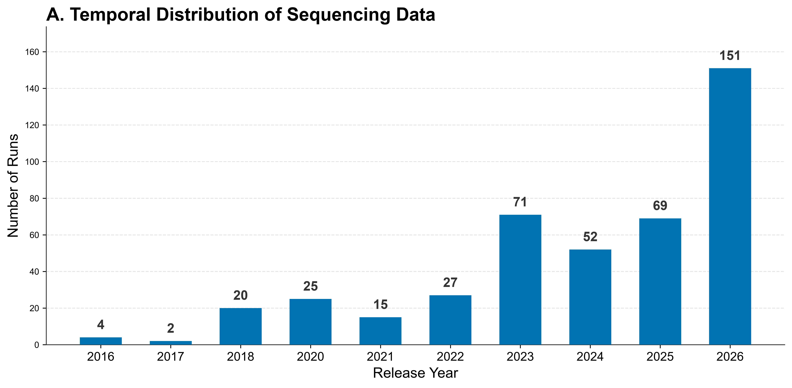

# Meta-Search · 公共数据检索

> 返回 [Home](Home) ｜ 上一页：[Public-Data](Public-Data) ｜ 下一页：[Prescreen](Prescreen)

输入一个物种拉丁名，得到一张可编辑、可绘图的 Run 表。它把 NCBI SRA 与 CNCB NGDC GSA 的公共测序条目合成检索表，再统一成 Core14 / Full 两档元数据，并出出版级图组。它是本组「检索 → 预筛 → 下载 → 建库」链路的起点，本身不下载测序数据。

对应引擎：`public_meta/search_engine.py`（SRA + GSA 双引擎）、`public_meta/info_engine.py`（Run → Core14 / Full）、`public_meta/landscape_plot.py`（出版级图组）；页面：`Virus_Platform_Core/web/meta.py` + `webapp/templates/meta.html`，路由 `/meta`；操作目录 id 无（agent 走 CLI 子命令）。

---

## 输入

### 输入格式

- **检索**：物种拉丁名，必填，如 `Lycium chinense`。
- **元数据提取**：Run 编号列表文件（每行一条）或单个编号；Web 端粘贴框留空 = 取当前项目的检索结果——从 `search/SRA_GSA_Merged_Final.csv` 取 `Run` 列（缺 `Run` 列当场报错），并落 `info_runs.txt` 作为本次输入清单。
- **绘图**：Web 端按 Core14 → Full → 检索表的优先级取表，取到哪个画哪个；都没有时提示先检索。

### 参数

| 参数 | 界面 | CLI / 引擎 | 说明 |
|---|---|---|---|
| 物种拉丁名 | 必填 | `--species` / `-q` | 如 `Lycium chinense` |
| 测序类型 | 下拉 | `--source` | 默认 `TRANSCRIPTOMIC`；`GENOMIC` / `All`（不限） |
| 目标库 | 下拉 | `--db` | `sra` / `gsa` / `both`（默认） |
| 详细模式 | 勾选 | `--no-detailed` 关闭 | 默认开启；关掉后不出 Tissue / Location / 发育阶段列 |
| GSA 并发 | 数字 | `--workers` | 1–20，默认 5；越高越快、越易被 NGDC 限流 |
| NCBI Key | 设置项 | `--ncbi-api` / 环境变量 `NCBI_API_KEY` | 提升 E-utilities 速率 |
| DeepSeek Key | 设置项 | `--deepseek-api` / 环境变量 `DEEPSEEK_API_KEY` | 配了才做 AI 清洗；未配自动降级为纯规则 |
| AI 统计段落 | — | `--summary` | 需同时给 `--deepseek-api` |
| 项目名 | 项目条（当前项目 / 切换） | `--out`（CLI 产物目录） | 检索每次自动新建项目；留空按 `<物种slug>_<YYYYmmdd_HHMM>` 建，同分钟撞名顺延 |

## 流程

### 步骤一 · SRA + GSA 双库检索

- 检索引擎源自 MMPV-RNA 的 `public_metadata_pipeline`。
- NCBI SRA（esearch / esummary）与 CNCB NGDC GSA 按物种检索，结果合并。
- 两表先各加 `Database` 列，再按 `Run` 去重（`drop_duplicates(subset=['Run'])`），同一条 Run 不会出现两行。
- 两个库分头抓取，任一来源失败不影响另一来源；全失败才非零退出，原因写 `source_status.json`。

### 步骤二 · 详细模式与 AI 清洗

- 详细模式开启时解析 Tissue / Location / 发育阶段三类字段。
- 详细模式开启时，配了 DeepSeek Key 就对合并后的整表过一遍 AI 清洗，只做去污染 / 归位 / 格式标准化，不许凭空补值；未配 Key 则走纯规则模式。
- `--summary` 出项目级 AI 统计段落，需同时给 Key。

### 步骤三 · 统一元数据（Core14 / Full）

- Run 列表（SRR / ERR / DRR / CRR）→ Core14 / Full 统一元数据。
- Core14 的 14 列：`Run` / `ReleaseDate` / `CollectionDate` / `Location` / `Source` / `Tissue` / `Age_GrowthStage` / `ScientificName` / `TaxID` / `LibrarySource` / `CenterName` / `BioProject` / `BioSample` / `PMID`。
- Full 是在其上的 34 列全维表，多出 `SRAStudy` / `ProjectID` / `Sample` / `SampleName` 等溯源列。
- `local` / `api` / `both` 三模式：`local` 纯本地规则解析（不调 LLM）；`api` 调 DeepSeek；`both` 规则打底、AI 补缺。Web 端未给 Key 时自动落 `local`，Key 优先级 = 请求体 > 环境变量 `DEEPSEEK_API_KEY` > `local`。
- 取值纪律：精确 ID 类字段必须取原始元数据，包括 Run / BioProject / BioSample / TaxID / LibrarySource / CenterName 等。生物特征类（Tissue / Source / CollectionDate / Age_GrowthStage）原始有值时 AI 不得覆盖，只在其为空时补。
- `--fill-date`：CollectionDate 缺失时用 ReleaseDate（GSA 用 LoadDate）回填，并新增 `CollectionDate_source` 列标注来源（`submitted` / `release` / `load`）。主列口径不变。

### 步骤四 · 出版级图组（meta-plot）

- 图组：一张 3×2 合并总览 `Combined_Landscape_Full`（PNG 600dpi + PDF 矢量 + SVG），加六张独立图。
- 六张独立图：`Panel_A_temporal`（采样时间）/ `Panel_B_database`（数据来源 SRA / GSA 占比）/ `Panel_C_organizations`（机构排名）/ `Panel_D_tissues`（组织类型）/ `Panel_E_regions`（地理分布）/ `Panel_F_stages`（发育阶段）。
- 输入表为 `search/SRA_GSA_Merged_Final.csv` 时，引擎对列名做了兼容（新版与早期列名都能识别），可先出初步全景。
- 页内「图表」页签另给交互式概览（各列 Top 取值 / 缺失率 / 年份分布）。

## 产物

### 目录结构

```text
run/meta_search/<项目>/
  search/
    SRA_GSA_Merged_Final.csv       合并去重后的检索表
    download_links.csv             逐 Run 直链 + md5
    query.json                     检索快照
    source_status.json             各来源成功 / 失败状态
  info/
    Global_Unified_Metadata_Core14.csv|.tsv
    Global_Unified_Metadata_Full.csv|.tsv
  plot/
    Combined_Landscape_Full.{png,pdf,svg}
    Panel_A_temporal · Panel_B_database · Panel_C_organizations
    Panel_D_tissues · Panel_E_regions · Panel_F_stages
```

### 关键文件与字段

| 文件 | 内容 |
|---|---|
| `search/SRA_GSA_Merged_Final.csv` | 合并去重后的检索表（`Database` / `Run` / `BioProject` / … / `FileSize_GB`） |
| `search/download_links.csv` | 逐 Run 直链 + md5（列：`Run`, `Database`, `url_1`, `md5_1`, `url_2`, `md5_2`） |
| `search/query.json` | 检索快照：检索式 / 各库命中数 / UTC 抓取时间 / 是否 detailed |
| `search/source_status.json` | 各来源成功 / 失败状态 |
| `info/Global_Unified_Metadata_Core14.csv` / `.tsv` | 14 列核心元数据表；CSV 带 BOM，Excel 直开不乱码，CSV / TSV 同内容 |
| `info/Global_Unified_Metadata_Full.csv` / `.tsv` | 34 列全维表：Core14 加 `SRAStudy` / `ProjectID` / `Sample` / `SampleName` 等溯源列 |
| `plot/` | 出版级图组：3×2 合并总览加六个面板，每个面板 PNG + PDF（有 SVG 后端时补 SVG） |

## 示例输入与输出

### 示例输入

```bat
python main.py meta-search --species "Lycium barbarum"
```

以该物种检索为例，产物项目为 `run/meta_search/Lycium_barbarum_20261014_2314/`：图组 B 面板给出 SRA 436 条、GSA 152 条。

### 示例输出

`plot/` 下的合并总览把六个维度压进一张 3×2 图：A / B 上排、C / D 中排、E / F 下排，每格 600dpi。同一个项目另有六张独立面板可单独取用。


*图注：A 为 Release Year 柱状分布（2016–2026 共 10 根柱，2026 年 151 条最高，2019 年整根缺席）。B 为数据来源环形图（SRA 蓝 74.1%、n=436，GSA 橙 25.9%、n=152）。C 为 Top 10 机构横向柱（Ningxia University 86 条居首，Qinghai University 69、Ningxia Academy of Agriculture and Forestry … 63 次之）。D 为组织类型（Fruit 227、Leaf 159 明显领先，其余各项 ≤39）。E 为采样地区（China, Ningxia 84、China, Qinghai 60、China, Yinchuan 47 为前三，配色为橙）。F 为发育阶段 / 年龄（Seedling Stage 60、Fruiting Period 36 领先，配色为绿）。六个面板横轴统一为 Number of Runs，每根柱 / 条末端直接标数值，可跨面板直接比量级。*

单看某一维时用独立面板更清楚，下图是从同一项目单独导出的 A 面板。



*图注：横轴 Release Year、纵轴 Number of Runs，柱顶标数值：2016=4、2017=2、2018=20、2020=25、2021=15、2022=27、2023=71、2024=52、2025=69、2026=151。2019 年整根柱缺失（该年无入库 Run），不是绘图漏项。从 2017 年的 2 条爬到 2026 年的 151 条，这条曲线通常就是「这个物种为什么现在做」的立项依据。*

合并版适合放进汇报一页讲全貌，单图版适合按维度嵌进论文正文；两者数值完全一致，差别只在版式与留白。

## 界面与 CLI

### 界面

- 页面共 8 个页签：① 检索 · S-浏览 / S-编辑 / S-图表（检索结果三视角）· Info 提取 · I-浏览 / I-编辑 / I-图表（Core14 三视角）。
- 表格：双击单元格直接改、行级记录详情可编辑、勾选行可删；支持导入 `.csv/.tsv/.txt/.xlsx/.xls` 整表替换，导出 `csv/tsv/xlsx`。
- AI 工具：AI 补全缺失（DeepSeek）对 9 列逐条清洗补全，列为 CollectionDate / Location / Source / Tissue / Age_GrowthStage / ScientificName / LibrarySource / CenterName / BioProject。AI 总结出项目级统计段落。
- 项目卡：显示检索条数 / Core14 条数 / 图表数；Core14 条数与检索条数不一致时标「过期」，提示重新提取。
- 跨模块交接：勾选 Run（或行内 ⬇）→「⬇ 勾选 Run 转入数据下载」写 `/api/dl/create` 后跳 `/download`；行内 🧬 先查该 Run 在 Logan 桶有无组装，有则带 accession 跳「LOGAN 数据下载」卡。
- 结果文件可直接经 `/meta_files/<项目>/<子路径>` 下载 / 预览（严格限定在项目目录内）。

### CLI 与 agent

```bat
python main.py meta-search --species "Lycium chinense"
python main.py meta-search --species "Lycium chinense" --db sra --source TRANSCRIPTOMIC --no-detailed
python main.py meta-info --runs meta_search\Lycium_chinense\search\sra.list --fill-date
python main.py meta-info --runs SRR24100141
python main.py meta-plot --input meta_search\...\SRA_GSA_Merged_Final.csv
```

> 注：检索引擎产出的是元数据表（`SRA_GSA_Merged_Final.csv`），不自动写 `.list` 文件；`meta-info --runs` 要的是每行一个编号的列表。Web 端会自动从检索表取 `Run` 列（落 `info_runs.txt`），CLI 侧可自备 `.list/.txt`，或直接给单个 Run 编号。

- agent：无操作目录 id，走上述 `meta-search` / `meta-info` / `meta-plot` 子命令。

## 相关

- 下一步：这批 Run 先筛一遍 → [Prescreen](Prescreen)
- 直接取 FASTQ → [Download](Download)
- 公共病毒组浏览 / 检索 → [Open-Virome](Open-Virome)
- 本组总览 → [Public-Data](Public-Data)
