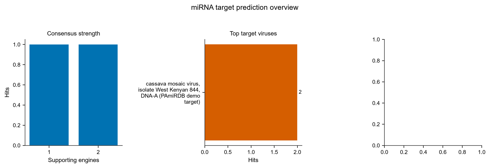
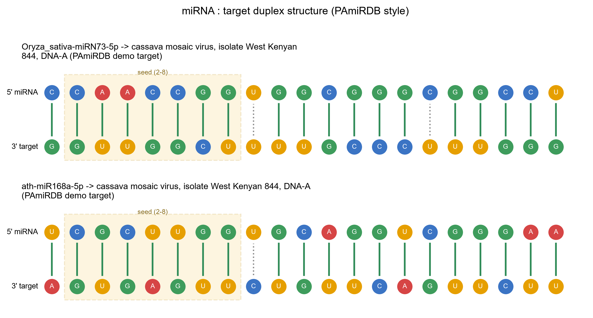

# Mirna · miRNA 靶标预测（PAmiRDB）

> 返回 [Home](Home) ｜ 上一页：[DsRNA](DsRNA) ｜ 下一页：[Compare](Compare)

宿主 miRNA 与病毒序列放在一起，找出可能的沉默靶点。Smith-Waterman 比对打底，psRNATarget / RNAhybrid 复刻引擎共识投票，完整模式追加 RNA22 / TAPIR / psRobot。输入是 miRNA 与病毒序列两组 FASTA，产物是结合位点表、彩色比对、双链 SVG 与二级结构弧图。

对应引擎：`Virus_Platform_Core/mirna_target/`（PAmiRDB 7 文件移植包：alignment / consensus / psrnatarget / rnahybrid / rna22 / tapir / psrobot）。工具卡 `t-mirna`（检测与防治 → miRNA 靶标预测）；无 CLI 子命令；操作目录 id `mirna`。主引擎纯 Python、无外部依赖；交叉验证用的官方二进制随包内置（`3rd/tools/srna-target/`）。

## 输入

### 输入格式

| 输入 | 说明 |
|---|---|
| miRNA | FASTA 或每行一条纯序列（≥15 nt，`U` 可直接写）；可从内置候选库选（`databases/mirna_lib/plant_mirna_library.tsv`，80,272 条植物成熟 miRNA / 799 物种） |
| 病毒序列 | FASTA，可多条；超 15 kb 截断到 15 kb（PAmiRDB v7 管线口径） |
| 规模上限 | miRNA × 病毒组合数 ≤ 5,000 对 |

- 字母表：miRNA 用 RNA 字母表；病毒序列可为 DNA 或 RNA，U / T 由引擎自动归一。

### 参数

| 参数 | 默认 | 说明 |
|---|---|---|
| `mirna_text` / `mirna_fasta` | 二选一 | 粘贴 miRNA 序列或给 FASTA 路径 |
| `virus_text` / `virus_fasta` | 二选一 | 粘贴病毒序列或给 FASTA 路径 |
| `algorithms` | miRanda + psRNATarget + RNAhybrid | 参与投票的引擎，逗号或空格分隔；miRanda 必选 |
| `full_mode` | 关 | 完整模式，追加 RNA22 / TAPIR / psRobot |

- 引擎打分口径与 PAmiRDB 线上版一致，不要单独改单个引擎的阈值，否则共识等级与线上库不可比。

## 流程

### 步骤一：Smith-Waterman 基座比对

miRanda 打底：Smith-Waterman 比对，带 seed 2–8 配对约束，必选。

### 步骤二：多引擎共识投票

1. 默认由 psRNATarget + RNAhybrid 复刻引擎参与投票。
2. 完整模式或手工勾选时追加 RNA22、TAPIR、psRobot。
3. 按支持引擎数给共识等级 LOW → VERY HIGH，越多越可靠；`consensus_detail` 记逐引擎结论。

### 步骤三：交叉验证列

另跑官方二进制 miRanda v3.3a / RNAhybrid / PITA（`3rd/tools/srna-target/`），作为并列列写入合并表。二进制缺失时该层为空，不影响共识投票。

### 步骤四：规模控制

先算 miRNA × 病毒组合数，超过 5,000 对即拒跑；单条病毒序列超 15 kb 先截断再比对。

## 产物

### 目录结构

```text
run/tool_runs/<mirna_run>/mirna_target/
├── results.json              全部命中（逐对全字段）
├── results.tsv               扁平表（21 列：共识等级 / 能量 / seed / 位点 / 各引擎分）
├── mirna_targets_merged.csv  sRNA 风格合并表（含官方二进制交叉验证列）
├── mirna_report.html         可排序表格 + 比对视图（双击离线可看）
└── summary.json              摘要（请求 / 实际 / 跳过引擎、共识分布、耗时）
```

### 关键文件与字段

| 文件 | 内容与关键字段 |
|---|---|
| `results.json` | 逐对全字段命中，含 `consensus_detail` 的逐引擎结论 |
| `results.tsv` | 21 列扁平表：共识等级、能量、seed、结合位点、各引擎打分 |
| `mirna_targets_merged.csv` | sRNA 风格合并表，附官方二进制交叉验证列（miRanda v3.3a / RNAhybrid / PITA） |
| `mirna_report.html` | 可排序表格与比对视图，双击离线可看 |
| `summary.json` | 请求 / 实际 / 跳过的引擎、共识分布、耗时 |

## 示例输入与输出

### 示例输入

植物 miRNA FASTA（RNA 字母表，`U` 可直接写；下方为 `examples/example_mirna.fasta` 的真实片段）加病毒靶标 FASTA（DNA 或 RNA，U / T 由引擎自动归一）。

```text
>ath-miR168a-5p Arabidopsis thaliana（抗病毒相关：靶向 AGO1）
UCGCUUGGUGCAGGUCGGGAA
>Oryza_sativa-miRN73-5p Oryza sativa（PAmiRDB 生产命中对：vs ACMV NC_001467.1）
CCAACCGGTGGCGGGCGGCCT
```

```text
>ACMV|NC_001467.1|geminiviridae|African
ATGCGTACGTACGTACGTACGTACGTACGTACGTACGT
```

### 示例输出

`mirna_targets_merged.csv`（逐靶标对：引擎、共识等级、MFE、靶标起止）、`results.tsv`、`mirna_report.html`，以及总览图。



*图注：左面板按支持引擎数统计命中数（柱越高表示越多靶标对同时被几个引擎支持，共识越可靠），中面板列出命中数最多的靶标病毒；本示例右侧面板没有数据，是因为有效 MFE 条目不足 3 条、直方图未绘制，不代表阴性结果。*



*图注：PAmiRDB 风格的 duplex 图——上行 5′ miRNA、下行 3′ target，米色虚线框为 seed 区（第 2–8 位），绿竖线 = Watson-Crick 配对，灰点线 = 错配 / GU 摆动；看图要点：seed 区连续配对是命中可信的核心，3′ 端额外互补可加分，中部出现成段错配则需复核。*

## 界面与 CLI

### 界面

工具卡 `t-mirna` 三步：

1. miRNA：粘贴或 FASTA，可「📚 从候选库选择」。
2. 病毒序列：粘贴或 FASTA。
3. 引擎勾选：miRanda 必选 + 5 个可选。

运行后结果区给命中表与 duplex / 弧图。

### CLI 与 agent

`main.py` 没有 `mirna` 子命令，CLI 入口不存在。

- agent：操作目录 id `mirna`，schema 查询 `python main.py agent-ops --id mirna --schema`，执行走 MCP `vp_run_tool`。

## 相关

- 同组的 dsRNA 设计（RNAi 防控分子）→ [DsRNA](DsRNA)
- 检测端 CRISPR 试剂设计 → [CRISPR-Design](CRISPR-Design)
- 其他单步工具与产物目录 → [Toolbox](Toolbox)
