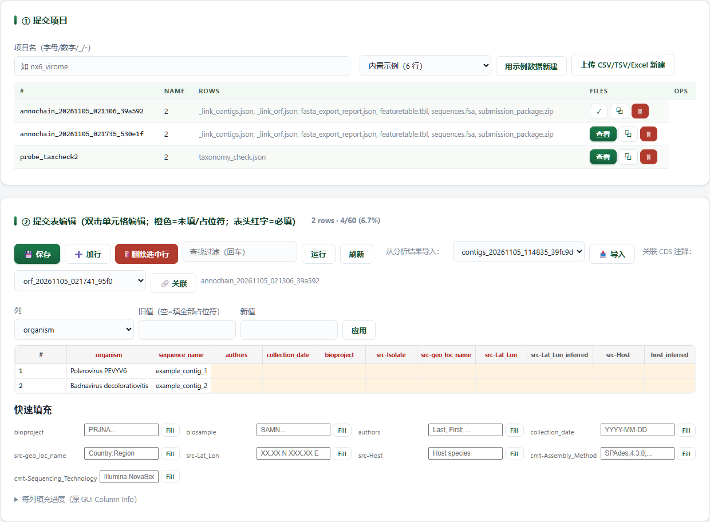

# NCBI-Submission · NCBI 提交准备

> 返回 [Home](Home) ｜ 上一页：[Genome-Plots](Genome-Plots) ｜ 下一页：[Detect-Intro](Detect-Intro)

导航「提交准备」页以 `unified_metadata.csv` 一张表驱动 GenBank + BioSample 提交准备。
最终走 NCBI BankIt 网页向导或 Sequin 桌面程序。

对应引擎：`Virus_Platform_Core/ncbi_submit/`。
子模块为 unified_metadata / store / report_html / adopt_mmpv / templates。
`.sqn` 生成编排由 `suvtk_submit.py` 负责。

---

## 输入

### 输入格式

- 主表 `unified_metadata.csv`：一行一个提交记录，GenBank 与 BioSample 共用。
- 序列 FASTA：用于生成 `sequences.fsa` 与 source modifiers。
- 建表可选输入：`taxonomy.tsv`（contig↔taxonomy）。
- 也可用公共元数据表（Core14/Full），或已有 unified CSV / TSV / Excel。

### 参数

| 参数 | 说明 |
|---|---|
| `--name` | 提交项目名 |
| `--taxonomy` | contig↔taxonomy 表，自动生成初表 |
| `--metadata` | 公共元数据表（Core14/Full），自动填日期 / 地点等 |
| `--import-csv` | 从已有 unified CSV / TSV / Excel 导入 |
| `--demo` | 示例数据建表 |
| `--authors` / `--title` | 作者与标题 |
| `--column` / `--value` | 按列批量填充 |
| `--assembler` / `--sequencer` / `--enrichment` | 导出时写入的组装与测序信息 |
| `--out-dir` / `--from-server` | 收编数据源：本地目录 / ssh+scp 拉取 |
| `--dry-run` / `--no-export` | 只报会生成什么 / 不导出 |
| `--last` / `--first` / `--affil` / `--city` / `--country` / `--email` | 作者 ASN.1 字段 |

## 流程

### 步骤一：建表（submit-init）

- `--taxonomy taxonomy.tsv`（contig↔taxonomy）自动生成初表。
- `--metadata` 接公共元数据表（Core14/Full），自动填日期 / 地点等，与 [Public-Data](Public-Data) 打通。
- `--import-csv` 从已有 unified CSV / TSV / Excel 导入。
- `--demo` 用示例数据建表。

### 步骤二：在线编辑与批量填充

- 在提交表编辑器里补全橙色占位符。
- 可双击单元格改值，也可按列批量替换。
- 编辑、预览与导出的细节见「界面」。

### 步骤三：校验（submit-validate）

- 提交前逐项检查必填字段，结果写 `validation_report.txt`。

### 步骤四：生成提交产物（submit-export）

- 产出 `source.src`、`sequences.fsa` 与提交包。
- 导出时可带 `--assembler` / `--sequencer` / `--enrichment` 元数据。
- 产物统一落 `run/submissions/<项目名>/`。

### 步骤五：一键收编（submit-adopt）

- 从 MMPV-RNA discovery 产物（`09b_Analysis_Verify/` 或 `08_Rescue/`）一键建提交项目。
- 数据源二选一：本地 `--out-dir`，或 `--from-server`（ssh / scp 拉取）。
- 自动以数据集名作 Isolate 前缀，按样本元数据表匹配 contig。
- 兜底元数据单样本或多样本逐项可指定。
- `--dry-run` 只报会生成什么。

### 步骤六：作者 ASN.1（submit-sbt）

- `--last` / `--first` / `--affil` / `--city` / `--country` / `--email` 生成 `authorset/template.sbt`。

### 范围与限制

- 不引入原管线的 suvtk / tbl2asn（Linux 依赖）。
- **特征表（.tbl）与 Sequin 包构建不在本模块范围**。
- 用 BankIt 网页向导提交 `source.src` + 序列即可。
- 若后续需要 `.sqn`：本地 `.sqn` 生成编排已就绪（`suvtk_submit.py`），在装有 suvtk 的环境补跑。

## 产物

### 目录结构

```text
run/submissions/<项目名>/
├── unified_metadata.csv        提交主表
├── source.src                  GenBank source modifiers
├── source_individual/          按病毒拆分的 source modifiers
├── biosample_template.tsv      BioSample 批量注册
├── miuvig.tsv                  MIUViG 结构化注释
├── assembly.tsv                组装元数据
├── authorset/template.sbt      作者 ASN.1
├── report.html                 交互式提交报告（可编辑）
├── validation_report.txt       校验结果
├── sequences.fsa               序列 FASTA
└── submission_package.zip      提交包
```

### 关键文件与字段

| 产物 | 用途 |
|---|---|
| `source.src` | GenBank source modifiers，含 `source_individual/` 按病毒拆分 |
| `biosample_template.tsv` | BioSample 批量注册 |
| `miuvig.tsv` / `assembly.tsv` | MIUViG 结构化注释 / 组装元数据 |
| `authorset/template.sbt` | 作者 ASN.1 |
| `report.html` | 交互式提交报告，可编辑 |
| `validation_report.txt` | 校验结果 |
| `sequences.fsa` | 序列 FASTA |
| `submission_package.zip` | 提交包 |

## 示例输入与输出

### 示例输入

```text
D:/submit_in/
├── unified_metadata.csv     提交主表（一行一个提交记录）
├── sequences.fsa            与表行对应的序列
└── taxonomy.tsv             contig ↔ taxonomy（submit-init --taxonomy 用）
```

### 示例输出



*图注：`/submit` 主区域——上半「① 提交项目」：项目名输入、内置示例下拉、「用示例数据新建」「上传 CSV / TSV / Excel 新建」，下方项目列表显示行数、已生成文件与查看 / 复制 / 删除操作；下半「② 提交表编辑」：保存 / 加行 / 删除选中行、按列批量填充（列 → 旧值 → 新值 → 应用），以及 `unified_metadata.csv` 网格。橙色单元格是未填占位符，红色表头是必填列，底部「快速填充」按列给出 bioproject、biosample、authors、collection_date、地理坐标等模板值。*

- 表建好并填完后，走「③ 生成提交文件与校验」产出 `source.src`、`sequences.fsa`、`featuretable.tbl` 与提交包。

## 界面与 CLI

### 界面

- 导航「提交准备」页：一张表驱动 GenBank + BioSample 准备。
- 编辑器支持双击单元格编辑、占位符高亮、Ctrl / Shift 多选删行、列排序、每列填充进度。
- **批量填充 / 快速填充**按列替换占位符。
- 必填字段校验（submit-validate）在提交前逐项检查。
- 项目可另存为；提交文件可预览、可在线编辑。
- `.sqn` 为二进制，编辑锁定；BioSample 导出可选含占位符行。
- 物种名走 NCBI Taxonomy 在线校验。
- 可提取序列 FASTA（`sequences.fsa`）与整包 zip 下载。
- 内置示例：6 行 Demo / 公共数据样例 / 自测样例，便于快速上手。

### CLI 与 agent

```bat
python main.py submit-list
python main.py submit-init --name nx6 --taxonomy taxonomy.tsv --authors "Zhang, Wenda" --title "..."
python main.py submit-init --name demo --demo
python main.py submit-fill --name nx6 --column bioproject --value PRJNA123456
python main.py submit-validate --name nx6
python main.py submit-export --name nx6 [--assembler "SPAdes;4.3.0;rnaviral" --sequencer "Illumina NovaSeq 6000" --enrichment "rRNA depletion"]
python main.py submit-adopt --name nx6 --out-dir <discovery输出根> [--dry-run] [--no-export]
python main.py submit-sbt --name nx6 --last Zhang --first Wenda --affil "Ningxia University" --city Yinchuan --country China --email me@x.com
```

- 产物在 `run/submissions/<项目名>/`。

## 相关

- 元数据来源 → [Public-Data](Public-Data)（Core14/Full）
- 共识序列来源 → [Assembly](Assembly) ③c
