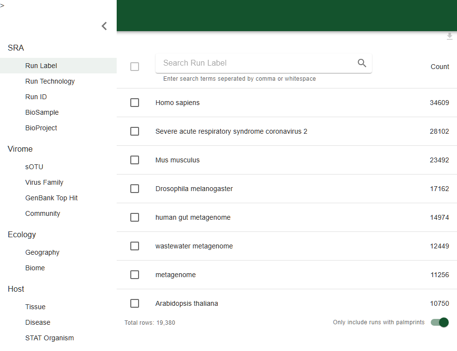

# Open-Virome · 公共病毒组浏览

> 返回 [Home](Home) ｜ 上一页：[Prescreen](Prescreen) ｜ 下一页：[Logan](Logan)

平台内嵌的公共病毒组浏览器：不建项目、不落文件，用于查看公共库的内容。输入是页面上的筛选条件，结果以内嵌 SPA 的图表与可导出的 Run 清单呈现。

对应引擎：Open Virome 前端（`3rd/open-virome/frontend/build`，打包回退 `webapp/static/virome`）；平台壳页 `Virus_Platform_Core/web/virome.py` + `webapp/templates/virome.html`，路由 `/virome`；操作目录 id 无（agent 走 MCP `vp_ov_*`）。

---

## 输入

### 筛选维度

四个模块各自一组维度，勾选后即过滤公共库：

| 模块 | 筛选维度 |
|---|---|
| SRA | Run Label / Run Technology / Run ID / BioSample / BioProject |
| Virome | sOTU / Virus Family / GenBank Top Hit / Community |
| Ecology | Geography / Biome |
| Host | Tissue / Disease / STAT Organism |

### 参数

- `filters`：筛选条件串。
- `palmprintOnly`：只含带 palmprint 的 Run。

### URL 约定

- 进入壳页时把平台页 URL 的查询串透传给 iframe（`/virome/` + `location.search`）。
- 内嵌应用里改筛选后，壳页每 800ms 把 iframe 的查询串同步回平台页 URL（`history.replaceState`，不刷新页面）。
- 因此 `/virome?filters=...&palmprintOnly=...` 可直接收藏、分享，或由程序构造打开。

## 流程

### 步骤一 · 壳页与路由

- `/virome` 是平台壳页（顶部导航 + iframe），`/virome/` 为 SPA 本体，`/virome/<path>` 为静态资源。
- 三条路由中 `/virome/<path>` 静态资源统一经 `check_path` + `send_from_directory` 防目录穿越，并保留子目录相对路径（`static/js/...` 这类嵌套资源不会 404）。

### 步骤二 · 前端部署与回退

- 源码模式直接用 `3rd/open-virome/frontend/build`（重新构建即时生效，无需拷贝）；打包部署回退 `webapp/static/virome` 同步副本。
- build 目录「完整」才启用：`static/` 与 `vendor/` 必须同时存在。`index.html` 一律引用 `/virome/vendor/*`，缺 `vendor/` 时四个核心库全 404、SPA 白屏；缺件即回退 `webapp` 副本。

### 步骤三 · 查询与导出

- 查询由内嵌前端直连 Open Virome 公共 API（生产地址 `https://zrdbegawce.execute-api.us-east-1.amazonaws.com/prod/`；前端开发态默认 `http://localhost:8000/`）。
- 平台侧不代理、不缓存、不落盘：页面关掉就什么都没留下，也不进任务中心。
- 代价是离线不可用，且可用性取决于上游服务；需要本地留存的 Run 清单请自行复制出去。

## 产物

### 目录结构

平台不落本地产物，只托管前端资源；部署目录二选一：

```text
3rd/open-virome/frontend/build/    源码模式（重新构建即时生效）
webapp/static/virome/              打包回退副本
```

### 关键文件与字段

| 项 | 说明 |
|---|---|
| `index.html` | SPA 入口，统一引用 `/virome/vendor/*` |
| `static/` | SPA 脚本与样式 |
| `vendor/` | 四个核心库；缺失时 SPA 白屏并回退 `webapp` 副本 |
| `filters` / `palmprintOnly` | 平台页 URL 上的筛选状态，与 iframe 双向同步 |
| 上游 API | 前端直连，平台不代理、不缓存 |

## 示例输入与输出

### 示例输入

```text
模块：Host
维度：STAT Organism
当前取值表：Homo sapiens 34,609；Severe acute respiratory syndrome coronavirus 2 28,102；Mus musculus 23,492
Total rows: 19,380
```

### 示例输出

下图是打开左侧筛选抽屉后的检索界面。



*图注：左栏是四个模块的筛选维度：SRA（Run Label / Run Technology / Run ID / BioSample / BioProject）、Virome（sOTU / Virus Family / GenBank Top Hit / Community）、Ecology（Geography / Biome）、Host（Tissue / Disease / STAT Organism）。右栏是当前维度的取值表（Homo sapiens 34,609、Severe acute respiratory syndrome coronavirus 2 28,102、Mus musculus 23,492 等，底部 Total rows: 19,380）。右下「Only include runs with palmprints」即 URL 里的 `palmprintOnly`。*

## 界面与 CLI

### 界面

- 单页应用（SPA）：顶部平台导航 + 组导航 + 满幅 iframe；四个模块各自出图与表，表可导出 CSV、图可导出 PNG。
- 查到高价值 Run 后的动作在别的卡：去 [Meta-Search](Meta-Search) 补元数据、去 [Prescreen](Prescreen) 筛含病毒、去 [Download](Download) 取 FASTQ。

### CLI 与 agent

```text
无 main.py 独立子命令（纯前端页，不产生本地产物）。
agent 走 MCP：
  vp_ov_search_runs   按维度过滤出 Run（organism / tissue / disease / sex /
                      geo_attribute / biome / virus_family / stat_organism；
                      palmprint_only 默认开，max_runs 默认 200、上限 2000）
  vp_ov_counts        对一批 Run 做元数据分布统计（group_by 同上，另可 sra）
  vp_ov_mwas          对一批 Run 做 MWAS（元数据 × 病毒丰度关联）
```

## 相关

- 拿到的 Run 去补元数据 → [Meta-Search](Meta-Search)
- 先判断含不含病毒 → [Prescreen](Prescreen)
- 直接取 FASTQ → [Download](Download)
- 想知道某条序列还出现在哪些公共样本 → [Logan](Logan)
- 本组总览 → [Public-Data](Public-Data)
