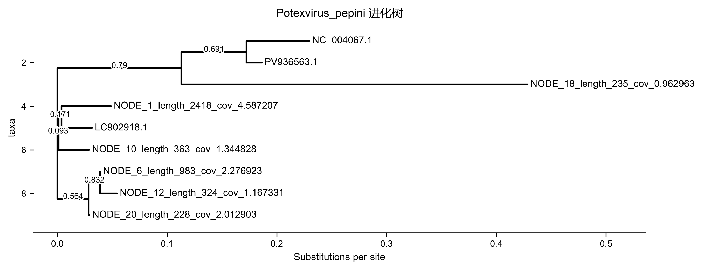
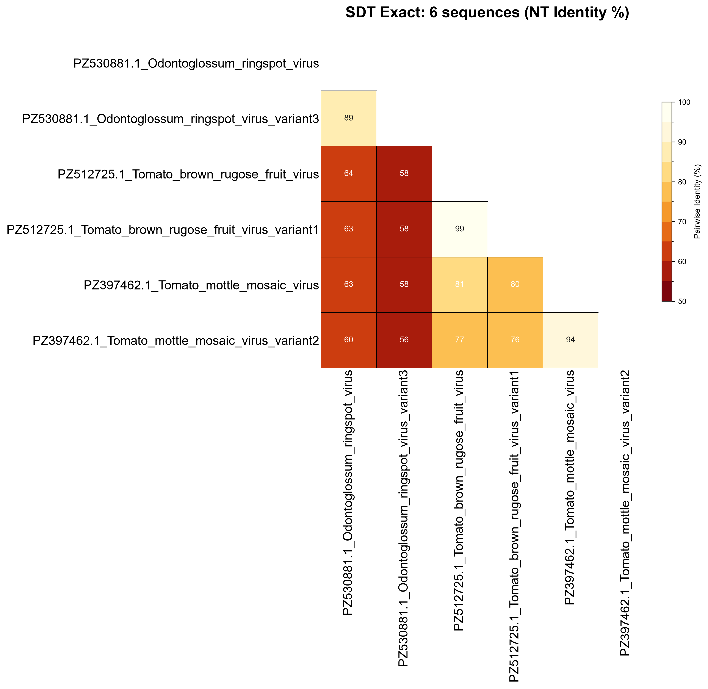
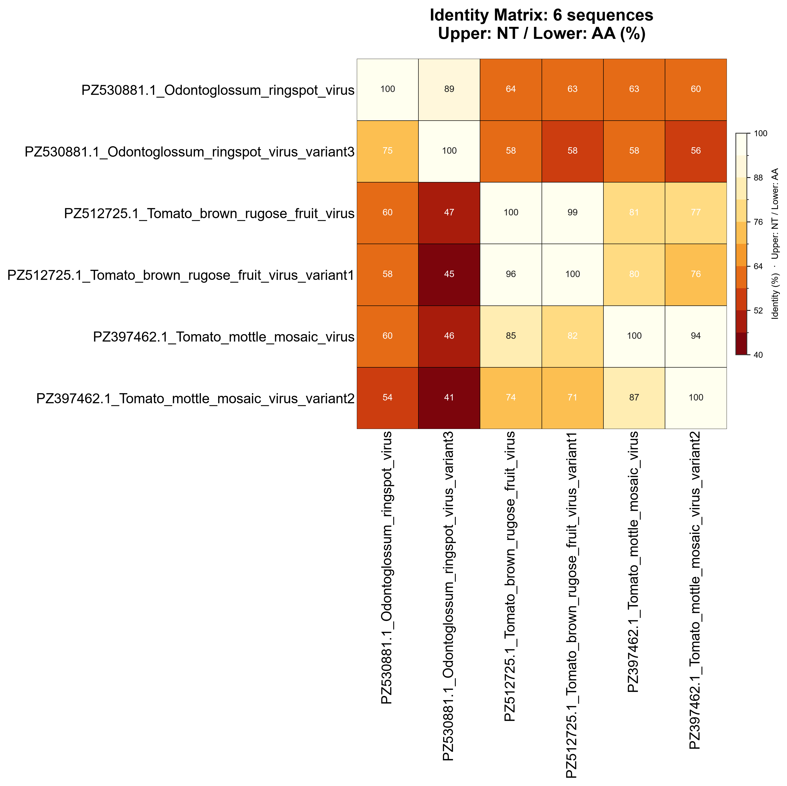

# Phylo · ⑦ 进化树与 SDT

> 返回 [Home](Home) ｜ 上一页：[Align](Align) ｜ 下一页：[Phylodynamics](Phylodynamics)

两件事合成一篇：样品流程 ⑦ 的**进化树构建**，与属级 **SDT 同一性分析**。输入是各物种分组的序列与近缘参考；产物是 `run/results/<样品>/05_phylo/<组>/` 下的比对、Newick 树图与 identity 矩阵，SDT 另出热图与分布图。

对应引擎 `phylo.py`（⑦ 编排）、`sdt_exact.py`（SDT 精确引擎）、`msa_view.py`（MSA 查看）；工具卡 `t-treebuild`（操作目录 id `quicktree`）与 `t-sdt`（操作目录 id `sdt` / `identity`）。

## 输入

### 输入格式

建树有三种来源：

- 样品流程 ⑦：按病毒物种分组后的序列组，每组 = 病毒 contigs + top-N 近缘参考；
- GenBank 集合：全基因组 / 挑选的序列集（CDS / PEP）；
- 任意 FASTA，或已比对 MSA（`aligned` 置真时跳过比对）。

SDT 两种模式：

- NT·SDT：多序列 FASTA，≥2 条，**无需预先比对**（引擎对每一对序列独立跑 MAFFT）；
- NT+AA：核苷酸 FASTA 必填，可选氨基酸 FASTA；AA 按序列名与核酸匹配，留空则自动按最长 ORF 翻译。

### 参数

建树侧：

| 参数 | 默认 | 说明 |
|---|---|---|
| `--tree-tool` / `method` | `fasttree` / `nj` | `nj` / `fasttree` / `raxml-ng` |
| `--tree-sampling` | `blast` | `blast` / `macro` / `genus` / `lineage` |
| `--top-n-refs` | 10 | 每组近缘参考条数 |
| `--ncbi-refs` | 空 | 并入每组的 NCBI 参考集合名 |
| `max_n` | 100 | 工具卡最多条数 |
| `aligned` | 关 | 输入已是比对结果，跳过 MAFFT |

SDT 侧：

| 参数 | 默认 | 说明 |
|---|---|---|
| `seqs` / `nt_seqs` | 必填 | 序列 FASTA（≥2 条） |
| `aa_seqs` | 空 | 仅 NT+AA 模式；空 = 按最长 ORF 翻译 |
| `max_n` | 30 | 最多条数（卡上夹到 3–200） |
| `orient` | 开 | 比对前定向 |
| `seqtype` | `auto` | `auto` / `nt` / `aa` |
| `palette` | `sdt` | 热图配色 |
| `aligned` | 关 | 输入为已比对 MSA，直接算公式 |

## 流程

### 建树

1. **分组**：按病毒物种分组（BLAST top hit）。每组 = 病毒 contigs + top-N 近缘参考。
2. **挑参考**，四种口径：
   - 默认比对 hits（`--tree-sampling blast`）；
   - `macro` = 同科建树：目标属 + 同科各属 3 条背景；
   - `genus` = 属级树；`lineage` = 种级树。
   - 后三者用 `databases/tree_db/plant_tree.db` 植物病毒参考库（48 科 / 452 属 / 6,167 条）。
3. **追加参考**：`--ncbi-refs 集合名` 把 `ncbi-dl` 下载的集合并入每组比对（见 [Seq-Prep](Seq-Prep)）。ICTV 口径选参用 `ictv-refs --genus Tobamovirus [--download]`：本地优先，缺的按需下载（见 [Databases](Databases)）。
4. **比对**：MAFFT 全长比对 → **trimAl（automated1）清剪**。过度修剪自动回退原比对；Gblocks 可用。
5. **建树**：

| 工具 | 口径 | 适用 |
|---|---|---|
| **FastTree**（默认） | 类 ML，秒级 | 快速查看、序列少 |
| **RAxML-NG** | GTR+G，ML 搜索 + 100 次 FBP 自举支持值；固定种子可复现、线程自动封顶 8 | 发表级 |
| **NJ** | 距离法 | 探索 |

- 两类自动降级：序列 <4 条时 RAxML-NG 降级 NJ（自举要求 ≥4 条）；比对无信息（所有列全 N / 全 gap）导致 RAxML-NG 底层断言崩溃时降级 FastTree 兜底保树。
- 两类降级原因都写入任务日志；最优模型与对数似然写进 `05_phylo` 的 `summary.json`。
- 实测口径（209 条 × 966 nt）：RAxML-NG 含自举 730.6s；IQ-TREE 3（GTR+G + 1000 UFBoot）1049s——RAxML 端到端快约 1.4 倍。

### SDT 同一性

- 平台用 **SDT 精确引擎**（`sdt_exact.py`，SDTv1.3 的纯 Python 复刻）。
- 逐对 MAFFT 比对 + 成对 gap 删除口径，重算全长 identity 矩阵（与 SDT 算法一致）。
- 产物 `sdt_matrix.csv` + 热图；NT+AA 模式另出 `nt_matrix.csv` / `aa_matrix.csv` / `identity_table.csv` + 复合热图。
- 同时生成 `sdt_input.fas`，可在结果中心点「启动 SDT」后拖入 SDT v1.3 GUI 交互查看。

### MSA 查看（SNP-only 变异热图）

- 结果中心内置（`msa_view.py`）：选样品与 05_phylo 分组，只显示比对中的**变异位点**。
- 渲染为 ACGT 彩色字符热图（A 绿 / C 蓝 / G 橙 / T 红），带共识行、每列变异度柱、悬浮位点计数，大比对自动分页。
- 优先展示建树所用清剪后比对（`aln.trim`）。
- 设计参考 PhyloSuite MSA Viewer 的 SNP-only 思路，前端为平台自有实现。

## 产物

### 目录结构

```text
run/results/<样品>/05_phylo/<组>/
├── aln.fasta / aln.trim.fasta    比对与清剪后比对
├── tree.nwk (+tree.png)          Newick 与树图
├── sdt_matrix.csv                identity 矩阵
├── sdt_input.fas                 可拖入 SDT GUI
└── summary.json                  建树参数/模型/耗时
```

### 关键文件与字段

| 文件 | 内容 |
|---|---|
| `aln.fasta` | MAFFT 比对结果 |
| `aln.trim.fasta` | trimAl 清剪后比对，MSA 查看优先取它 |
| `tree.nwk` | Newick；枝长 = 每位点替换数，节点数字 = 支持值 |
| `tree.png` | 树的渲染图 |
| `sdt_matrix.csv` | 成对全长 identity 矩阵 |
| `sdt_input.fas` | 供 SDT v1.3 GUI 的输入 |
| `summary.json` | 建树参数 / 模型 / 耗时（RAxML-NG 的最优模型与对数似然也在此） |

- 一组一个目录。`t-sdt` 卡单独跑时产物落工具运行目录：`sdt_matrix.csv`、`sdt_heatmap.png` / `.pdf`、`sdt_distribution.png` / `.pdf`、`sdt_matrix.json`。NT+AA 模式出 `nt_matrix.csv` / `aa_matrix.csv` / `identity_table.csv` 与复合热图。

## 示例输入与输出

### 示例输入

**① 进化树（`t-treebuild`）**：多序列比对 FASTA（MAFFT 输出，等长、缺失记为 `-`），外加一棵 Newick。Newick 即 ⑦ 的 `tree.nwk`：枝长 = 每位点替换数，节点数字 = 支持值。

```text
>NODE_1_length_2418_cov_4.587207
-----tgacaatactgttaagcaagtgtatgccggtgacgacatggcattagatggagttgttgaaaatc
>NC_004067.1
catcttgattctacagtcaagcaggtttatgctggagatgatatggcattagatggagttgtagaaaatc
>LC902918.1
cacattggcaatactgttaagcaagtgtatgctggtgatgacatggcattagacggagttgttgagaatc
```

```text
(((NC_004067.1:0.05739,PV936563.1:0.01389)0.691:0.05948,NODE_18_length_235_cov_0.962963:0.31568)0.790:0.11297,((NODE_1_length_2418_cov_4.587207:0.04514,LC902918.1:0.02796)0.171:0.00257,NODE_10_length_363_cov_1.344828:0.02796)0.093:0.00129,((NODE_6_length_983_cov_2.276923:0.00061,NODE_12_length_324_cov_1.167331:0.01580)0.832:0.00996,NODE_20_length_228_cov_2.012903:0.00061)0.564:0.02876);
```

**② SDT·NT 模式（`t-sdt` 模式一）**：多序列 FASTA，≥2 条；无需预先比对，序列名即热图标签。

```text
>PZ530881.1_Odontoglossum_ringspot_virus
ATGCGTACGTACGTACGTACGTACGTACGTACGTACGT
>PZ530881.1_Odontoglossum_ringspot_virus_variant3
ATGCGTACGTACGTACGTACGTACGTACGTACGTACGA
```

**③ SDT·NT+AA 模式（`t-sdt` 模式二）**：核苷酸 FASTA（必填），可选氨基酸 FASTA。AA 按序列名与核酸匹配；留空自动按最长 ORF 翻译。

```text
>PZ530881.1_Odontoglossum_ringspot_virus
ATGCGTACGTACGTACGTACGTACGTACGTACGTACGT
>PZ512725.1_Tomato_brown_rugose_fruit_virus
ATGCGTACGTACGTACGTACGTACGTACGTACGTACGA
```

### 示例输出：进化树

`tree.nwk` + 渲染树图 `tree.png`；同一分组下还有 `aln.fasta` / `aln.trim.fasta` / `sdt_matrix.csv`。



*图注：横轴 Substitutions per site 是枝长（每位点替换数），节点上的数字是支持值（0–1）。`NODE_*` 是本样品 contig，`NC_/accession` 是参考序列；同一小分支内越近表示序列越相似，长枝提示与参考分化较大或组装片段较短。*

### 示例输出：SDT 同一性（NT）

`sdt_matrix.csv` + 下三角 identity 热图（80/85/90/95/100 硬分界）+ identity 分布图。



*图注：行与列都是序列名，下三角每格数字是成对核苷酸 identity（%）。颜色越浅（米白）越高、越深红越低。按通用病毒学口径：≥95% 判同一株系，85–95% 判同种不同分离物，<85% 判不同种。本图中番茄褐色皱果病毒（tomato brown rugose）的两个分离物为 99%（同株），跨种比较只有 56–64%。*

### 示例输出：NT+AA 同一性表

`nt_matrix.csv` / `aa_matrix.csv`（两两矩阵）+ `identity_table.csv`（逐对 NT% / AA% 两列）+ 复合热图。



*图注：同一张矩阵里上三角为核苷酸（NT）identity，下三角为氨基酸（AA）identity。两者都以 % 计，色阶 40–100。解读要点：AA 一般掉得比 NT 快，原因是密码子简并。同种分离物 NT/AA 双高（本示例同种对 NT 98.5 / AA 96.3），AA 仍高说明蛋白功能保守。跨种比较先看 AA：AA 明显低于 NT 属正常，AA 掉到 60 以下基本可判不同病毒种。*

## 界面与 CLI

### 界面

- 分析管道 ⑦ 阶段卡：参考数 / 建树工具 / 抽样策略 + `📊 查看`。
- 结果中心有**交互树查看器**（Newick 渲染）与 MSA 查看。
- 比较基因组侧另有 `t-treebuild`「进化树构建（科/属级）」与 `t-sdt`「SDT 同一性分析（属级）」两张工具卡，输入换成 GenBank 集合或任意 FASTA。

### CLI 与 agent

```bat
python main.py analyze --r1 ... --sample S1 --stages phylo ^
       --tree-tool raxml-ng --tree-sampling lineage --top-n-refs 10 ^
       --ncbi-refs TobamoRefs
python main.py ictv-refs --genus Tobamovirus --download    :: ICTV 选参
python main.py ncbi-dl "Tobamovirus[ORGN] AND complete genome[TITL]" -n TobamoRefs
```

- `main.py` 无独立 tree / sdt 子命令；外部 agent 走操作目录 id `quicktree` / `sdt` / `identity`（`agent-ops --id <id> --schema`，MCP `vp_run_tool`）。

## 相关

- 更高层级的进化动力学（分子钟 / 地理）→ [Phylodynamics](Phylodynamics) / [Phylogeography](Phylogeography) / [BEAST](BEAST)
- 建树前的比对 → [Align](Align)；集合与参考集 → [Seq-Prep](Seq-Prep)
- 参考库细节 → [Databases](Databases)
