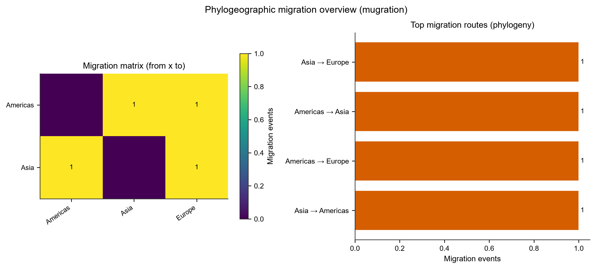

# Phylogeography · 系统地理分析

> 返回 [Home](Home) ｜ 上一页：[Rdp](Rdp) ｜ 下一页：[BEAST](BEAST)

地理 / 时间元数据驱动的迁移重构 + 分子钟定年，按「地理分析」场景组织：输入更简单、直接出图。对标远端 Phylogeography Dash 服务的**本地化版本**——离线、不出网。

对应引擎 `phylogeo.py`（~3500 行，本地实现主引擎）、`phylogeo_gif.py`（动画导出）；工具卡 `t-phylogeo`；操作目录 id `phylogeo`。重组检测与重组前序列预筛已独立成篇 → [Rdp](Rdp)。

## 输入

### 输入格式

- 序列 FASTA：可给未比对序列（工具内部走 MAFFT），也可直接给已比对 FASTA。
- 元数据表：第一列 `seq_id`，区划列默认 `region`，年份列默认 `year`；与 `examples/example_phylogeo.meta.csv` 同口径。
- 头信息也可直接写 `>名称|区划|年份`，如 `>SIM_Asia_1|Asia|2001`。
- 区划名可用内置质心表补坐标；要画逐样本点位，在元数据里加 `lat` / `lon` 列，或另给坐标表。
- `dated_tree` 可接受 [Rtt](Rtt) 产出的 `tree.date.nexus`（LSD2 兼容），给了就用真正的节点年代。

### 参数

| 参数 | 默认 | 说明 |
|---|---|---|
| `input` | 必填 | 比对 FASTA |
| `meta` | 空 | 元数据 CSV（性状列） |
| `trait` | 留空自动识别 | 区划列名；新版 explorer 叫 `Geo_Location` / `Country` |
| `date_trait` | `year` | 日期列名 |
| `method` | `nj` | 建树工具 `nj` / `fasttree` |
| `dated_tree` | 空 | 带年代树（`.date.nexus`）；不给则退回近似 |
| `coords` | 空 | 坐标表：逐样本点层 + 区划落点（样本坐标中位数优先） |
| `motp_bin` | 0 | 迁移随时间（MOTP）的分箱宽度（年）；>0 才做 |
| `rrt_perm` | 0 | 区域随机化检验置换次数（0=不做；建议 ≥1000） |
| `rssp_bs` | 0 | 根状态 bootstrap 复本数（0=不做；建议 ≥100）；同时是权重分带的驱动源 |
| `seed` | 0 | 置换 / bootstrap 随机种子 |
| `beast_log` / `beast_trees` | 空 | BEAST 产物回读；两个都不给 = 不做 BEAST 面板 |

## 流程

### 主链路

```text
序列 FASTA + 采样地点/日期元数据
  → MAFFT 比对（复用平台链路）
  → 建树（复用平台 NJ / FastTree）
  → 离散性状（地点）祖先重构 + 迁移计数
  → 分子钟定年（root-to-tip / TreeTime 口径）
  → 迁移走廊表 + 时间轴
```

- 前端交互：时间滑杆动画（迁移弧线随时间出现）、地点分布统计、逐走廊计数表。
- 与 [Phylodyn](Phylodyn) 的 mugration 同口径（ML / Fitch 双口径走廊并列、采样偏倚提示），但按「地理分析」场景组织。
- BEAST 只是**只读导入**：`.log` / `.trees` 由服务器跑出，本地不跑 MCMC；导入失败只影响 BEAST 面板，主分析照常。

### 迁移弧线动画 GIF

- 网页里的时间滑杆动画只能在浏览器里看；本功能把它导出成 **GIF 进 PPT / 补充材料**。
- 全离线逐帧渲染经纬度地图上的迁移弧线动画（plotly + kaleido + Pillow）。
- 帧序 = 采样时间轴；弧线粗细 / 颜色 = 迁移强度。
- 可调 `fps`（1–10，默认 2）、`max_frames`（1–80，默认 80）、`max_arcs`（1–24，默认 24）、`width` / `height`（默认 960×520）。
- 两端缺坐标的迁移不画进 GIF；MOTP 分箱为空时直接报错「没有可渲染的帧」。

### 与一键链的分工

- 本卡面向「一次地理分析出一套图」，参数少、产物扁平。
- [Phylodyn](Phylodyn) 面向 A0–A5 全链，接口产物是 `clock/timetree.nwk`；本卡的 `dated_tree` 可以直接吃 [Rtt](Rtt) 的 `tree.date.nexus`。
- 需要贝叶斯后验（95% HPD / BF）时走 [BEAST](BEAST) 轨道，本卡只负责导入与展示。

## 产物

### 目录结构

```text
run/tool_runs/<phylogeo_run>/phylogeo/
├── tree_annotated.nwk      带祖先区划注释的树
├── migration_matrix.tsv    区划间迁移计数矩阵
├── leaf_states.tsv         每个叶的观测状态
├── transitions.tsv         逐条迁移事件
├── transition_classes.tsv  迁移事件分类
├── summary.json            摘要（前端面板数据源）
├── coords_resolved.tsv     区划落点（给了坐标表或 lat/lon 才有）
├── sample_coords.tsv       逐样本坐标（同上）
├── rrt_permutation.tsv     区域随机化检验（rrt_perm>0 才有）
├── weight_bands.json       后验权重分带（rssp_bs>0 才有）
└── migration.gif           迁移弧线动画（导出后才有）
```

### 关键文件与字段

| 文件 | 内容 |
|---|---|
| `migration_matrix.tsv` | 行 = 来源区划，列 = 目的区划，格内为迁移计数 |
| `transitions.tsv` | 逐条迁移事件（来源 / 目的 / 树上位置） |
| `tree_annotated.nwk` | 带祖先区划注释的 Newick |
| `summary.json` | 面板数据源；GIF 渲染也读它 |
| `coords_resolved.tsv` / `sample_coords.tsv` | 区划落点与逐样本点位 |
| `rrt_permutation.tsv` / `weight_bands.json` | 可选统计的产物 |
| `migration.gif` | 迁移弧线动画；缓存命中时直接复用旧文件 |

## 示例输入与输出

### 示例输入

```tsv
seq_id	region	year
SIM_Asia_1	Asia	2001
SIM_Asia_2	Asia	2003
SIM_Asia_5	Europe	2009
SIM_Europe_1	Europe	2006
```

配一份多序列 FASTA（未比对即可，工具内部做 MAFFT；头也可写成 `>SIM_Asia_1|Asia|2001`）。

### 示例输出

迁移矩阵 + Top 迁移路线图。同目录另有 `migration_matrix.tsv`、`transitions.tsv`、`tree_annotated.nwk` 与动画 GIF。



*图注：左图行 = 来源区划、列 = 目的区划，格内数字为迁移事件数；颜色越亮表示事件越多。右图条形按事件数排序，长度即迁移次数。跨区事件很少（本例每个方向仅 1 次）时，祖先区划重构的不确定性较大，需结合树的节点支持值判断方向。*

## 界面与 CLI

### 界面

- 专项分析页「系统地理」工具卡：输入 FASTA + 元数据，可选带年代树、坐标表与统计开关。
- 结果面板含动画预览、走廊表、地图点位。
- 重组事件表不在本卡，见 [Rdp](Rdp) 的结果区。

### CLI 与 agent

- `main.py` **没有** phylogeo 子命令（`add_parser` 核实）。
- 外部 agent 走操作目录 id `phylogeo`：`python main.py agent-ops --id phylogeo --schema` 查参数，MCP `vp_run_tool` 执行。
- 迁移 GIF 由结果区的导出按钮触发，落到 `phylogeo/migration.gif`。

## 相关

- 分子钟与走廊的完整方法学（含对拍验证）→ [Phylodynamics](Phylodynamics)
- 时间树从哪来（RTT / TreeTime 定年、DRT 显著性）→ [Rtt](Rtt) / [Phylodyn](Phylodyn)
- 重组检测与掩蔽 → [Rdp](Rdp)
- BEAST 贝叶斯轨道 → [BEAST](BEAST)
- 时空采样设计（降采样）→ [Pd-Prep](Pd-Prep) GeoSubsampler
