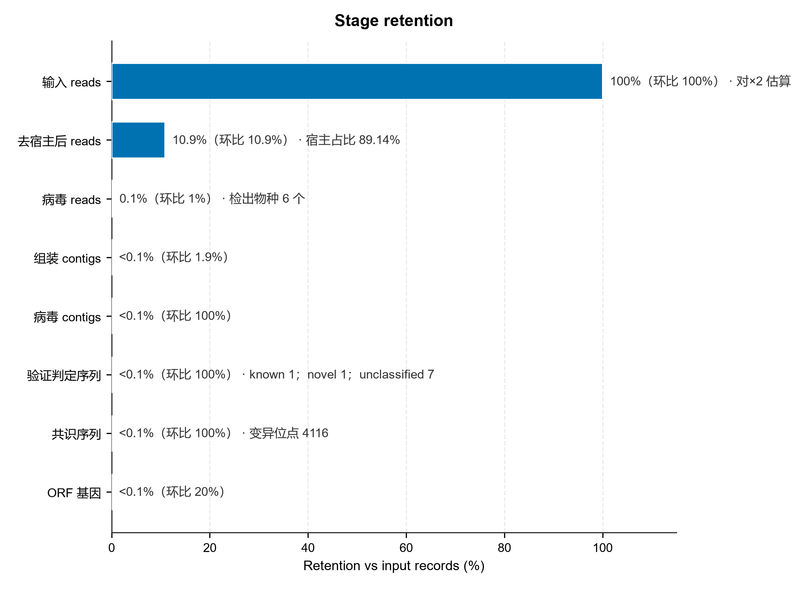

# Preprocess · 样本处理管线（⓪ 质控 · ⓪b 转换 · ① 宿主去除）

> 返回 [Home](Home) ｜ 上一页：[Sample-Intro](Sample-Intro) ｜ 下一页：[Prepchain](Prepchain)

对应引擎：`Virus_Platform_Core/pipeline.py`（阶段编排 / `.done` 断点）、`preprocess.py`（⓪ fastp、⓪b fq2fa）、`host_removal.py` + `kunpeng.py`（① 宿主去除）。本页是**管线阶段总览**，按阶段编排视角汇总 ⓪ / ⓪b / ① 三步；各模块引擎细节见专页，不在此重复。

## 阶段顺序与依赖

### 三步顺序

```text
⓪ fastp（可选）→ ⓪b FASTQ→FASTA（可选）→ ① 宿主去除 → ②b kvsuite → ③ assembly → ③b verify → ③c consensus → ④…
```

- `STAGE_REGISTRY` 里 ⓪ / ⓪b / ① 均为 `deps=[]`（不强制前置），运行约定按上序串行。
- ③c `consensus` 显式依赖 `assembly` + `host`，因为它的 reads 固定取 `01_host_removal/`。

### 断点与产物根

- 每阶段在自己目录写 `.done`：`00_prep/.fastp.done`、`00_prep/.fq2fa.done`、`01_host_removal/.host_removal.done`。
- 复用前核对输入指纹（路径/大小/mtime）与参数；换输入或改阈值会重跑，不单凭旧 `.done` 硬复用。
- 产物根：`run/results/<样品>/`（随 `platform.json` 的 `output_root` 平移）。`00_prep/` 放质控/转换产物与 `input.json`；`01_host_removal/` 放 kept reads 与统计。

### 模块专页索引

| 模块 | 专页 |
|---|---|
| ⚡ 一键前处理（五步串链） | [Prepchain](Prepchain) |
| 样品创建 / 批量导入 | [Samples](Samples) |
| ⓪ 序列质控（fastp） | [Fastp](Fastp) |
| ⓪b 格式转换（SRA / FASTQ → FASTA） | [Convert](Convert) |
| ① 宿主去除 / 非宿主提取 | [Host-Removal](Host-Removal) |
| 病毒序列提取（样本分析） | [Identify](Identify) |

## 输入

### 文件格式

- FASTQ / FASTQ.gz（`.fastq` `.fq` `.fastq.gz` `.fq.gz`）：双端选 R1/R2，单端只选 R1。
- FASTA / FASTA.gz：建库/分类输入。
- `.zip` / `.rar` / `.tar` 需先解压；文件浏览对话框只显示数据文件类型，浏览范围限平台目录内。

### 样品目录与样本表

- 样品目录约定 `run/results/<样品>/`。
- 批量样本表仍是 `name` / `r1` / `r2` 三列（单端 `r2` 留空），示例 `run/tool_runs/_example_inputs/example_sample_sheet.tsv`。

## CLI

### 常用组合

```bat
python main.py analyze --r1 R1.fastq.gz --r2 R2.fastq.gz --sample S1 ^
       --stages fastp,fq2fa,host        :: 只跑预处理三步
python main.py analyze ... --sample S1 --stages fq2fa,host,kvsuite,assembly
```

- `--stages` 逗号分隔，按 `STAGE_ORDER` 做稳定拓扑排序；默认全链见 `DEFAULT_ANALYZE_STAGES`。
- `--no-fq2fa` 关闭 ⓪b（默认开启）。

### 引擎细节去向

- ⓪ 质控 → [Fastp](Fastp)
- ⓪b 转换 → [Convert](Convert)
- ① 宿主去除 → [Host-Removal](Host-Removal)
- 病毒序列提取 → [Identify](Identify)；样品登记 → [Samples](Samples)；整链 → [Prepchain](Prepchain)
- 宿主库构建（`build-host-db`）→ [Host-Removal](Host-Removal) / [Databases](Databases)

## 示例输出

### 保留率漏斗



*图注：以输入 reads 为 100%（标注「对×2 估算」），逐关卡给出保留率与环比——去宿主后 reads 10.9%（环比 10.9%，宿主占比 89.14%）、病毒 reads 0.1%（环比 1%，检出物种 6 个）、组装 contigs <0.1%（环比 1.9%）、病毒 contigs <0.1%（环比 100%）、验证判定序列 <0.1%（环比 100%，known 1 / novel 1 / unclassified 7）、共识序列 <0.1%（环比 100%，变异位点 4116）、ORF 基因 <0.1%（环比 20%）；条形长度是相对输入 reads 的累计保留率，括号内的「环比」是相对上一关卡的保留比例。*

这是全流程各阶段保留率的汇总视图（样品管线口径），用来快速判断 ⓪ 质控 / ⓪b 转换 / ① 宿主去除等前处理关卡的损失是否正常；各阶段自己的统计与产物见对应专页。

## 相关

- 宿主库构建与 TaxID 校验 → [Databases](Databases)
- 去宿主 reads 去向 → [Kvsuite](Kvsuite)（识别定量）与 [Assembly](Assembly)（组装输入）
