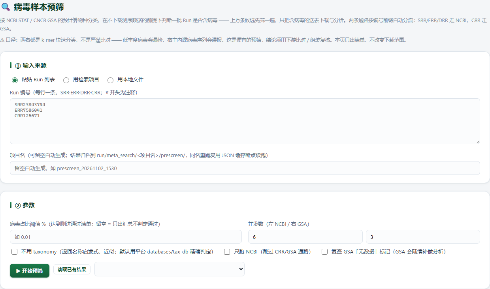

# Prescreen · 病毒样本预筛

> 返回 [Home](Home) ｜ 上一页：[Meta-Search](Meta-Search) ｜ 下一页：[Open-Virome](Open-Virome)

用 NCBI STAT 与 CNCB GSA 的预计算物种分类判断一批 Run 是否含病毒，不下载任何测序数据。输入是 Run 列表、检索项目或本地清单文件，产物是判定表、两类清单、四图组与病毒谱。只出清单、不改变下载范围，门控方向由使用者定。

对应引擎：`public_meta/prescreen_engine.py`（预筛引擎）、`public_meta/prescreen_plot.py`（四图组）、`public_meta/virome.py`（病毒谱）；页面：`Virus_Platform_Core/web/prescreen.py` + `webapp/templates/prescreen.html` + `webapp/static/app-prescreen.js`，路由 `/prescreen`；操作目录 id 无（agent 走 MCP `vp_prescreen_run` 等）。

---

## 输入

### 输入格式

- **粘贴 Run 列表**（引擎 `--runs`）：每行一条（SRR / ERR / DRR / CRR），`#` 开头为注释；单次上限 20,000 条，更大批量请分批。
- **选一个「公共数据检索」项目**：直接取其 Core14 / search / full 元数据表的 Run 列。查找按 `core14 → search → full` 顺序进行，取第一个存在且能认出 Run 列的表；Run 列名兼容 `Run / run / RUN / RunID / run_accession / Accession`，再退化为「列名含 run」的第一列。
- **本地文件**（引擎 `--csv --run-col` 或 `--acc`）：平台内 `.list` / `.txt` 或 `.csv` / `.tsv` 文件，自动识别 Run 列。
- 页面另给「读取已有结果」下拉（按产物时间倒序，只列有汇总表的项目）。

### 参数

| 参数 | 默认 | 说明 |
|---|---|---|
| 项目名 | 留空自动 | `prescreen_YYYYMMDD_HHMM`（撞名顺延秒位 / 序号）；决定产物归档目录与缓存复用范围 |
| 病毒占比阈值 % | 留空 | `0–100`；留空 = 只出汇总、不判定通过 |
| NCBI 并发 `-j` | 6 | `1–20`，过高会被 NCBI 限流 |
| GSA 并发 `--gsa-jobs` | 3 | `1–6`；NGDC 有反爬，建议不动 |
| 不用 taxonomy | 关 | 退回名称启发式（近似，不推荐） |
| 只跑 NCBI | 关 | 跳过 CRR / GSA 通路 |
| 复查 GSA「无数据」 | 关 | GSA 会陆续补做分析，可定期复查 |
| 自定义目标 taxid | — | 引擎 `--taxids`（每行一个 taxid 的文件），追加到 Viruses（10239）子树 |
| 请求节奏 | — | 引擎 `--min-interval`（NCBI，默认 0）/ `--gsa-min-interval`（GSA，默认 0.4s）/ `--retries`（4）/ `--timeout`（90s） |

- 引擎侧另有 `--taxdump` 可指定别的 taxdump 目录（含 `nodes.dmp`）；`--cra-map` 给 CRR → CRA 映射表（两列 TSV）可跳过 GSA 网页解析。
- `--no-cache` 强制重抓；不加时按项目目录内的 JSON 缓存断点续跑。

## 流程

### 步骤一 · 分流与抓取

- NCBI STAT 与 CNCB GSA 两条通路都用上游预计算的物种分类，不下载测序数据。
- 按编号前缀分流：SRR / ERR / DRR 走 STAT，CRR 走 GSA；勾「只跑 NCBI」则跳过 GSA 通路。
- JSON 缓存落在项目目录内，同一项目重跑近乎秒级；GSA 的 `FAILED` 属临时故障，不写缓存，重跑即补。
- 重试与请求间隔可调；并发过高易被 NCBI 限流。

### 步骤二 · 病毒判定

- 默认用平台 `databases/tax_db` 分类树（`Viruses` taxid 10239 子树），与名称启发式取并集——单用任一边都会漏。
- `--taxids` 传 taxid 列表文件可追加目标范围；`--taxdump` 可换 taxdump 目录。
- 勾「不用 taxonomy」则退回名称启发式（近似，不推荐）。
- GSA 通路无 taxid，按名字判定。
- 两条通路都是快速分类而非严谨比对：低丰度病毒可能漏检，宿主内源病毒序列可能误报，结论须下游比对 / 组装复核。

### 步骤三 · 阈值判定与两类清单

- 设「病毒占比阈值 %」（`--virus-pct`）时，达阈值的 run 标 `PASS` 并单出通过清单 `prescreen_pass.tsv`；留空则只出汇总、不判定通过。
- 上游没有分类数据的 run 进未决清单 `unresolved.tsv`（含来源 / 状态 / 原因）与 `unresolved.list`（纯 accession，可直接喂下游）。
- 判定口径：`PASS` 不代表样本一定带毒，只代表预计算分类给出的病毒占比过了所设的线；未决也不等于没有，只是上游还没做分类。
- 跨来源比较用归一化列 `virus_pct_ident`，两通路分母不同。

### 步骤四 · 病毒谱统计

- 样本视角回答「哪些样本含病毒」，病毒谱回答另一半：这批样本检出了哪些病毒、各自什么分类、占比多少、在多少个样本里出现过。
- 层级：`specific`（最特异检出，默认）/ `species` / `genus` / `family` / `order` / `class` / `phylum` / `kingdom` / `realm`；切层级不重算（贵的是 taxonomy 加载）。
- 默认口径「最特异检出」：每样本只保留没有检出后代的病毒节点。STAT 的 tax_table 是完整谱系、父子节点计数递增，按名字直接汇总会把一个物种同时算进属 / 科 / 目，发生率整体虚高。
- 发生率分母 = 全部样本数（含本来就没做分类的样本，「无数据」按未检出计，最保守口径）；需要「有数据样本内发生率」时用返回的 `n_with_data` 自行换算。
- 规模：每层 Top 30 类群、关联矩阵 Top 40、矩阵最多 400 个样本。首次计算 15–45 秒（瓶颈是读 `nodes.dmp` / `names.dmp`，与数据量无关），进程内加项目 `.cache/virome.json` 两层缓存，结果加载后前端自动预取。

## 产物

### 目录结构

```text
run/meta_search/<项目>/prescreen/
  stat_run_summary.tsv        每 run 一行（含 pass）
  stat_viral_taxa.tsv         病毒 taxon 长表
  prescreen_pass.tsv          通过清单（设了阈值才出）
  unresolved.tsv / .list      未决清单（明细 / 纯 accession）
  STAT_PRESCREEN_REPORT.md    人读报告
  figures/                    四图组（PNG 600dpi + PDF）
  stat_raw/  gsa_raw/         原始 JSON 缓存（同名重跑断点续跑）
  .cache/virome.json          病毒谱缓存
  input.list  run.log         粘贴模式下落盘的输入清单；各次运行日志
```

### 关键文件与字段

| 产物 | 内容 |
|---|---|
| `stat_run_summary.tsv` | 每 run 一行：来源、状态、`virus_pct`、`virus_pct_ident`、`top_virus`、测序量、`pass` 等 |
| `stat_viral_taxa.tsv` | 病毒 taxon 长表 |
| `prescreen_pass.tsv` | 通过清单；设了 `--virus-pct` / 页面阈值才出 |
| `unresolved.tsv` / `unresolved.list` | 未决清单：明细（来源 / 状态 / 原因）与纯 accession 两版 |
| `STAT_PRESCREEN_REPORT.md` | 人读报告 |
| `figures/` | 四图组：F1 病毒占比分布直方图（分来源 + 阈值线）、F2 测序量 × 病毒占比散点（归一化口径 `virus_pct_ident`）、F3 Top-N 检出病毒类群条形图、F4 预筛漏斗 + 未决状态构成 |
| `stat_raw/` · `gsa_raw/` | 原始 JSON 缓存，同名重跑断点续跑 |
| `.cache/virome.json` | 病毒谱缓存 |
| `input.list` · `run.log` | 粘贴模式下落盘的输入清单；各次运行日志 |
| 病毒谱 CSV | 文件名 `<项目>_virome_<层级>.csv`，带 BOM |

- 绘图失败只警告，不影响结果表。

## 示例输入与输出

### 示例输入

```text
SRR23843744
ERR7586041
CRR125671
```

SRR / ERR 走 NCBI STAT，CRR 走 NGDC GSA。

### 示例输出

下图是 `/prescreen` 的 ① 输入来源与 ② 参数两卡（③ 预筛结果卡在任务跑完前不显示）。



*图注：① 输入来源三选一（粘贴 Run 列表 / 用检索项目 / 用本地文件），截图里粘贴了 SRR23843744、ERR7586041、CRR125671 三条，正好覆盖 NCBI STAT（SRR / ERR）与 NGDC GSA（CRR）两条通路。项目名留空即按 `prescreen_YYYYMMDD_HHMM` 自动建目录。② 参数区是病毒占比阈值（留空 = 只出汇总、不判定通过）、并发数（左 NCBI 右 GSA，默认 6 / 3）与「不用 taxonomy / 只跑 NCBI / 复查 GSA『无数据』」三个开关。底部是「▶ 开始预筛」「读取已有结果」与历史下拉。*

点「▶ 开始预筛」后结果与四图组才出现在下方，产物仍落在 `run/meta_search/<项目>/prescreen/`。

## 界面与 CLI

### 界面

- 页面三段：① 输入来源——粘贴 / 用检索项目 / 用本地文件，加项目名。② 参数——阈值、并发、三个开关、「▶ 开始预筛」/「读取已有结果」/ 历史下拉。③ 预筛结果。
- 结果首行是统计条（总数 / 有分类 / 检出病毒 / PASS / 未决 / NCBI·GSA 分来源），下方按「样本视角 / 病毒谱」两个主标签切换。
- 样本视角四个视角：全部 run / 通过清单 / 检出病毒 / 无分类数据；行内「⬇ 转入数据下载」与 🧬 各走各的交接。
- 病毒 taxon 明细按需拉（`/api/prescreen/viral?name=&acc=`，单 run 可达万行，不随结果整包返回）。
- 任务在后台跑，切页回来「运行中」接口会重挂进度条；产物经 `/prescreen_files/<项目>/<子路径>` 下载（点开头目录是内部缓存，不对外）。
- 与「公共数据下载」衔接：结果表可勾选或按行「⬇ 转入数据下载」，写 `/api/dl/create` 后跳 `/download` 取 FASTQ；`unresolved.list` 也可直接拿去下载或本地比对。
- 行内 🧬：先查该 Run 在 Logan 公共桶有无预组装，有则带 accession 跳「LOGAN 数据下载」卡（见 [Logan-Fetch](Logan-Fetch)）。CRR 等非 SRA 编号必然没有。

### CLI 与 agent

```bat
:: 无 main.py 独立子命令；网页 / MCP 之外的命令行用法 = 直接跑引擎
python -m Virus_Platform_Core.public_meta.prescreen_engine --runs my_runs.list -o run\meta_search\P1\prescreen --virus-pct 0.05
python -m Virus_Platform_Core.public_meta.prescreen_engine --csv core14.csv --run-col Run --no-gsa -j 6 --gsa-jobs 3
:: 只重画图组
python -m Virus_Platform_Core.public_meta.prescreen_plot run\meta_search\P1\prescreen --threshold 0.05
python -m Virus_Platform_Core.public_meta.virome run\meta_search\P1\prescreen --level family --top 30
```

- MCP：`vp_prescreen_run`（提交）、`vp_prescreen_projects`（列可复用项目）、`vp_prescreen_result`（读 PASS 统计与清单头部）；轮询用 `vp_get_task` / `vp_wait_task`。

## 相关

- 上游：找候选 Run → [Meta-Search](Meta-Search)
- 下游：只下载筛出来的 Run → [Download](Download)
- 有组装就直取 contigs → [Logan-Fetch](Logan-Fetch)
- 公共库浏览（不经平台筛） → [Open-Virome](Open-Virome)
- 本组总览 → [Public-Data](Public-Data)
