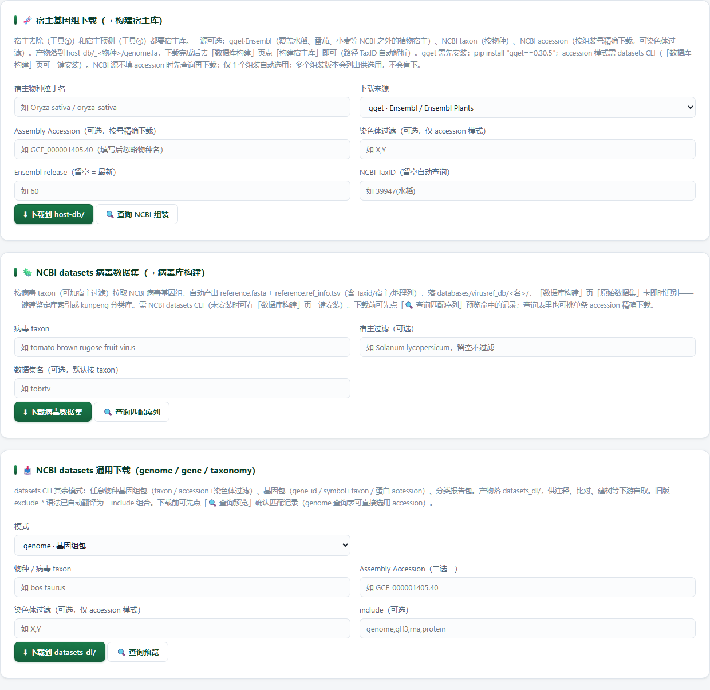

# Ref-Data · 基因组查询下载

> 返回 [Home](Home) ｜ 上一页：[Download](Download) ｜ 下一页：[Databases](Databases)

测序数据之外的「参考件」总仓：宿主基因组、任意物种基因组 / 基因 / 分类报告、病毒数据集，下载后可直接建库。输入是物种名、组装号或 taxon，产物是 `host-db/` 与 `databases/` 下可直接建库的目录。

对应引擎：`public_meta/host_genome.py`（宿主参考基因组，NCBI / gget 双源）、`public_meta/datasets_cli.py`（NCBI datasets CLI 包装与落位）；页面：`Virus_Platform_Core/web/pages.py` 的 `/refdata` + `web/build.py` 的下载接口 + `webapp/templates/refdata.html`；操作目录 id 无（agent 走 `vp_cli_submit`）。

---

## 输入

### 输入格式

- **宿主基因组**：物种拉丁名，或组装号 `GCF_...`（可配 `--chromosomes X,Y`）；来源二选一：NCBI 或 gget / Ensembl。
- **病毒数据集**：病毒 taxon 或 `--accession NC_...`；可加宿主过滤 `--host`，或只取蛋白 `--protein S`。
- **通用下载**：`genome`（taxon / accession 加染色体过滤）、`gene`（gene-id / symbol + taxon / 蛋白 accession）、`taxonomy`（taxon，逗号分隔多个）。
- 网页三卡各管一类，查询与下载共用同一组参数。

### 参数

| 参数 | 适用 | 说明 |
|---|---|---|
| `--source` | 宿主基因组 | `ncbi` / `gget`；CLI 缺省 `ncbi`，网页卡与 `body.source` 缺省 `gget` |
| `--include-organelles` | 宿主（NCBI） | 同时下叶绿体 / 线粒体；仅 NCBI 源支持 |
| `--accession` | 宿主 / datasets | 按组装号精确下载；taxid 从数据报告自动解析、目录自动重命名 |
| `--chromosomes X,Y` | 宿主 / genome | 染色体过滤 |
| `--release` | 宿主（gget） | 钉 Ensembl 版本 |
| `--verify-only` | 宿主 | 只检查已有下载 |
| `--host` | virus | 宿主过滤 |
| `--protein S` | virus | 直接取蛋白 |
| `--include` | genome / virus | 下载内容（`genome,gff3,rna,protein`）；virus 默认 `genome` |
| `--name` | virus | 数据集名；网页端同名且已有 `reference.fasta` → 409 |
| `--no-dataset` | virus | 不套平台布局，落通用 `datasets_dl/` |

- 网页卡填了 Assembly Accession 会自动把来源切到 NCBI（组装号只走 NCBI；gget / Ensembl 按物种名取官方组装），后端对「gget + accession」直接 400。
- gget 未安装时后端 400 并给出 `pip install "gget==0.30.5"`；accession 模式缺 datasets CLI 时提示先 `python main.py datasets-setup`。

## 流程

### 步骤一 · 宿主基因组双源取数

- **NCBI 源**：按物种下载宿主参考基因组 FASTA（datasets CLI 优先、E-utilities 回退；`--include-organelles` 同时下叶绿体 / 线粒体）；`--accession GCF_...` 按组装号精确下载，可 `--chromosomes X,Y` 过滤。
- **gget / Ensembl 源**（`--source gget`）：走 [gget](https://github.com/pachterlab/gget) → Ensembl / Ensembl Genomes（含 Ensembl Plants，覆盖水稻、番茄、小麦等 NCBI 覆盖不全的植物宿主）；`--release` 可钉 Ensembl 版本；需先 `pip install "gget==0.30.5"`（依赖较重，作为可选依赖维护在 `requirements-dev.txt`）。
- 下载域名校验：NCBI 源仅允许 `ncbi.nlm.nih.gov`，gget 源仅允许 `ftp.ensembl.org` / `ftp.ensemblgenomes.org`；Ensembl 部分发布文件为双层 gzip，下载器按魔数逐层解到明文。

### 步骤二 · 双源选择

| 场景 | 选择 | 说明 |
|---|---|---|
| 常规模式物种 | NCBI 源 | RefSeq 参考组装；CLI 走 datasets、缺 CLI 时 E-utilities 回退，网页卡固定走 E-utilities |
| 植物宿主、NCBI 参考不全 | gget · Ensembl Plants | 水稻、番茄、小麦等以 Ensembl Plants 更全 |
| 已知组装号、只要某几条染色体 | NCBI + `--accession` + `--chromosomes` | 按号精确下载，taxid 从报告自动解析、目录自动重命名 |
| 要叶绿体 / 线粒体 | NCBI + `--include-organelles` | 仅 NCBI 源支持 |

### 步骤三 · 先查后下

- NCBI 源不填 accession 时先查参考组装：命中 1 个自动选用。≥2 个则在页面列出候选并拦下本次下载，直接调接口时由后端 400 / 409 兜底。必须选定一个 accession，不允许盲下多个版本混建同一个宿主库。
- 查询是秒级只读操作（不进任务中心），预览上限：genome 200 / virus 500 / gene 200 / taxonomy 50，超出标 `truncated`。
- 查询与下载用同一组参数，避免「查的和下的不是一批」。

### 步骤四 · datasets 四种模式

| 模式 | 关键参数 | 典型用途 |
|---|---|---|
| `genome` | `--taxon` 或 `--accession`；`--chromosomes X,Y`；`--include genome,gff3,rna,protein` | 任意物种基因组包（含注释 / 蛋白） |
| `gene` | `--gene-id`；或 `--symbol` + `--taxon`；或 `--accession NP_...`（蛋白号） | 单基因包 |
| `taxonomy` | `--taxon`（必填，逗号分隔多个） | 分类报告包 |
| `virus` | `--taxon` 或 `--accession NC_...`；`--host` 宿主过滤；`--protein S`；`--include`（默认 `genome`）；`--name`；`--no-dataset` | 病毒数据集，直接落平台鉴定库布局 |

- 工具定位：PATH → 平台内置 `3rd/tools/datasets/datasets.exe`；缺失时 `python main.py datasets-setup` 从 NCBI 官方（域名白名单内）自动下载。
- datasets CLI v14+ 起不再支持 `--exclude-*`；包装层把它翻译为 `--include` 组合，原命令照写即可。

### 步骤五 · 落位与布局

- virus 模式默认落 `databases/virusref_db/<名>/`：`reference.fasta`（所有包内 FASTA 合并）加 `reference.ref_info.tsv`（由 `data_report.jsonl` 转换，13 列，列名对齐 `load_ref_info` 同义词表）。数据库构建页「原始数据集」卡即时识别，下载后一键建鉴定库索引 / kunpeng 分类库，全链路不出平台。
- 只取蛋白（`--include protein`）的包没有病毒报告，因此不出 ref_info。
- `--no-dataset` 不套平台布局，落到通用 `datasets_dl/`；`--name` 指定数据集名。
- 通用三模式落 `datasets_dl/<模式>_<查询名>/`（genome / gene / taxonomy），不做平台数据集布局。

## 产物

### 目录结构

```text
host-db/<TaxID>_<物种>/
  extracted/                 原始下载文件（gget 源为解压后的基因组 FASTA）
  all.genome.uniq.fasta      合并去重后的全部序列
  genome.fa                  平台建库锚点名
  genome_report.txt          下载报告（两源都生成）
  gget_ref.json              Ensembl release 与链接元数据（仅 gget 源）
databases/virusref_db/<名>/
  reference.fasta
  reference.ref_info.tsv
datasets_dl/<模式>_<查询名>/
```

### 关键文件与字段

| 文件 | 内容 |
|---|---|
| `all.genome.uniq.fasta` | 合并去重后的全部序列 |
| `genome.fa` | 平台建库锚点名，建库页 / 配置按它识别宿主源目录 |
| `genome_report.txt` | 下载报告，两源都生成 |
| `gget_ref.json` | Ensembl release 与链接元数据，仅 gget 源 |
| `reference.fasta` | 病毒数据集：所有包内 FASTA 合并 |
| `reference.ref_info.tsv` | 13 列：`Accession` / `Taxid` / `Species` / `Host` / `Host_Taxid` / `Segment` / `Molecule_type` / `Geo_Location` / `Collection_Date` / `Isolate` / `Length` / `Completeness` / `GenBank_Title` |

- 下载任务带回 `genome_fa` 与 `taxid`，前端据此显示结果与「去建库」入口；建库页「构建宿主库」自动解析路径与 TaxID。
- TaxID 解析不到时目录退化为 `host-db/genome_<物种>/`，建库前需手工补 TaxID。
- 下载类任务在任务中心带「暂停 / 继续」；`--verify-only` 只做已有下载的完整性复查。

## 示例输入与输出

### 示例输入

```text
宿主基因组卡
  下载来源：gget · Ensembl / Ensembl Plants
  Assembly Accession：不填（组装号只走 NCBI）

病毒数据集卡
  数据集名：tobrfv
  查询：先「🔍 查询匹配序列」预览，再下载
```

### 示例输出

三张卡各管一类「参考件」，查询与下载共用同一组参数；下图是 `/refdata` 的整页主区域。



*图注：上卡「🧬 宿主基因组下载（→ 构建宿主库）」有宿主物种拉丁名、下载来源（截图选的是 gget · Ensembl / Ensembl Plants）、Assembly Accession、染色体过滤、Ensembl release、NCBI TaxID，按钮「⬇ 下载到 host-db/」与「🔍 查询 NCBI 组装」。中卡「🦠 NCBI datasets 病毒数据集（→ 病毒库构建）」有病毒 taxon、可选宿主过滤、数据集名（示例 tobrfv），按钮「⬇ 下载病毒数据集」与「🔍 查询匹配序列」。下卡「📥 NCBI datasets 通用下载（genome / gene / taxonomy）」按模式下拉（截图选中 genome·基因组包）给 taxon / accession / 染色体 / include，按钮「⬇ 下载到 datasets_dl/」与「🔍 查询预览」。*

## 界面与 CLI

### 界面

- 数据资源组「基因组查询下载」独立卡（`/refdata`），页内三卡各自独立，左键下载、右键查询并列。
- ① 🧬 宿主基因组下载（→ 构建宿主库）：物种 / 来源（gget · Ensembl 或 NCBI RefSeq）/ Assembly Accession / 染色体过滤 / Ensembl release / TaxID。点「🔍 查询 NCBI 组装」先列出参考组装再选用。
- ② 🦠 NCBI datasets 病毒数据集（→ 病毒库构建）：病毒 taxon + 可选宿主过滤 + 数据集名；「🔍 查询匹配序列」预览命中记录，表里可挑单条 accession 精确下载（给 accession 时忽略 taxon）。
- ③ 📥 NCBI datasets 通用下载（genome / gene / taxonomy）：模式切换后按模式显示对应字段；「🔍 查询预览」确认匹配记录（genome 查询表可直接选用 accession）。
- 下载进任务中心（带暂停 / 继续），完成后给产物路径与序列条数；宿主卡出结果后给「去建库」，病毒数据集卡给「去构建鉴定库 / 分类库」，通用下载卡只给产物目录。
- 所有下载都经平台域名白名单与路径校验，产物路径由 `check_path` 限定在平台目录内。

### CLI 与 agent

```bat
python main.py host-genome --species "Lycium barbarum" --include-organelles
python main.py host-genome --species "Oryza sativa" --source gget
python main.py host-genome --accession GCF_000001405.40 --chromosomes X,Y
python main.py host-genome --species "Oryza sativa" --verify-only
python main.py datasets genome --taxon "bos taurus"
python main.py datasets genome --accession GCF_000001405.40 --chromosomes X,Y
python main.py datasets gene --symbol brca1 --taxon "mus musculus"
python main.py datasets taxonomy --taxon "human,sars-cov-2"
python main.py datasets virus --taxon "tomato brown rugose fruit virus" --name tobrfv
python main.py datasets virus --accession NC_045512.2 --name sars2
python main.py datasets-setup
```

- agent 侧：`vp_cli_submit('host-genome', {...})` / `vp_cli_submit('datasets', {raw: "virus --taxon ... --name ..."})`（长任务，轮询 `vp_get_task`）；或走 `/refdata` 的 HTTP 接口。

## 相关

- 下载宿主基因组后 → 建宿主库 → [Databases](Databases)
- 下载病毒数据集后 → 建鉴定库 / 分类库 → [Databases](Databases)
- 上游：先取测序数据 → [Download](Download)
- 本组总览 → [Public-Data](Public-Data)
