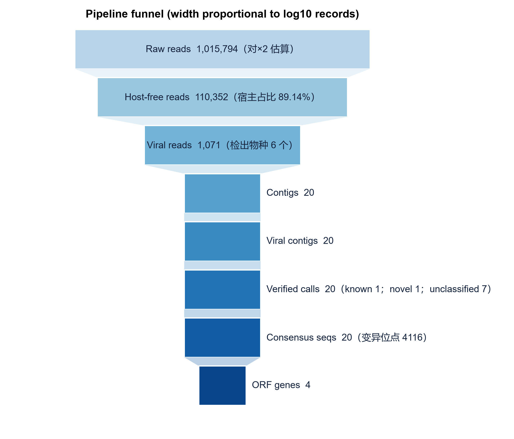
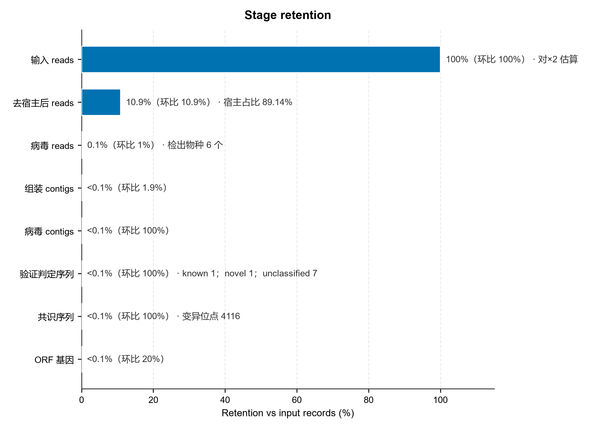
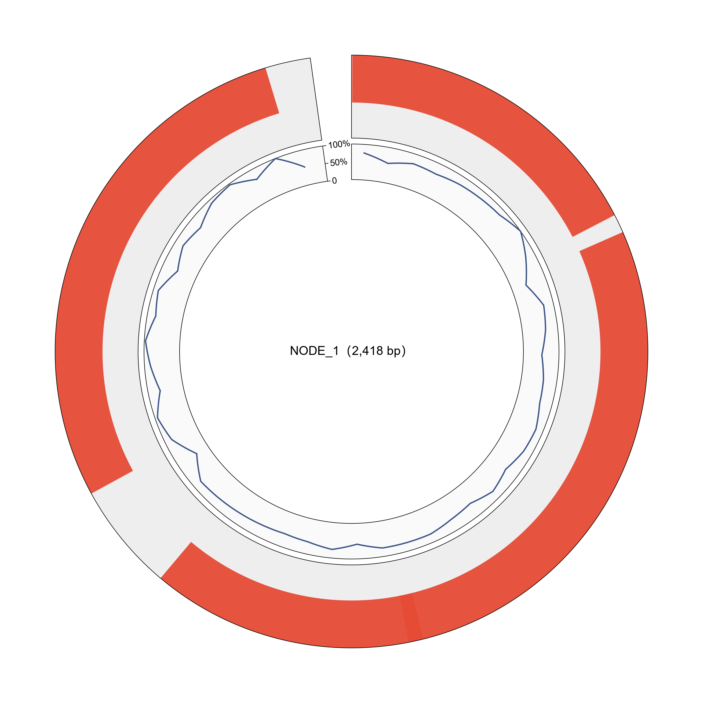

# Report · ⑩ 可视化报告

> 返回 [Home](Home) ｜ 上一页：[Result-Interpretation](Result-Interpretation) ｜ 下一页：[Svguest](Svguest)

把一个样品的全部阶段产物汇总成单文件交互式报告 `results/<样品>/07_report/report.html`：双击用浏览器打开，plotly 全离线，可直接归档或发合作者。

对应引擎：`viz.py`。管线阶段 ⑩；页面入口见 [Results](Results)。

## 报告构成

### 汇总范围

- 覆盖一个样品的全部阶段产物；阶段目录缺失时报告写 `N/A（阶段未运行）`，不推断。
- 结果图整理（svguest）已独立成篇 → [Svguest](Svguest)。
- 产物未变、只想换报告样式时，用 `report` 子命令或卡片单独重跑（`--force`）。

### 板块与图表

| 板块 | 图表 |
|---|---|
| 样品概览 | 测序量、宿主占比、病毒 reads、组装 / 注释关键数字 |
| 分类组成 | **桑基图**（reads → 宿主 / 病毒科属种流向）、**旭日图**（分类组成，pycirclize） |
| 已知病毒 | ②b 鉴定表 / 定量表 Top、覆盖度-深度 |
| 组装 | contig 长度分布、N50、病毒 contig 一览 |
| 宿主预测 | ④ 的桑基 / 旭日（科→宿主、科→属→种）嵌入 |
| ORF 注释 | 功能类别分布、科分布、Top 注释表 |
| 进化 | ⑦ 树图（`tree.png`）与 SDT 热图嵌入 |
| 基因组图 | ⑨ 圈图 / 线图 SVG 内嵌 |
| 引物 | ⑧ 引物表 |

### 特性

- **全离线单文件**：plotly / pycirclize / matplotlib 图全部内嵌，无需联网。
- **结果预览面板**：任务结束后任务卡自动展开，各阶段关键数字加「打开报告」；页面在后台时发系统通知。
- **阶段产物在线预览**：9 个阶段卡片带 `📊 查看`，表格就地弹窗（含下载），HTML 报告新窗口。

## 示例输入与输出

### 示例输入

一个已完成流水线的样品结果目录（⑩ 直接汇总各阶段产物）：

```text
run/results/GQMIX/
  00_prep/             # fastp 质控产物
  01_host_removal/     # kept_R1/R2、stats.json、host.kreport2
  02b_kvsuite/         # identify/ filter/ align/ viral_R1/R2
  03_assembly/         # contigs.filtered.fasta、viral_contigs.fasta
  03b_verify/  03c_consensus/
  04_orf/  04b_orf_annot/
  05_phylo/            # 按物种分组：tree.nwk、tree.png、sdt_matrix.csv
  06_primer/
  07_report/           # report.html、stage_funnel.png、genome_*.png
  08_host_analysis/  09_genome_plots/
```

### 示例输出

单文件 `07_report/report.html`（Plotly 全离线），并同步产出漏斗图与基因组图。



*图注：自上而下每一层是一道处理关卡（Raw reads → Host-free → Viral reads → Contigs → Viral contigs → Verified calls → Consensus seqs → ORF genes），条带宽度按记录数的 log10 缩放、并非线性；块内数字是该层实际记录数，括号里是宿主占比、检出物种数、验证分类数或变异位点数，任一层骤降都应回对应阶段排查。*



*图注：与漏斗同一份数据的「保留率」视角——横轴为相对输入 reads 的保留百分比，每条末尾还带「环比」（相对上一阶段的通过率）；适合精确定位断档发生在哪一步：本示例去宿主一步就剩 10.9%（宿主占 89.14%），病毒 reads 只占 0.1% 但检出 6 个物种，属低丰度样品的正常形态，而「验证判定」层标注 known 1 / novel 1 / unclassified 7 提示多数序列只能定到候选级。*



*图注：报告把 ⑨ 的圈图直接内嵌进单文件 HTML——外圈红色为 ORF 特征轨道，内圈蓝色折线为 GC 含量（0–100%，50% 基线），圆心标注 contig 名与长度，与 `09_genome_plots/` 下的独立图一致。*

## 界面与 CLI

```bat
python main.py report --sample S1 [--force]
python main.py analyze --r1 ... --sample S1 --stages report
```

## 相关

- 每个阶段的产物路径 → [Architecture](Architecture) 样品结果目录
- 交互查看器（树 / MSA / SDT）→ [Phylo](Phylo)
- 结果中心入口 → [Results](Results)
- 图件二次排版 → [Svguest](Svguest)
