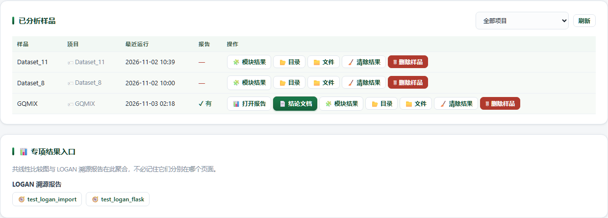

# Results · 结果中心

> 返回 [Home](Home) ｜ 上一页：[Result-Intro](Result-Intro) ｜ 下一页：[Result-Interpretation](Result-Interpretation)

全平台产物的统一查看出口。按「样品 / 专项运行 / 公共检索项目」聚合分析结果，并统一给出报告、模块结果页、交互查看器与图件整理的入口。输入是各模块落盘的目录与文件，产物是可打开、可下载、可二次排版的结果视图。

对应引擎 / 页面：`Virus_Platform_Core/web/pages.py::page_results` + `webapp/templates/results.html`；文件操作复用 `webapp/static/app.js`（`toggleFiles` / `openDir`）。页面 `/results`；本页无独立操作目录 id。

## 输入

### 输入来源

| 来源 | 位置 | 在页面上的形态 |
|---|---|---|
| 样品结果 | `run/results/<样品>/0X_*/` | 「📋 样品结果」分区 |
| 归档样品 | `run/results/_archive/<样品>/` | 默认折叠的归档区 |
| 专项运行 | `run/tool_runs/<tool>_<时间戳>_<6位十六进制>/` | 「🧪 专项运行」分区，最近 30 条 |
| 公共检索项目 | `run/meta_search/<项目>/` | 「🔎 公共检索」分区 |
| 比对与建树产物 | `05_phylo/<组>/` 下 `sdt_matrix.csv`、比对 FASTA、树文件 | SDT / MSA / 进化树三个查看器 |

### 参数

顶栏一次只显示一个分区，点击切换并把分区名写进 hash，可直接收藏或分享：

| 分区 | hash |
|---|---|
| 📋 样品结果 | `#samples` |
| 🔎 公共检索 | `#meta` |
| 🧪 专项运行 | `#runs` |
| 🧬 SDT 分析 | `#sdt` |
| 🧬 MSA 查看 | `#msa` |
| 🌳 进化树 | `#tree` |
| 📄 序列查看器 | `#seqview` |
| 🎨 结果图整理 | 外链 `/svguest/`，见 [Svguest](Svguest) |

两个深链参数：

- `?sample=<样品>`（`RS_WANT_SAMPLE` / `rsPickSample`）：样品表对应行高亮并滚到中间；MSA / SDT / 进化树三个下拉也自动选中该样品。任务中心用 `/results?sample=...#samples` 跳回。
- `?run=<运行名>`（`RS_WANT_RUN`）：切到专项运行区（配合 `#runs`），展开该运行的文件并高亮滚到眼前。任务中心用 `/results?run=...#runs` 跳回。

## 流程

### 分区导航

顶栏各项按上表切换（结果图整理为外链），hash 决定初始分区。样品结果、公共检索、专项运行三块各自拉自己的 API；SDT / MSA / 进化树 / 序列查看器各有独立查看器面板。

### 样品结果表与操作

表格列：样品、项目、最近运行、报告、操作。项目列来自样品 `input.json` 或项目清单，顶部项目筛选器与全局项目筛选同步。

每个样品一行操作，按钮按实际产物动态出现：

| 按钮 | 行为 |
|---|---|
| 📊 打开报告 | `/report/<样品>`，即 `07_report/report.html`（图表报告） |
| 📄 结论文档 | `/report/<样品>?v=paper`，优先 `report_v2.html`；未生成时自动回落到 `report.html` |
| 🧩 模块结果 | `/api/module_report?sample=<样品>&stage=report`，按需生成并跳转到该阶段的 `results.html` |
| 📂 目录 | `/api/open_report_dir/<样品>`，在资源管理器打开样品结果目录 |
| 📁 文件 | 懒加载 `/api/sample_files/<样品>`，展开完整文件树 |
| 🧹 清除结果 | 删除分析产物，保留样品登记与 `00_prep/input.json`、`project.json`；样品有运行中任务时拒绝 |
| 🗑 删除样品 | 连同样品登记与全部文件删除；运行中或目录被占用时拒绝 |

归档样品只提供「📊 打开报告」「📄 结论文档」（走 `/archive_report/<样品>`）。归档样品不出现在各模块下拉与首页最近列表；把目录移回 `run/results/` 即可恢复。

### 专项运行

「🧪 专项运行」列出 `run/tool_runs/` 最近 30 条运行（按目录 mtime 倒序），每条显示：

- 运行名、文件数、输出目录（可复制 / 打开）。
- 「📁 文件」展开文件列表（接口每运行最多返回 40 个文件），点击下载。
- `contigs_*` 运行额外给「📊 分类报告」（`/api/tool/report?run=<运行名>`）。
- 所有运行都给「📄 结论文档」（`/api/tool/report?run=<运行名>&v=paper`，失败回落图表报告）与「🧩 模块结果」（`/api/module_report?run=<运行名>`）。
- SVG 文件给「🎨 整理」；「📂 打开目录」调用 `/api/tool/open`。

一键链的汇总目录（如 `annochain_*`）也会出现在这里，子运行目录可单独打开。

### 公共检索项目

`#meta` 拉 `/api/meta/collections`：

- 每个归档项目显示检索结果 / Core14 / Full / 图表计数与「过期」标记。
- 可打开检索结果或 Core14 的分页表（`/api/meta/table/<项目>?which=search|core14`）。
- 可下载 `SRA_GSA_Merged_Final.csv` 与 `Global_Unified_Metadata_Full.csv`。
- 可跳回 `/meta?p=<项目>` 继续编辑，或删除项目。

### 专项结果入口

「📊 专项结果入口」卡拉取 `/api/gb/collections` 与 `/api/logan/jobs`，把 `has_report` 为真的 LOGAN 任务列成 🧭 入口，指向 `/logan/report/<任务名>/`。

页面说明文字还提到共线性比较图；当前渲染代码只列 LOGAN 报告（`webapp/templates/results.html:466-486`）。

### 其它查看器

- **SDT**：选样品与 `05_phylo` 分组，读 `/api/sdt/data` 绘制全长成对 identity 热图；优先用 `sdt_matrix.csv`，缺失时由比对 FASTA 现算。
- **MSA**：读 `/api/msa/data`，只显示比对中的变异位点；每页 60 / 100 / 150 列，可选共识行与变异度柱，优先展示清剪后的 `aln.trim`。
- **进化树**：读 `/api/tree/data`，支持 FastTree `tree.nwk`、NJ `nj.nwk`、RAxML-NG `raxml.raxml.support`，旧 IQ-TREE `treefile` / `contree` 仍可查看；矩形 / 环形 / 无根布局、支持值与 PNG / SVG / PDF 导出在查看器面板。
- **序列查看器**：`/api/seqview` 流式统计 FASTA / FASTA.gz 的序列数、总碱基、GC% 与简并碱基比例，每页 50 条预览。

## 产物

### 目录结构

样品结果树的典型结构（`📁 文件` 把样品目录递归摊平成相对路径列表，跳过点文件与 `plotly.min.js`，点击即下载）：

```text
run/results/<样品>/
  00_prep/             # 质控、子采样、FASTQ→FASTA
  01_host_removal/     # 去宿主 reads 与 stats.json
  02b_kvsuite/         # 已知病毒识别 / 过滤 / 定量
  03_assembly/         # contigs、viral_contigs
  03b_verify/          # 候选序列验证
  03c_consensus/       # 共识序列与变异
  04_orf/              # ORF 预测
  04b_orf_annot/       # ORF 功能注释
  05_phylo/            # 按物种/分组：tree.nwk、sdt_matrix.csv
  06_primer/           # 引物设计
  07_report/           # report.html、report_v2.html、fig_manifest.json
  08_host_analysis/    # ICTV 宿主预测
  09_genome_plots/     # 圈图 / 线图 SVG
```

阶段目录不存在时，报告里写 `N/A（阶段未运行）`，不以 0 代替。

### 报告与判读入口

| 入口 | 产物 | 说明 |
|---|---|---|
| 📊 打开报告 | `07_report/report.html` | `viz.build_report` 的图表报告：漏斗、分类组成、覆盖度、树 / 基因组图等 |
| 📄 结论文档 | `07_report/report_v2.html` | `report_kit` 的学术论文风结论文档：判定、证据、口径边界与缺口；旁附 `report_v2_meta.json` |
| 🧩 模块结果 | 各阶段 / 工具运行目录下 `results.html` | 该模块的输入说明、图表（PNG / SVG 切换）、表格、交互页与全部文件链接 |
| 一键链报告 | 链汇总目录下 `chain_report.html` | 材料 / 方法 / 结果；由工具页链结果或 `python -m Virus_Platform_Core.chain_report` 生成 |

结论文档与图表报告并存、互不覆盖。`?v=paper` 只在 `report_v2.html` 存在时使用它，否则回落 `report.html`；两者都没有时 `/report/<样品>` 返回 404「该样品还没有生成报告」。

判读阈值与结论口径统一见 [Result-Interpretation](Result-Interpretation)；报告结构与图表含义见 [Report](Report)。

### 文件下载

- 样品文件：`/api/sample_files/<样品>` 返回 `{path, size}` 列表；每行链接为 `/api/samples/<样品>/<相对路径>?dl=1`，`dl=1` 以附件下载，路径强制落在样品目录内。
- 专项运行文件：文件区来自 `/api/tool/runs` 的 `files`，链接为 `/tool_runs/<运行名>/<相对路径>`。
- 图件行额外给「🎨 整理」：
  - 样品结果的 `.svg` / `.png` 行都会给（`app.js:2337`）；
  - 专项运行只给 `.svg`（`app-jobs.js:668-671`，PNG 在该列表不提供整理按钮）。
- 「🎨 整理」等价于打开 `/svguest/?open=<同源 URL>`，在本地编辑器里载入这张图，详见 [Svguest](Svguest)。

## 示例输入与输出

### 示例输入

浏览器打开 `http://127.0.0.1:8765/results`，默认落在 `#samples` 分区；也可带深链，如 `/results?run=<运行名>#runs` 或 `/results?sample=<样品>#samples`。

### 示例输出



*图注：`/results` 的「📋 样品结果」分区——「已分析样品」卡片含项目筛选与刷新，表格按样品列出项目、最近运行、报告（✓ 有 / —）与操作按钮（📊 打开报告 / 📄 结论文档 / 🧩 模块结果 / 📂 目录 / 📁 文件 / 🧹 清除结果 / 🗑 删除样品，按样品实际产物动态出现）；下方「📊 专项结果入口」把 LOGAN 溯源报告等专项入口聚合到一处。*

从这张表出发即可进入报告、结论文档或模块结果页，按钮口径见上文表格。

## 界面与 CLI

### 界面

页面地址 `http://127.0.0.1:8765/results`；默认端口被占用时按 8900 / 8989 / 9600 / 8888 / 5050 / 5000 顺延。

- 样品文件树按需加载，列表过长时靠浏览器内搜索定位。
- 报告与结论文档按钮只在对应文件存在时出现；模块结果页按需生成。
- 本页只读与下载；删除类操作（清除结果 / 删除样品）在运行中任务存在时会拒绝。

### CLI 与 agent

```bat
:: 重跑 ⑩：图表报告 + 结论文档 + 模块结果页一起刷新
python main.py report --sample S1 [--force]

:: 只生成结论文档 report_v2.html（更快，不碰 matplotlib）
python -m Virus_Platform_Core.report_kit <样品目录或工具运行目录> [--force] [--open]

:: 生成模块结果页 results.html
python main.py module-report --sample S1 [--stage kvsuite]
python main.py module-report --run <工具运行名>
```

本页无操作目录 id；agent 侧用上述子命令生成产物，再按路径读取。

## 相关

- 报告内容与图表 → [Report](Report)
- 判读阈值与写作口径 → [Result-Interpretation](Result-Interpretation)
- 图件二次排版 → [Svguest](Svguest)
- 样品目录与阶段划分 → [Architecture](Architecture)、[Pipeline-Overview](Pipeline-Overview)
- 公共检索与溯源 → [Public-Data](Public-Data)、[Logan](Logan)
