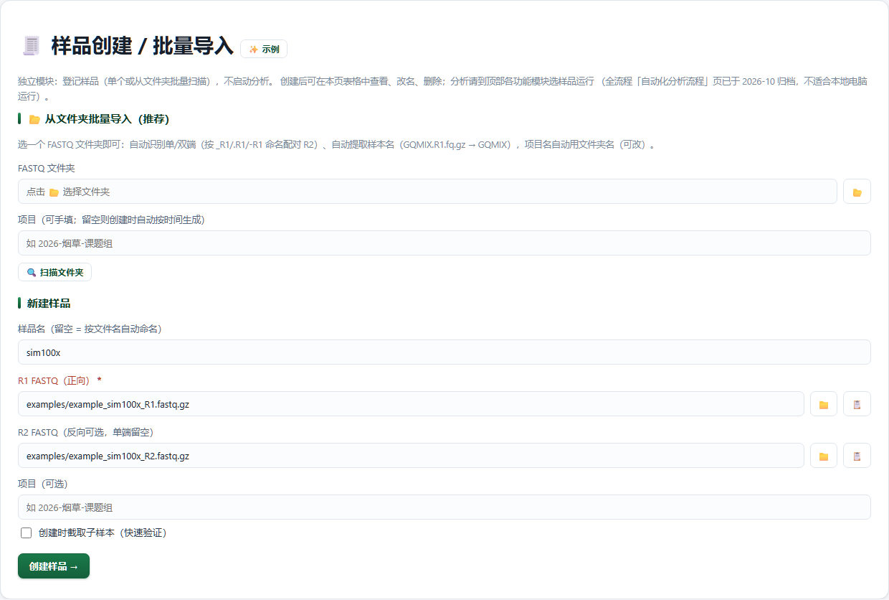

# Samples · 样品创建 / 批量导入

> 返回 [Home](Home) ｜ 上一页：[Prepchain](Prepchain) ｜ 下一页：[Fastp](Fastp)

把 FASTQ 登记成平台的组织单位：每个样品一个 `run/results/<样品>/`，后续阶段与工具产物都挂在它下面。
对应引擎 `Virus_Platform_Core/web/samples.py`（`/api/pipeline/create`、`/api/samples/scan_folder`）+ `pipeline.save_sample_input`；页面 `/samples`（导航「样本处理」组）。

## 输入

### 输入格式

- 单样品：R1 必填，R2 单端留空，可挂项目名。
- 文件夹批量：选 FASTQ 文件夹，自动识别单/双端（`_R1` / `.R1` / `-R1` 命名配对），自动提取样品名（`GQMIX.R1.fq.gz` → `GQMIX`）。
- 样本表 TSV：批量口径为 `name` / `r1` / `r2` 三列（单端 `r2` 留空），示例见 `run/tool_runs/_example_inputs/example_sample_sheet.tsv`；kvsuite 卡、kvchain 一键链与 `known_virus_suite` 引擎 CLI（`--sample-sheet`）都吃这个格式。
- 路径可写绝对路径，也可写相对平台根目录的路径。

### 参数

| 参数 | 默认 | 说明 |
|---|---|---|
| 样品名 | 留空按文件名自动命名 | 要当目录名进 SPAdes / BLAST，中文与空格会被规范化 |
| R1 | 必填 | 正向 FASTQ |
| R2 | 空 | 反向 FASTQ；单端留空 |
| 项目 | 可选 | 目录模式的默认项目名取文件夹名，可改 |
| 创建时截取子样本 | 关 | 前 N 对 / 随机 N 对 / 按比例，大样品先小规模验证 |

- 同名样品已存在时直接报错，不覆盖；名字被改写时创建结果回显实际登记名。

## 流程

### 方式一 新建样品

填样品名与 R1（R2 可选），可挂项目名；勾选「创建时截取子样本」时按所选模式先取子集，再登记。

### 方式二 从文件夹批量导入

1. 选 FASTQ 文件夹，点「🔍 扫描文件夹」。
2. 平台自动识别单/双端、提取样品名，列出预览。
3. 预览里改样品名、勾选要建的样品。
4. 一次创建，结果回显实际登记名。

### 扫描与命名规则

- R1 识别按 `_R1` / `.R1` / `-R1` → Illumina `_R1_001`（带 `_L001` / `_S1` 前缀也可）→ ENA/DDBJ `_1`（如 `DRR1175147_1.fastq.gz`）依次尝试。
- 单独 FASTQ（无 R1 标记）视为单端；有 R2 但找不到 R1 的「孤儿 R2」不当样本，扫描结果会列在 `orphan_r2` 并从批量里跳过。
- 样品名剥掉 R1/R2 与 lane/set 尾巴（`NX-5_S2_L001_R1_001` → `NX-5_S2`）；同一文件夹重名自动追加 `_2`、`_3`。
- 顶层没有 FASTQ 时自动下探一层子目录（按样本分文件夹的存放习惯）；项目名默认取文件夹名，可改。

### 样品名规范化

`safe_sample_name`：非 `[A-Za-z0-9_\-.]` 的连续字符折叠成一个 `_`，去掉首尾 `._-`，截断 50 字符，空则回退 `sample`。名字被改写时创建接口在 `note` 里明确回告，不静默改名；`_` 开头是内部保留前缀，改名时会被拒绝。

### 子采样

- 三种模式：`prefix` 取前 N 对（默认，快速冒烟）、`random` 蓄水池随机 N 对（固定 seed，可复现）、`proportion` 按比例随机（先数总数再抽，条数精确）。
- 双端逐对取用；R1/R2 条数不一致会直接报错，不静默截断。

## 产物

### 目录结构

```text
run/results/<样品>/
├── 00_prep/
│   ├── input.json          # sample / r1 / r2 / project（后续阶段自动带出）
│   └── sub_R1.fastq.gz     # 仅勾选「创建时截取子样本」时
├── project.json            # 项目清单（分析后生成）：输入、参数、已完成阶段、运行历史
└── 0X_*/                   # 后续各阶段目录
```

### 关键文件与字段

| 文件 | 内容 |
|---|---|
| `00_prep/input.json` | `sample` / `r1` / `r2` / `project`，后续阶段自动带出 |
| `00_prep/sub_R1.fastq.gz` | 子采样产物，仅勾选截取子样本时存在 |
| `project.json` | 项目清单：输入、参数、已完成阶段、运行历史 |

- 产物目录随 `platform.json` 的 `output_root` 平移；样品目录本身仍以 `run/results/` 为默认根。

## 示例输入与输出

### 示例输入

样本表 TSV（`name` / `r1` / `r2` 三列，单端 `r2` 留空）：

```tsv
name	r1	r2
EXAMPLE	examples/example_sim100x_R1.fastq.gz	examples/example_sim100x_R2.fastq.gz
```

### 示例输出



*图注：`/samples` 的「样品创建 / 批量导入」主卡——上半「从文件夹批量导入（推荐）」：FASTQ 文件夹选择、项目名（可手填，留空按时间生成）与「🔍 扫描文件夹」；下半「新建样品」：样品名（留空按文件名自动命名）、R1 FASTQ（正向，必填）、R2 FASTQ（反向可选，单端留空）、项目（可选），以及「创建时截取子样本（快速验证）」复选项与「创建样品 →」按钮。*

这张卡就是把 FASTQ 登记成 `run/results/<样品>/` 的入口：扫描后在预览里改名、勾选，一次创建多个样品，后续阶段与工具产物都挂到同名样品目录下。

## 界面与 CLI

### 界面

- `/samples` 页：顶部项目筛选器 + 样品列表（可改名、清空产物、删除）；下方「从文件夹批量导入」与「新建样品」两块表单。
- HTTP：`POST /api/pipeline/create`（建样品）、`POST /api/samples/scan_folder`（扫描目录）、`POST /api/samples/<sample>/rename`、`POST /api/samples/<sample>/clear`、`POST /api/samples/<sample>/delete`。

### CLI 与 agent

- `main.py` **没有 samples-create 子命令**；登记入口是页面/API。
- 后续分析用 `python main.py analyze --r1 ... --sample <样品>`，产物落到同名 `run/results/<样品>/`。

## 相关

- 建好样品后的整链前处理 → [Prepchain](Prepchain)
- 样本表在定量链里的用法 → [Kvchain](Kvchain)
- 产物目录与输出根设置 → [Settings-Ops](Settings-Ops)
