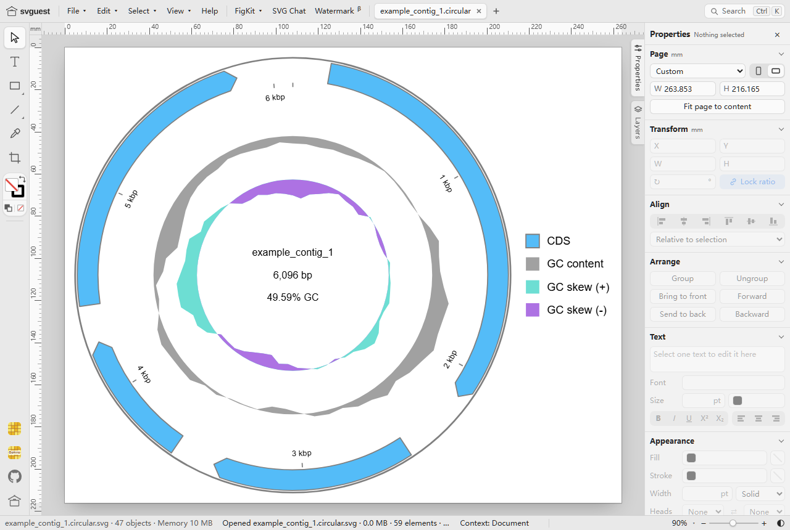

# Svguest · 🎨 结果图整理

> 返回 [Home](Home) ｜ 上一页：[Report](Report) ｜ 下一页：[AI-Assistant](AI-Assistant)

把各模块产出的 SVG 与图片在浏览器里合并、排版、标注、加比例尺，再导出 PNG · SVG · PDF。输入是平台产出的图件文件，产物是可直接进论文或汇报的图版；文件全程不上传。

对应引擎 / 页面：`Virus_Platform_Core/web/pages.py::page_svguest` 静态发送 `webapp/static/vendor/svguest/app.html`（上游 svguest v1.0.1，GPL-3.0-or-later；平台集成补丁见同目录 `SOURCE.md`）。页面 `/svguest/`；无操作目录 id。

## 输入

### 输入格式

- SVG：作为可编辑矢量文档打开，每个文件一个标签页，各自独立撤销历史。
- PNG / JPG / GIF / WebP：作为图片置入画布。
- 载入方式：File › Open；File › Import（Ctrl+Shift+P）；直接拖放或粘贴；或带 `?open=` 参数由平台直接送入。

### 参数

`/svguest/?open=<同源 URL>` 是唯一启动参数：

- 只接受同源地址，跨域 URL 直接忽略。
- 页面加载后 `fetch` 该地址，把响应包成 `File` 交给编辑器。SVG 作为可编辑矢量文档打开，PNG / JPG / GIF / WebP 作为图片放到画布上。
- 失败时用编辑器自身的 `msg()` 提示，不影响空白画布继续使用。
- 按钮链接由 `svgEditHref()` 生成：`/svguest/?open=` + `encodeURIComponent(同源文件 URL)`。

## 流程

### 合并

- File › Open 打开 SVG，每个文件一个标签页，各自独立撤销历史。
- File › Import（Ctrl+Shift+P）或直接拖放 / 粘贴，把多个 SVG 放进同一画布。
- PNG / JPG / GIF / WebP 作为图片置入画布；FigKit › Merge channels 可叠合 2–7 张同尺寸图片，各通道单独着色。

### 排版

FigKit 提供一组面向图版的布局工具：

- **Size each**：统一选中对象的宽或高，可保持比例或拉伸。
- **Grid**：按行列与间距排成网格，移动前先预览。
- **Align and space**：按边 / 中心对齐，按固定间距、等间距、等中心距或总长度分布。
- **Positions / Swap two**：记录位置并套用到其它对象，或交换两个对象的中心。
- 标尺、参考线、网格、图层与缩放（Fit / Actual size / Zoom）用于精细定位；参考线不参与导出。

### 标注与比例尺

- **Panel labels**：给每个面板加 A、B、C… 可编辑文字，文字跟随面板移动。
- **Frames**：给面板加跟随移动的矩形框。
- **Zoom inset**：在图片上框出区域并生成放大的联动副本。
- **Scale bar**：先输入图片的像素尺寸完成标定（nm / µm / mm），再添加随图片缩放的比例尺。
- **Update linked objects**：标签、边框、比例尺、放大插图与所属对象失配时一键复位。
- **Colours / Adjust picture / Pseudocolor**：按 HEX / RGB 调色，做非破坏性的亮度 / 对比度 / 曲线调整与灰度伪彩。

### 典型流程

1. 在 [Results](Results) 里定位图件：样品结果「📁 文件」或专项运行「📁 文件」。
2. 点该行的「🎨 整理」，图直接载入 svguest；也可以先开 `/svguest/`，再用 File › Open / Import、拖放或粘贴载入。
3. 用 FigKit 排成网格 / 对齐，补 Panel labels、Frames 或 Scale bar。
4. File › Export 选 SVG / PNG / JPG / PDF，导出到本地。

## 产物

### 导出格式

| 格式 | 入口 | 说明 |
|---|---|---|
| SVG | File › Export SVG（Ctrl+S）/ Export SVG as… | Inkscape 兼容矢量；文件名可带时间戳 |
| PNG | File › Export PNG › 300 / 600 dpi | 白底，写入 dpi 元数据 |
| JPG | File › Export JPG › 300 / 600 dpi | 白底、最高质量 |
| PDF | File › Export PDF (print)（Ctrl+P） | 走打印对话框的矢量 PDF，Chrome / Edge 效果最好 |

导出写到浏览器下载目录或你选择的位置。Auto-save 只在浏览器内保留副本，Auto-save to a folder（Chrome / Edge）另写一份带时间戳的副本到指定文件夹，两者都不覆盖原文件。多文档标签页、Open recent 都是可选辅助。

### 集成形态与上游版本

`/svguest/` 是结果中心的独立页，内置 svguest（GPL-3.0，单文件纯前端）。平台只做一次静态发送，编辑与导出全部在浏览器完成，文件不上传。

| 项 | 值 |
|---|---|
| 上游仓库 | https://github.com/JieqiangHe/svguest |
| 在线实例 | https://www.svguest.online/ · https://jieqianghe.github.io/svguest/ |
| 版本 / 许可 | v1.0.1，GPL-3.0-or-later（全文见 `webapp/static/vendor/svguest/LICENSE`） |
| 取件日期 / 提交 | 2026-10-23 · `9a7df8b9d4529d7e236356498a11b120dbe5020d` |
| 文件形态 | `app.html` 单文件应用（约 528 KB），无后端依赖 |

平台对上游代码只做一处改动：在 `app.html` 末尾、`</body>` 之前追加 `?open=` 启动脚本，其余代码、样式与资源未改。`/svguest/` 路由以 `text/html` 发送该文件并设 `Cache-Control: no-cache`，不做任何服务端编辑或上传。

## 示例输入与输出

### 示例输入

`/svguest/?open=<同源 SVG 地址>`，示例载入 `example_contig_1.circular.svg`（环状 contig 图）。

### 示例输出



*图注：`/svguest/?open=…` 载入 `example_contig_1.circular.svg` 后的编辑器主界面——顶部菜单（File / Edit / Select / View / Help / FigKit / SVG Chat / Watermark）与文档标签页，左侧工具栏，中间画布按「Fit page to content」显示整张矢量图（当前 90%），右侧 Properties 面板给出页面尺寸、Transform、Align、Arrange、Text、Appearance；底部状态栏显示文件名、47 objects 与打开耗时。*

载入后的对象仍可单独选中、改色、移动与缩放；多图合并、排版与导出口径见上文。

## 界面与 CLI

### 界面

入口共三处：

- 结果中心顶栏「🎨 结果图整理」，直接打开 `/svguest/`。
- 导航组卡片：结果中心组内的「🎨 结果图整理（svguest）」，`href` 为 `/svguest/`。
- 文件列表行：
  - 样品结果「📁 文件」：`.svg` 与 `.png` 行都给「🎨 整理」（`webapp/static/app.js:2337`）；
  - 专项运行的文件区：只对 `.svg` 给「🎨 整理」（`webapp/static/app-jobs.js:668-671`）。

### CLI 与 agent

svguest 没有 CLI，也没有平台子命令；它是一个静态页面。先启动平台：

```bat
python app.py
:: 或
VirusPlatform.exe --web
```

然后访问 `http://127.0.0.1:8765/svguest/`；默认端口被占用时按 8900 / 8989 / 9600 / 8888 / 5050 / 5000 顺延。平台只监听本机回环，图形数据不会上传。

## 相关

- 结果中心入口与文件下载 → [Results](Results)
- ⑩ 报告与图件汇总 → [Report](Report)
- 基因组图 SVG 来源 → [Genome-Plots](Genome-Plots)
- 进化树与 MSA 查看器 → [Phylo](Phylo)

### 使用与分发注意

- 平台不上传图形数据：打开、编辑与导出都在本地浏览器完成。上游自带的 SVG Chat 是可选功能（需自备 GLM / DeepSeek API Key），不使用它时平台侧不产生上传。
- 平台分发安装包时需保留 `webapp/static/vendor/svguest/LICENSE` 与 `SOURCE.md`，并遵守 GPL-3.0 的源码提供义务；若不想承担该义务，可在打包时排除该目录，改为链接上游在线实例。
- 更新上游时重新取 `app.html` 并补 `?open=` 补丁；补丁依赖上游的全局 `readFile()` 与 `msg()`，升级后需重新核对（见 `SOURCE.md`）。
