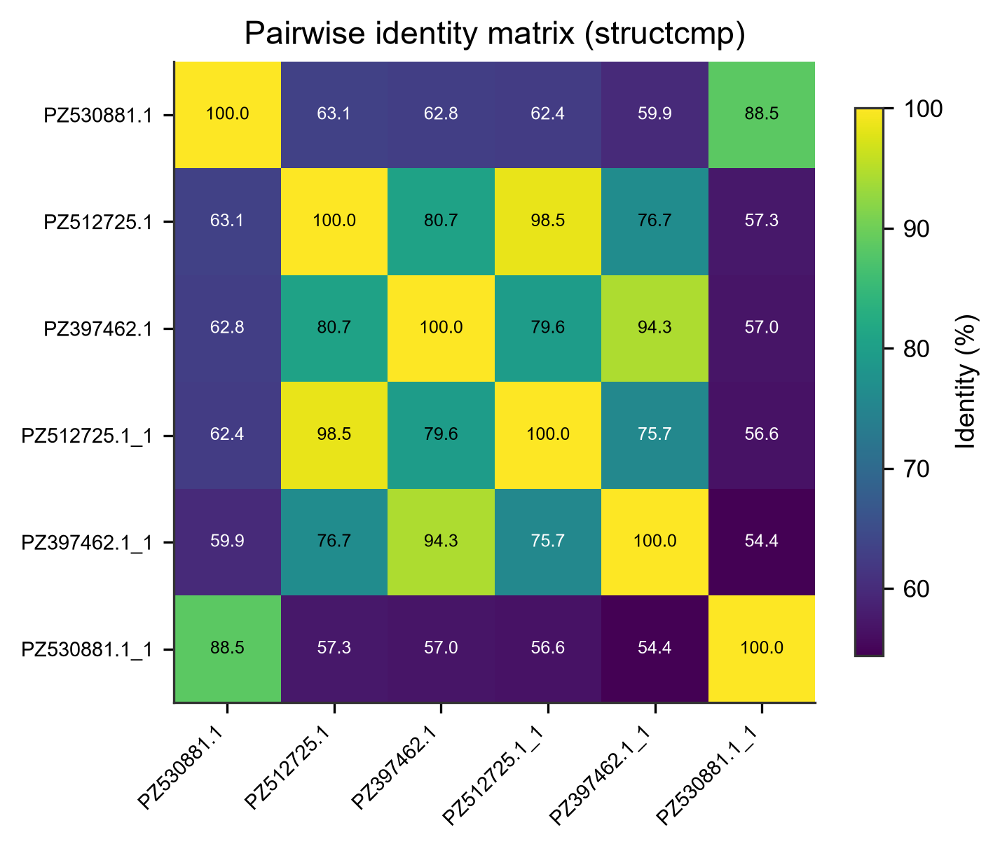

# Toolbox · 专项工具箱

> 返回 [Home](Home) ｜ 上一页：[FAQ](FAQ) ｜ 下一页：无

导航「专项分析」页：不分样品流程的独立分析，以 🧬 单步工具为主。专项工具的详细说明已按导航组归位（见本节末指路）。产物统一落 `run/tool_runs/`（规范化双层结构，见 [Settings-Ops](Settings-Ops)）。

## 单步工具（把主管道拆开单跑）

| 工具 | 说明 |
|---|---|
| 质控 | fastp 独立运行 |
| 病毒鉴定提取 | kvsuite 识别 + 病毒 reads 提取 |
| 组装 | SPAdes 单跑 |
| contig 分类与深度分析 | kunpeng 分类 / contig 深度注释（Taxonomy 8 级谱系统列）/ 离线检索（BLASTN、DIAMOND BLASTX，`local_search.py`）/ contig 功能画像（含 BFVD 病毒域） |

专项工具的详细说明已按组归位：dsRNA → [DsRNA](DsRNA)、miRNA → [Mirna](Mirna)、参考集合 / 比对 / SDT 与 NT+AA 同一性（identity，SDT 卡模式二）→ [Compare](Compare) / [Phylo](Phylo)。结构比较（structcmp）没有独立导航卡，示例见下一节。

## 专项工具（无独立导航卡）

### 结构比较（structcmp）

多条序列做 MAFFT 全长比对，输出两两 identity 全矩阵（SDT 口径）。与 SDT 的「下三角」呈现不同，这里给全矩阵，便于整体扫视。入口：工具箱 / 操作目录，agent 走 `vp_run_tool(tool='structcmp', ...)`。

**示例输入**：序列 FASTA（≥2 条，默认最多取 30 条）。

```text
>PZ530881.1
ATGCGTACGTACGTACGTACGTACGTACGTACGTACGT
>PZ512725.1
ATGCGTACGTACGTACGTACGTACGTACGTACGTACGA
```

**示例输出**：`identity_matrix.tsv` 加全矩阵热图；比对中间文件 `aln.fasta` 一并落盘。



*图注：成对 identity 全矩阵（%），行 / 列为 MAFFT 比对后的序列名，颜色越亮（黄绿）同源性越高；与 SDT 的下三角呈现不同，structcmp 给全矩阵便于快速扫视——本示例同种对 94–98%、跨属对 54–63%，左下 / 右上角 88.5% 那一格值得注意：跨属里出现了局部高同源，需结合注释核实是否为保守域驱动。*

## 其他工具

- **SnpEff**（`3rd/tools/jre-snpeff/`，jlink 精简 Java 21 运行时 47 MB）：变异注释（③c 变异位点 → 基因 / 蛋白影响）。
- **环境自检 / 内存自检**：`selfcheck.py` / `mem_check.py`（见 [Settings-Ops](Settings-Ops)）。

## 相关

- 比较基因组分析（参考获取 → 比对 → 建树 / SDT）→ [Compare](Compare)
- dsRNA 全链路设计 → [DsRNA](DsRNA)
- miRNA 靶标预测 → [Mirna](Mirna)
- 产物目录管理 → [Settings-Ops](Settings-Ops)
